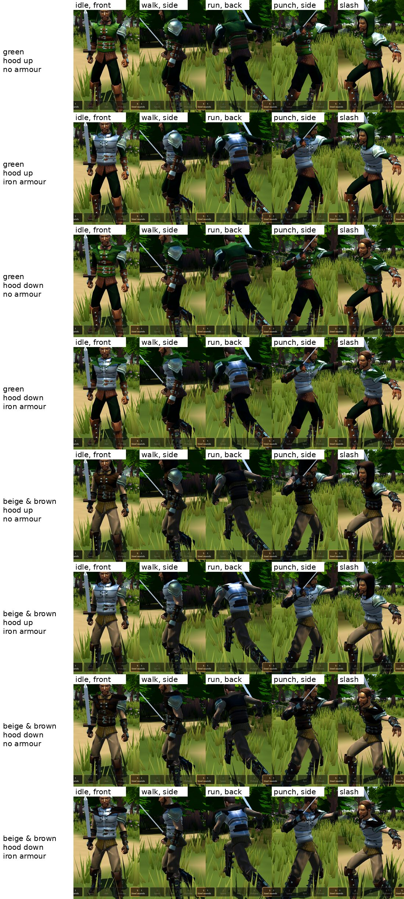
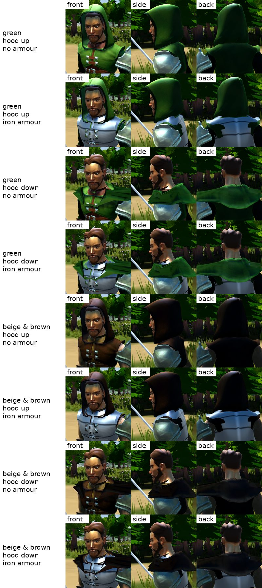
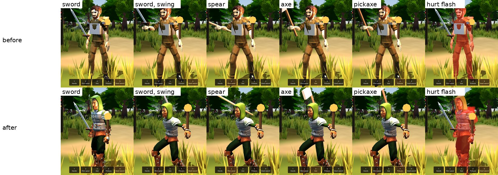
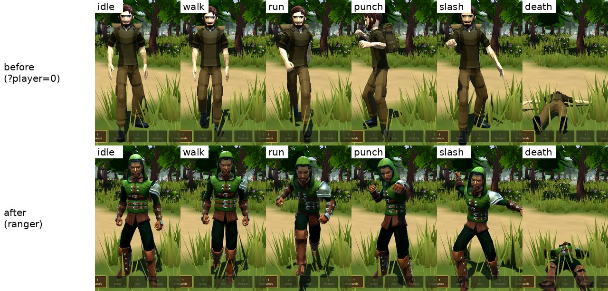
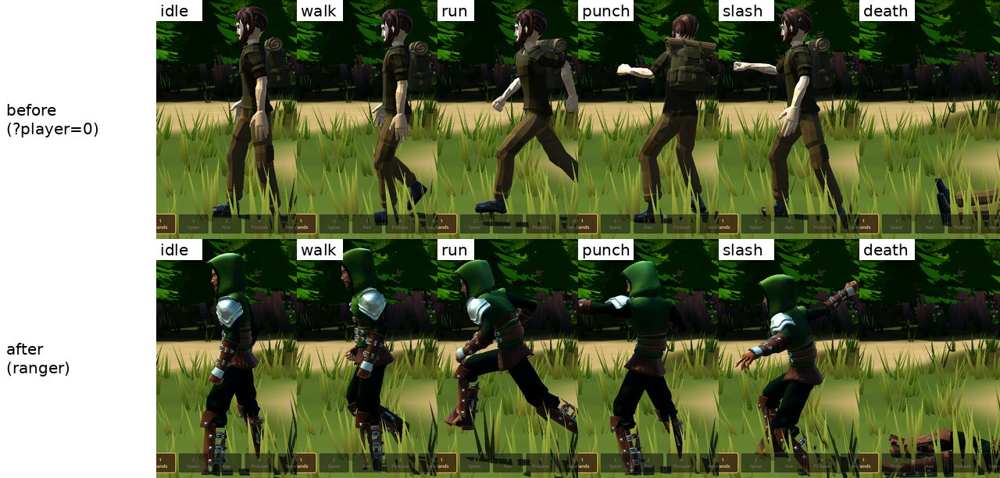
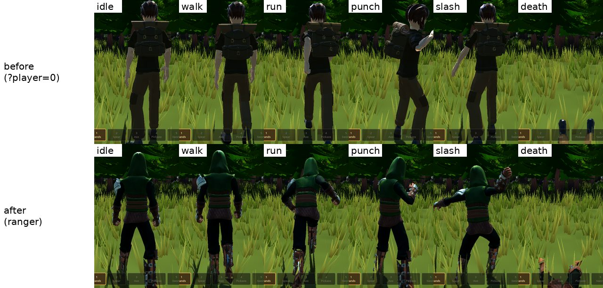
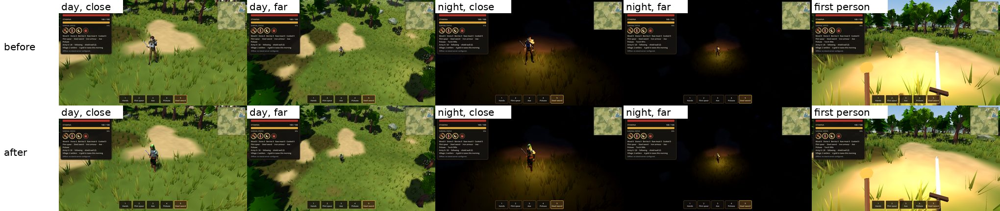

# Phase 4C: final integration review

**Scope.** A review of the player character as it stands on `main` after PRs #34–#37. Baseline: `9ea3d32`, the last commit before Phase 4C. Nothing was redesigned or added. This branch contains only this report, review tools, renders and benchmark results, and one smoke-test fix that lets the existing suite also run with `?player=0`.

**Verdict.** The approved features work together and nothing regressed in gameplay or saves. All 286 pre-4C smoke checks still pass, with or without the new model. Performance is unchanged within measurement noise; the cost is +1.9 MB of download.

Three things need a decision; see [Remaining issues](#remaining-issues):

1. **The backpack, an excluded feature, is still on by default in the game.**
2. **The skin-tone option, also excluded, is still reachable from the URL.**
3. With the **hood up and armour on**, the hood's shoulder cowl pokes through the armour at the back of the shoulders.

## Completed features

| Feature | PR | Status |
|---|---|---|
| **Ranger player model.** Quaternius ranger outfit (CC0), the shared 65-bone humanoid rig, six animations under the names the game already uses. One skinned mesh, one surface, one material. | #34, refined in #35 | approved |
| **Armour.** A fitted shell made from the tunic, skinned with it, in each gear tier's colours (hide, iron, steel, gilded). It replaces the boxy breastplate on the ranger. | #35 | approved, final |
| **Hood up / hood down.** Hood up is the kit's hood with cropped hair under it. Hood down is the same hood folded onto the shoulders, with parted hair. | #36 | approved, final |
| **Outfits.** Original green, and the kit's beige and brown as a texture variant of the clothing only. | #37 | approved |
| **Developer comparison.** `?player=0` (old adventurer). `?hood=down` and `?outfit=earth` set the look. `?devlook=1` turns on F8 (hood) and F9 (outfit). | #34–#37 | developer tools |
| Backpack | #35 | **excluded**, but still shown by default (see [Remaining issues](#remaining-issues)) |
| Skin-tone variations | #35 | **excluded**, still reachable by URL (see [Remaining issues](#remaining-issues)) |

## Test results

### 1. Approved variations together

`tools/phase4c_review_shots.gd` renders all **8 approved looks**: 2 outfits × hood up/down × armour off/on (iron). Each look is shown in idle, walk, run, punch and slash, each from a different side. The backpack is hidden and the skin is the default, both being excluded.

- **All 8 combinations render correctly in every animation.**
- **Hood down with armour:** the drape lies over the armour shell.
- **Outfits with armour:** the beige and brown outfit keeps the armour's tier colours unchanged.

### 2. Animations

Idle, walk, run, punch, slash and death play in every look (above), and against the old adventurer below. `tools/phase4c_review.gd` checks the six animations: 52–56 tracks each, all on bones of the skeleton, 0.87–2.50 s long.

### 3. First and third person

| View | Result |
|---|---|
| **Third person** | The game camera close and far, by day and at night with the torch, matches the adventurer's framing and size (`before-after-views.jpg`). |
| **First person** | The body casts its shadow only, exactly as the adventurer did. Tool and torch are drawn in front of the camera as before. Hood, outfit and armour affect only third person and shadows. |

### 4. Clipping (armour, hood, outfit)

Head close-ups from the front, side and back in all 8 looks (`matrix-head-clipping.jpg`):

- **Hood up:** the cropped hair stays inside the hood, and the face is unobstructed.
- **Hood down:** the drape clears the jaw and the hair.
- **Outfits:** both outfits clip identically, as they share the same geometry.
- **Armour and hood down:** the drape stays outside the armour.
- **Armour and hood up: clipping found.** The hood's cowl, the part on the shoulders that both hood options keep, and the armour shell cross at the top of the shoulders. From behind and from the side, slivers of the cowl show through the armour. See [Remaining issues](#remaining-issues).

### 5. Skeleton, skin bindings and equipment

From `tools/phase4c_review.gd` (headless; prints `REVIEW_OK`):

| Check | Result |
|---|---|
| Skeleton | 65 bones, the kits' shared humanoid rig (root, pelvis, spine_01–03, neck_01, Head, hands, feet, fingers) |
| Skin binds | all 123 binds name a bone of the skeleton |
| Vertex weights | all 27,934 vertices: weights sum to 1, bone indices in range, none unbound |
| Approved parts unchanged | each part's vertices (positions, normals, UVs, bones, weights) match the fingerprints recorded when they were approved. That covers clothing, skin, hood up, hood down and **armour**, plus the backpack (excluded and hidden, but its vertices are unchanged) |
| Equipment followers | right hand → `hand_r`, left hand → `hand_l`, chest → `spine_01`, neck → `neck_01` |
| Tools in hand | sword, spear, axe and pickaxe each stay exactly at their grip (0.000 m off) through idle, walk, run, punch and slash. The axe and pickaxe are held 8 cm down the handle, as before 4C. |
| Torch | in the left hand |
| Worn armour | the ranger's own shell; the boxy breastplate is not shown |

### 6. Gameplay and save/load unchanged

**Code audit.** `git diff 9ea3d32..main` over the game's scripts shows only these changes:

- **`player.gd`:**
  - which model to load;
  - applying the look;
  - hiding the boxy breastplate on the ranger;
  - colouring the armour shell.

  No stats, combat, movement, inventory or save code changed.
- **`character_model.gd`:**
  - bone-name fallbacks (`hand_r` and so on), tried only when the adventurer's names are missing;
  - recognising a pre-merged mesh.
- **`main.gd`:** reading the developer URL options, and the F8/F9 keys, which are active only with `?devlook=1`.
- **Unchanged:** soldiers, settlers and raiders keep their own model constants. Saves don't store the look.

**Smoke test** (`tools/smoke_test.gd`, the CI gate, including a full save and reload):

| Build | Checks | Result |
|---|---|---|
| Pre-4C (`9ea3d32`) | 286 | pass |
| `main` (ranger) | 301: **all 286 pre-4C checks** plus 15 new | pass |
| `main` with `--player=0` (adventurer) | 288 (the ranger-only checks skipped) | pass, after the fix below |

**Fix in this review.** Before, the smoke test stopped part-way with `--player=0`: its ranger-only checks assumed the ranger. Those checks now run only for the ranger, and the adventurer gets its own breastplate check. Nothing else in the test changed. With that, the comparison mode `?player=0` is itself tested.

### 7. Draw calls, triangles, materials, memory, download

**Model:**

| | Adventurer (`?player=0`) | Ranger |
|---|---|---|
| Meshes / surfaces / materials | 1 / 1 / 1 | **1 / 1 / 1** |
| Draw calls per pass | 1 | **1** |
| Triangles drawn | 10,198 | **24,506** (hood up), 24,977 (hood down); +2,115 with armour (up to 27,092) |
| Triangles in the buffer | 10,198 | 31,184 (includes the hidden hood set, armour and backpack, collapsed when not shown) |
| Vertices skinned per frame | — | 27,934 |
| Mesh LODs | — | 2 (generated by Godot) |
| Textures | none (vertex colours) | 1024×512 colour atlas, 512×256 normal, 512×256 roughness/metal, 512×512 second outfit: **0.78 MB on the GPU** |
| Model file | `adventurer.glb` (shared with soldiers and settlers) | `ranger.scn`, 1.13 MB |

**Download** (web export, the same engine `index.wasm` in both builds):

| | Pre-4C | Phase 4C | Change |
|---|---|---|---|
| `index.pck` | 3,704,800 B | 5,631,056 B | **+1.93 MB** |
| `index.pck` gzipped | 3,073,196 B | 4,649,440 B | **+1.58 MB** |
| `index.wasm` gzipped | 9,400,129 B | 9,400,129 B | unchanged |

### 8 and 9. Browser performance (Compatibility renderer), against `?player=0`

**Setup:**

- **Build:** the final web build (this branch, same game as `main`).
- **Runner:** `perf/run_web_bench.cjs`, with Chromium and ANGLE on Mesa llvmpipe (WebGL 2, Compatibility renderer).
- **Resolution and seed:** 1280×720, fixed seed.

**Runs:**

- `?player=0`, the old adventurer;
- the ranger in the **approved** look (`?backpack=0`, green, hood up);
- the ranger in **beige and brown with the hood down** (`?backpack=0&outfit=earth&hood=down`).

A fourth run, the ranger **as shipped** (backpack on), is in `web-ranger-shipped.json`; it is within noise of the approved one.

**Results:** `perf/phase4c-final/web-*.json`. Each cell is adventurer / ranger approved / ranger beige & hood down.

| Scene | Draw calls | Primitives (M) | Mesh surfaces | Frame p50 (ms) | Frame p95 (ms) | 1% low FPS | Video memory (MB) | Texture memory (MB) |
|---|---|---|---|---|---|---|---|---|
| Empty area | 309 / 311 / 311 | 2.08 / 2.08 / 2.08 | 559 / 559 / 559 | 489 / 488 / 495 | 535 / 718 / 715 | 1.9 / 1.4 / 1.4 | 31.8 / 33.2 / 33.2 | 9.1 / 9.8 / 9.8 |
| Forest | 321 / 330 / 321 | 2.37 / 2.41 / 2.38 | 555 / 555 / 555 | 658 / 637 / 679 | 966 / 1112 / 983 | 1 / 0.9 / 1 | 31.6 / 33.1 / 33.1 | 9.2 / 9.9 / 9.9 |
| Village | 570 / 571 / 573 | 1.98 / 2.00 / 2.01 | 714 / 714 / 714 | 525 / 521 / 568 | 564 / 584 / 624 | 1.8 / 1.7 / 1.6 | 39.8 / 41.2 / 41.2 | 9.3 / 10 / 10 |
| Village + 10 soldiers | 608 / 609 / 609 | 1.97 / 1.98 / 1.98 | 765 / 765 / 765 | 552 / 558 / 552 | 575 / 604 / 602 | 1.7 / 1.7 / 1.7 | 50.4 / 51.9 / 51.9 | 9.4 / 10.2 / 10.2 |
| **Village + 30 soldiers** | 706 / 707 / 707 | 2.19 / 2.20 / 2.20 | 867 / 867 / 867 | 662 / 673 / 688 | 692 / 722 / 756 | 1.4 / 1.4 / 1.3 | 62.5 / 64 / 64 | 9.8 / 10.5 / 10.5 |
| Night village + 30 soldiers | 794 / 795 / 795 | 2.70 / 2.71 / 2.71 | 869 / 869 / 869 | 750 / 741 / 760 | 791 / 851 / 851 | 1.3 / 1.2 / 1.2 | 62.5 / 64 / 64 | 9.8 / 10.5 / 10.5 |
| Area transitions | 309 / 307 / 304 | 1.61 / 1.61 / 1.60 | 546 / 525 / 525 | 643 / 684 / 676 | 838 / 808 / 795 | 1.2 / 1.2 / 1.2 | 43.5 / 45 / 45 | 9.3 / 10 / 10 |

Load to first frame: 8.9 / 8.9 / 9.4 s.

How to read this:

- **Draw calls and mesh surfaces are the same as the adventurer's** in every scene. The player is one draw in each pass, whatever the look.
- **Streaming scenes.** The forest and area transitions vary by ±10 draw calls and ±20 surfaces between runs of the *same* build, as props and grass stream in. This was measured in every earlier phase.
- **Primitives:** +0–1.7%. That is the ranger's extra triangles in each pass that draws the player (colour and shadows).
- **Video memory:** +1.4–1.5 MB, the textures and the larger vertex buffer.
- **Texture memory:** +0.7 MB.
- **Frame time.** Frame times are within the software renderer's run-to-run noise: no scene is consistently slower. The empty area's p95 is higher in both ranger runs (718 and 715 ms against 535 ms), but its p50 is the same. Two sampled frames can't separate that from noise.
- **No real GPU.** The benchmark machine has no real GPU. The counts are reliable; **real-GPU frame times have not been measured** (the phase 4A GPU validation was skipped).

## Known limitations

These are accepted parts of the approved design:

- **Player only.** Soldiers, settlers and raiders still use the old models. The ranger at 24.5k triangles is too heavy for 30 soldiers as it is; GRAPHICS_PLAYER_REFINEMENT.md has the path to a lighter version.
- **Look not saved, no in-game choice.** Hood and outfit are chosen by URL or developer keys, and aren't saved (saving would change the save format).
- **Hood down is the kit's hood folded by the build tool,** not a modelled lowered hood. It has no cloth folds, and its lining is the hood's colour.
- **Neck opening.** The brown undershirt at the tunic's neck opening is painted into the outfit texture.
- **Armour on the dead.** The armour shell stays on the body after death; it is skinned, unlike the old floating breastplate.
- **Hidden parts still skinned.** Hidden parts (the other hood, the backpack, armour when not worn) are skinned every frame and collapsed. That is cheaper than separate surfaces, but they still count towards the vertex cost.
- **Distant armour.** Godot's automatic far LODs simplify the whole surface. The armour's distant LOD may differ slightly from when it was approved; up close it is identical.

## Remaining issues

| # | Issue | Severity | Suggested action |
|---|---|---|---|
| 1 | **The backpack is shown by default.** It is listed as intentionally excluded, but `character_appearance.gd` has `DEFAULT := {..., "backpack": true}`, so every player sees it (in the 4C screenshots of earlier PRs too). It is part of the model, adds 1,748 triangles when shown, and only `?backpack=0` hides it. | **High**: an excluded feature is visible in the game | Set the default to `false`, or remove the backpack from the model and the `backpack` option. Not done here, as the review was not to change features; this needs your go-ahead. |
| 2 | **Skin tones are still reachable.** `?skin=light\|tan\|dark\|deep` still works, from the refinement. The default is the texture as made, so players never see it unless they use the URL. | Low: dormant developer option | Remove the option (the shader gain would remain as a no-op), or leave it as a developer tool. Needs a decision. |
| 3 | **Cowl through the armour.** With the hood up and armour on, the hood's shoulder cowl pokes through the armour at the back of the shoulders (`matrix-head-clipping.jpg`, "back" column). Hood down is unaffected, because the drape is pushed outside the armour. | Medium: visible from behind and at the side, small at play distance | Both pieces are approved and final, so nothing was changed. A fix would hide the cowl's shoulder triangles under worn armour, or push the cowl out over it. Either changes an approved part, so it needs your approval. |
| 4 | **Real-GPU performance unmeasured.** Every benchmark ran on a software renderer. | Medium | Run the existing `?gpuval=1` test (phase 4A) or the benchmark on a laptop GPU. |
| 5 | **Engine error.** `Parameter "material" is null`, 64 times per session in Godot's log. Measured on the pre-4C build too (64), on the ranger (64) and on `?player=0` (64), so it is **not** from Phase 4C. | Low: pre-existing noise | A separate investigation, outside 4C. |
| 6 | **Older docs and tools mention excluded features.** GRAPHICS_PLAYER_REFINEMENT.md still describes the backpack and skin tones as features, and `tools/player_shots.gd` still renders them. | Low: documentation | Mark them excluded once issues 1 and 2 are decided. |

No other regressions were found.

## How to repeat this review

| Command | Checks |
|---|---|
| `godot --headless --path last-light/game --script res://tools/phase4c_review.gd` | skeleton, skin, animations, approved-part fingerprints, equipment |
| `godot --headless --path last-light/game --script res://tools/smoke_test.gd [-- --player=0]` | gameplay and save/load (CI gate) |
| `xvfb-run godot --path last-light/game --rendering-driver opengl3 --resolution 1280x720 --script res://tools/phase4c_review_shots.gd` | the 8-look matrix and clipping close-ups |
| `… --script res://tools/player_shots.gd -- --player=0` and `-- --backpack=0` | before/after renders |
| `node perf/run_web_bench.cjs "<build>/index.html?bench=1&perf=1[&player=0\|&backpack=0…]" <out>` | browser benchmark |

## Files in this review

| File | What |
|---|---|
| `GRAPHICS_PHASE_4C_FINAL.md` | this report |
| `game/tools/phase4c_review.gd` | new: headless model, rig and equipment review |
| `game/tools/phase4c_review_shots.gd` | new: the 8-look render matrix |
| `game/tools/smoke_test.gd` | ranger-only checks skipped with `--player=0`; the adventurer's breastplate is checked instead |
| `perf/phase4c-final/` | renders and benchmark results |
