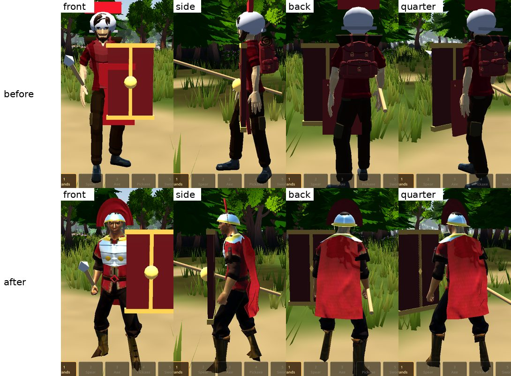
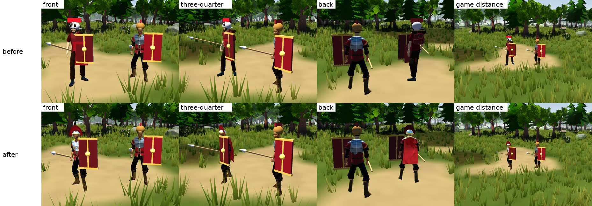
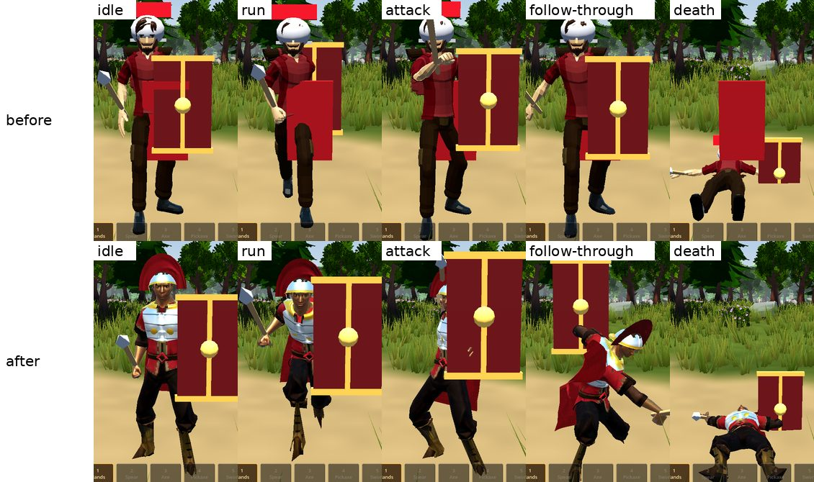
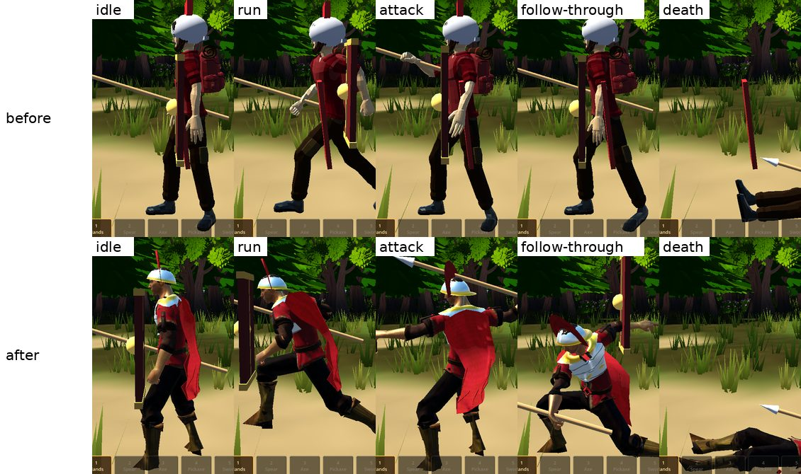
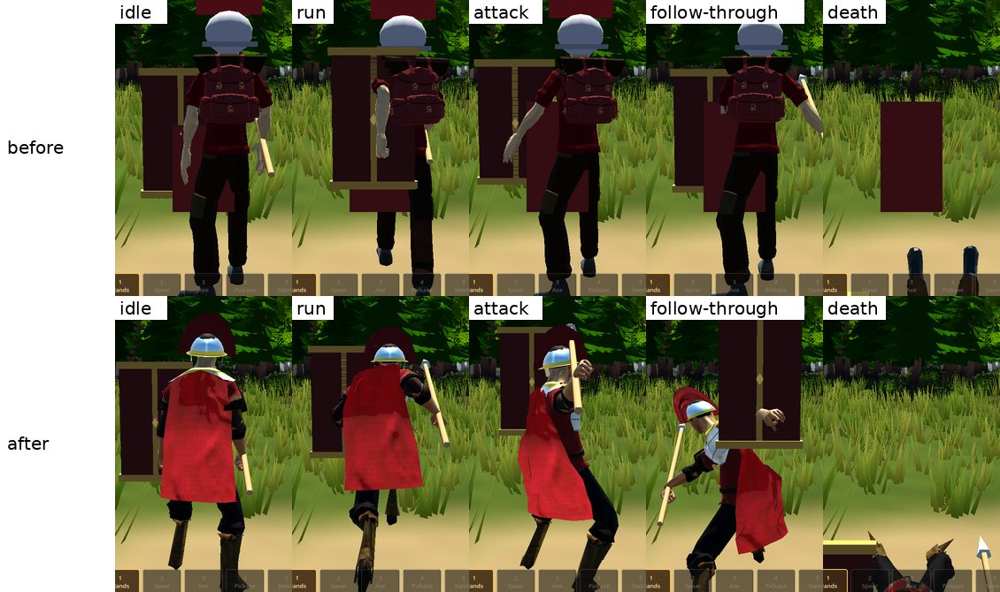
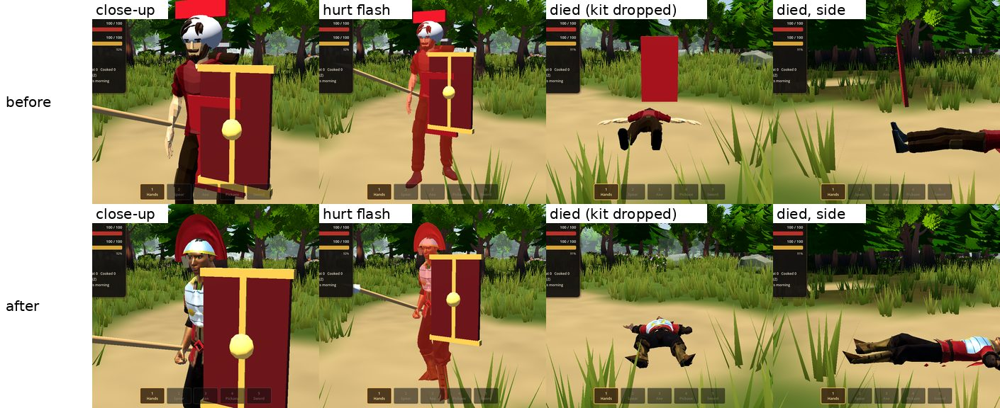
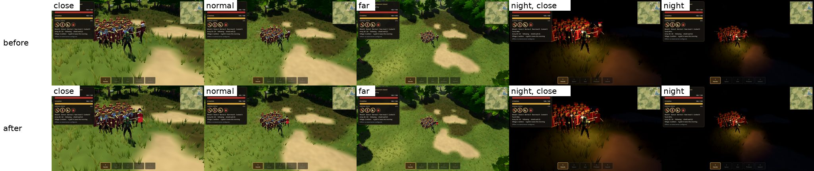

# Phase 4D.2: Centurion visual prototype

The Centurion is now a distinct Roman officer, built on the approved standard legionary's body and sharing its material and textures. He has:

- a **galea with a tall red transverse crest**;
- **steel plates trimmed in gold** with three gold **phalerae**;
- a **red officer's cloak**.

At gameplay distance he is recognisable at a glance beside ordinary legionaries. He is lighter than the old centurion (6,211 against 10,198 body triangles) and costs **two fewer draw calls**, because the helmet and cloak are now part of his body.

Only the centurion changed:

- **Other characters:** the standard legionary (its files are byte-for-byte unchanged), archers, cavalry, settlers, raiders and the player are as they were.
- **Systems:** gameplay, AI, combat, saves, networking and world generation are untouched.
- **Comparison:** `?centurion=0` shows the previous centurion.

Branch: `claude/centurion-prototype`, cut from `main` at `7d3a083`, which already includes the merged legionary (#39). Nothing was merged and no pull request was opened.

## 1. Inspection

- **Repository state:** I worked from `main` at `7d3a083` (PRs #34–#39 all merged). The working tree was clean.
- **How a centurion is selected:**
  - **Class:** `kind == "centurion"` in `soldier.gd`, with its stats in `KINDS`.
  - **Recruitment:** one per barracks (`main.gd`).
  - **Formation:** he leads it (`KIND_ORDER`).
  - **Inspire:** nearby soldiers are inspired (`main.gd`).
  - **Save:** the kind is stored as that string.

  None of this changed.
- **Old centurion:**
  - **Body:** the old adventurer body (`adventurer.glb`, 10,198 triangles, 310 binds, no LODs), tinted dark red.
  - **Kit:** the procedural pieces on bone followers:
    - a silver dome helmet with a red box as its transverse crest;
    - the dark red shield;
    - the spear;
    - a flat red box as a cloak, rigid on the model and not skinned (it stood upright over the body after death).
- **Legionary (phase 4D.1):** `models/soldiers/legionary.scn`, built by `tools/build_legionary_model.gd`:
  - **Body:** the Quaternius Peasant outfit, dyed red, with iron plates made from the tunic, the ranger's head and cropped hair, and Universal Animation Library clips.
  - **Rig and shading:** the shared 65-bone humanoid rig, one skinned surface, `character_atlas.gdshader` with a 0.15 MB atlas, and LODs.
  - **Kit:** helmet, shield and spear on `hand_r`/`hand_l`/`Head`, with three constants (`NEW_HELMET_LIFT`, `NEW_HELMET_SCALE`, `NEW_SHIELD_LIFT`) for the new rig.

## 2. Asset research

| Candidate | Source | Licence (checked) | Formats | Rig and animations | Size | Verdict |
|---|---|---|---|---|---|---|
| **Quaternius LowPoly Animated Knight** | quaternius.itch.io/lowpoly-animated-knight; opengameart.org/content/lowpoly-animated-knight | CC0 (listed on both pages), commercial use allowed | FBX, OBJ, Blend: **no glTF** | Its own older rig (`Palm.R`-style, like the old adventurer), not our humanoid rig. Idle, Walk, Run, Attack, Death, Roll. One OpenGameArt user reports animations missing from the download. | ~8 MB zip; flat colours, no textures | **Not used.** A different rig and flat-colour style from the textured ranger and legionary, and a knight, not a Roman officer. |
| **KayKit Character Pack: Adventurers 1.0** (Knight and others) | github.com/KayKit-Game-Assets (cloned locally in phase 4C) | CC0 (`LICENSE.txt` read) | glTF, FBX | Its own rig and animation pack | ~1k–3k triangles, one 1024² texture | **Not used.** Chibi proportions, which clash with the ranger and legionary; rejected in 4C for the same reason. |
| **Kenney Animated / Blocky Characters** | kenney.nl; opengameart.org/content/animated-characters-1 | CC0 | FBX / glTF | Own simple rigs; 3–27 animations | very low | **Not used.** Blocky style, no soldier. |
| **System G6 "Modular RPG Characters"** | opengameart.org/content/modular-rpg-characters | CC0 (as listed) | Blend | Own rig; users report idle-only animation files | unknown | **Not used.** Unverified quality and animations; a different rig. |
| **Quaternius Modular Character Outfits – Fantasy, Source edition** (12 outfits, tagged "knight"; "Noble" and "Wizard" named in its changelog) | quaternius.itch.io/modular-character-outfits-fantasy | CC0, but **paid** ($20+) | glTF, FBX, Blend | **Our rig and animation library** | similar to Peasant/Ranger | **Not bought** (your decision). The best future source for officer outfits. |
| **Already in the project:** Quaternius Outfits Standard (Peasant), Universal Base Characters, Universal Animation Library | quaternius.itch.io (credited in `models/CREDITS.md`) | **CC0 1.0** (each kit's licence file read) | glTF | **The shared 65-bone humanoid rig**, all needed animations | the legionary's 0.15 MB atlas | **Used**, as for the legionary |

**Conclusion.** No free asset offered a Roman officer on our rig in our style. So the centurion is the legionary's body (the same CC0 files) with an officer's kit **modelled in the build tool**: helmet, crest, phalerae and cloak. Nothing new was downloaded, and no questionable asset was used.

## 3. Implementation

### The model (`tools/build_centurion_model.gd` → `models/soldiers/centurion.scn`)

It is the legionary's builder with officer parts added to the same single skinned surface. The body (outfit, head, hair, simplification) is identical to the legionary's.

| Part | Triangles | How |
|---|---|---|
| Legionary body (tunic, arms, trousers, boots, head, hair) | 5,260 | The same CC0 parts and simplification as the legionary |
| **Steel plates** | 229 | The legionary's plate shell, **minus 47 back triangles hidden under the cloak**. They were unseen geometry and poked through the cloak when the back bent. The plate pattern is mapped before they're removed, so the rest look as on a legionary. |
| **Galea (helmet)** | 340 | A bowl fitted to the measured head: 1.6 cm clearance, the rim just above the eyebrows at the front, lower at the back. A gold rim, a flared neck guard and two cheek guards. Skinned to the head. Drawn as armour: steel, a raised centre ridge, the rim and guards in the gold trim band. |
| **Transverse crest** | 96 | A tall red half-ring standing **side to side** on the helmet, 40 cm across and 15 cm above it: the centurion's mark, readable at gameplay distance. Front, back and outer edge, skinned to the head, cloth from the atlas's dyed-red linen. |
| **Phalerae** | 30 | Three gold discs (3.2 cm) on the chest plates, in the armour's gold trim colour, skinned to the chest |
| **Cloak** | 256 | A 9×9 grid from the shoulders to above the knee, two-sided. It stands 4.5 cm off the clothes and plates, 15.5 cm at the hem, wider at the hem. Each row is skinned to the bones at its height (clavicles and upper spine down to the pelvis) with long, gradual blends. Red linen from the atlas. |
| **Total** | **6,211** | LODs: 2,817 and 1,409 |

**Measured, not guessed.** The helmet, crest, cloak and discs are fitted from the actual meshes: the head's bounding box, the eyebrows' top, and the clothes' back and front surfaces. A bug in that measurement first pulled the cloak's top into the chest. It was caught by printing the cloak against the clothes and fixed, so the back profile now uses only points behind the body.

**No new textures, one shared material.**

- **Textures:** every part points into the legionary's atlas: the crest and cloak into its dyed-red linen patch, the helmet and discs as armour.
- **Material:** in the game, the centurion's mesh is given **the legionary's own material instance** the first time one is made (`Soldier._share_material`). Legionaries and centurions are drawn with one material and one set of textures. The smoke test checks this.

### In the game (`soldier.gd`, visual only)

- **Loading:** `uses_new_model()` covers the centurion as well as the legionary. A centurion loads `centurion.scn`, shares the legionary's material, and wears **steel plates (`#c4cad2`) trimmed in gold (`#e0b43c`)**: Gear's steel and gilded colours, against the legionary's iron.
- **Kit:** it no longer adds the procedural helmet or box cloak, which are now part of the body. It keeps its **shield** (dark red, as before) and **spear**, on the same hand followers with the same offsets as the legionary.
- **Unchanged:** stats, inspiration, the one-per-barracks rule, formation, AI, the hurt flash and death.
- **Comparison switch:** `?centurion=0` (or `-- --centurion=0`) shows the previous centurion. This follows the `?legionary=0` / `?player=0` convention.
- **Opt-in benchmark:** `?centurionbench=1` adds 1-, 10- and 30-centurion scenes to the benchmark, like `?legionbench=1`. The default benchmark is unchanged.

### Animation and equipment compatibility

| | Old centurion | New |
|---|---|---|
| Skeleton | adventurer rig | the shared 65-bone humanoid rig (same as legionary and player) |
| idle / run / attack / death | Man_Idle / Man_Run / Man_SwordSlash / Man_Death | Idle / Jog_Fwd / Sword_Attack / Death01 (as the legionary) |
| Helmet and crest | separate pieces placed on `Head` each frame | skinned to `Head` in the body: they can't drift |
| Cloak | a rigid box on the model | skinned down the back; it follows every animation, death included |
| Spear / shield | `Palm.R` / `Palm.L` | `hand_r` / `hand_l` (aliases), the legionary's offsets |
| Hurt flash, death | overlay; kit hidden | the same (the helmet and cloak, being the body, stay on the fallen centurion) |
| Shadows | off | off |

## 4. Screenshots

All renders come from `tools/centurion_shots.gd`, run with and without `--centurion=0` (native Godot, Compatibility renderer, 1280×720).

**Front, side, back and three-quarter back:**

**Beside a standard legionary** (front, three-quarter, back, game distance):

**Animations** (idle, run, attack, follow-through, death):

**Close-up, hurt flash, death:**

**Leading 29 legionaries**, by day (close, normal, far) and at night:

## 5. Testing

| Check | Result |
|---|---|
| Model loads; skeleton and skin | Loads in every run. One surface, 123 binds on the shared rig, all four animations (smoke test). |
| Helmet, crest, cloak and equipment stay attached | The helmet, crest, cloak and phalerae are skinned into the body, so they can't come loose. They follow idle, run, attack and death in the renders. Spear and shield are on the hand bones (smoke test). |
| Clipping and missing geometry | Fixed during the work: the helmet bowl was first invisible (its faces pointed inward), then the plates and tunic poked through the cloak. The final renders show neither from any side or in any pose. |
| Rank readable at gameplay distance | Yes: the crest's silhouette from the front and side, the red cloak from behind |
| Standard legionary unchanged | Its files (`legionary.scn` and its atlas) are untouched (git). The smoke test's legionary checks pass, and its renders match 4D.1. |
| Other NPCs unchanged | Archers and the other kinds keep the old body (smoke test). Settlers, raiders and the player have no changes. |
| Save/load and gameplay | **Smoke test passes**: with the new centurion (309 checks), with `--centurion=0` (306) and with `--legionary=0` (301). That includes recruiting, one centurion per barracks, inspiration, combat and a full save and reload. |

**New smoke checks:**

- the centurion is the new body: one surface with LODs, all four animations, triangles between the legionary's and 7,000;
- **legionaries and centurions share one material**;
- spear and shield on the hand bones;
- steel plates trimmed in gold;
- no separate helmet piece;
- no shadows;
- with `--centurion=0`, the old centurion with its separate helmet.

## 6. Performance

### Per centurion

| | Old | New | Change |
|---|---|---|---|
| Body triangles | 10,198 | **6,211** | −39% |
| At a distance (LOD) | 10,198 (none) | 2,817 / 1,409 | −72% / −86% |
| Skinned vertices | 20,569 | **4,376** | −79% |
| Whole soldier (body and kit) | 10,601 triangles | 6,410 | −40% |
| Meshes = draws per pass | 6 (body, helmet, shield, spear, cloak, …) | **4** | −2 |
| Materials | 3 | 3, the body's shared with every legionary | — |
| New textures | — | none (the legionary's atlas) | 0 MB |
| Download (`index.pck`) | 6,160,496 B (`main`) | 6,542,880 B | **+382 KB** (+379 KB gzipped); `centurion.scn` is 381 KB, mostly its copy of the animation clips |

### Browser benchmark (software renderer)

**Setup:**

- **Runner:** `perf/run_web_bench.cjs`, with Chromium and **ANGLE on Mesa llvmpipe, a CPU software renderer** (WebGL 2, Godot Compatibility), 1280×720, fixed seed.
- **Builds:** the same web build, run with `?centurion=0` (old) and without (new).
- **Centurion scenes:** both runs add `?centurionbench=1`, measuring 1, 10 and 30 centurions on open ground. The game allows only one per barracks; the crowds are for measurement.
- **Village scenes:** the village armies are the usual mix: 6 legionaries, 2 archers, a cavalryman and a centurion per 10.
- **Results:** `perf/centurion/web-old.json`, `web-new.json`.

Each cell is old → new.

| Scene | Soldiers | Draw calls | Primitives | Mesh surfaces | Frame p50 (ms) | Frame p95 (ms) | Video memory (MB) | Texture memory (MB) |
|---|---|---|---|---|---|---|---|---|
| Empty area (no soldiers) | 0 → 0 | 311 → 311 | 2.085 M → 2.079 M | 559 → 559 | 486 → 530 | 823 → 742 | 33.2 → 33.2 | 9.8 → 9.8 |
| **1 centurion** | 1 → 1 | 307 → 306 | 2.095 M → 2.093 M | 565 → 563 | 490 → 506 | 517 → 551 | 35 → 33.8 | 9.8 → 10 |
| **10 centurions** | 10 → 10 | 357 → 337 | 2.186 M → 2.144 M | 619 → 599 | 529 → 548 | 569 → 575 | 40.1 → 35 | 10 → 10 |
| **30 centurions** | 30 → 30 | 474 → 414 | 2.377 M → 2.255 M | 739 → 679 | 573 → 580 | 628 → 621 | 51.5 → 37.6 | 10.3 → 10.2 |
| Village (no soldiers) | 0 → 0 | 565 → 566 | 1.987 M → 1.998 M | 713 → 713 | 543 → 547 | 566 → 706 | 41.2 → 40.2 | 10 → 10.2 |
| Village + 10 soldiers (1 centurion) | 10 → 10 | 605 → 603 | 1.952 M → 1.950 M | 764 → 762 | 568 → 571 | 635 → 606 | 47.3 → 46 | 10.3 → 10.3 |
| **Village + 30 soldiers** (3 centurions) | 30 → 30 | 705 → 699 | 2.127 M → 2.114 M | 866 → 860 | 653 → 688 | 792 → 760 | 53.9 → 51.7 | 10.5 → 10.5 |
| **Night village + 30 soldiers** | 30 → 30 | 796 → 790 | 2.650 M → 2.638 M | 868 → 862 | 776 → 759 | 830 → 820 | 53.9 → 51.7 | 10.5 → 10.5 |
| Forest | 0 → 0 | 323 → 326 | 2.335 M → 2.376 M | 555 → 555 | 676 → 716 | 1153 → 1171 | 34.2 → 33.2 | 9.9 → 10.1 |
| Area transitions | 0 → 0 | 303 → 301 | 1.585 M → 1.564 M | 524 → 524 | 710 → 696 | 812 → 812 | 42.6 → 41.6 | 10 → 10.2 |

How to read this:

- **Crowds of centurions get cheaper.**
  - **Draw calls and mesh surfaces:** with 30 centurions, −60 each (474 → 414 draw calls), two per centurion, because the helmet and cloak are now in the body.
  - **Primitives:** −122,000.
  - **Video memory:** −13.9 MB (51.5 → 37.6 MB).
- **The villages:** with 3 centurions among 30 soldiers, −6 draw calls, −13,000 primitives and −2.2 MB of video memory.
- **Texture memory is unchanged.** The centurion adds no textures.
- **Frame times are within this software renderer's run-to-run noise,** in both directions. The empty area and village without soldiers moved as much as the soldier scenes, and those didn't change at all.
- **No first-appearance spike.** Render-CPU time stayed at about 2 ms in every centurion scene: the spike seen once in the legionary's first scenes didn't occur.
- **Software renderer only.** These are **software-renderer measurements on a CPU** and do not represent real-GPU performance. The counts (draw calls, surfaces, primitives, memory) carry over to a real GPU; the frame times do not. Real-GPU timing is still to be done (phase 4A's GPU validation was skipped).

## 7. Known limitations and remaining issues

- **Kit modelled, not an asset.** The helmet, crest, phalerae and cloak are modelled procedurally in the build tool: simple shapes, sized and placed from measurements, in the game's style. A professionally modelled officer outfit, for instance from the paid Source edition of the outfit kit, would be more detailed.
- **The cloak is not simulated.** It is skinned down the spine, so it follows the body but doesn't swing or flutter. In a fast run its hem stays at the same distance from the legs. Its upper half shows the shared linen normal map's folds as darker patches.
- **Helmet stays on in death.** The helmet, crest and cloak stay on the fallen centurion, because they're part of the body. The old separate helmet was hidden on death, and its box cloak stood upright over the body.
- **Side view.** The crest is transverse, so from the side it's a thin edge. Rank reads from the front, the back (the cloak) and at an angle.
- **Plain leather belt.** The belt is the legionary's. The ranger kit's decorated belts were considered but would sit on a different body, so they weren't used.
- **Animations not shared.** The animation clips are again stored per model (0.38 MB in `centurion.scn`, a near-copy of the legionary's). Sharing one animation library would cut both downloads. That's worth doing before more soldier types move to the new rig.
- **The material share depends on the legionary.** With `?legionary=0`, the centurion keeps its own copy of the material (same textures), so the "shared material" saving applies only with the new legionary, which is the default.
- **One face.** Every centurion (and legionary) has the same face.
- **Shield and spear are the old pieces.** They are the same procedural pieces as the legionary's, as before.
- **Development aid in the build tool.** `build_centurion_model.gd` keeps a `CLOAK_DEBUG=1` printout of the cloak's clearance.

## 8. Files

| File | What |
|---|---|
| `game/tools/build_centurion_model.gd` | new: builds the centurion (legionary body + helmet, crest, phalerae, cloak) |
| `game/models/soldiers/centurion.scn` | new: the model (no new textures) |
| `game/scripts/soldier.gd` | the centurion's new body, steel and gold plates, the shared material; no procedural helmet or cloak for it |
| `game/scripts/main.gd` | `?centurion=0` |
| `game/scripts/perf_bench.gd` | opt-in `?centurionbench=1` scenes |
| `game/tools/centurion_shots.gd` | new: the renders |
| `game/tools/smoke_test.gd` | the centurion checks |
| `game/models/CREDITS.md` | the centurion's note (no new assets) |
| `perf/centurion/` | renders and benchmark results |
