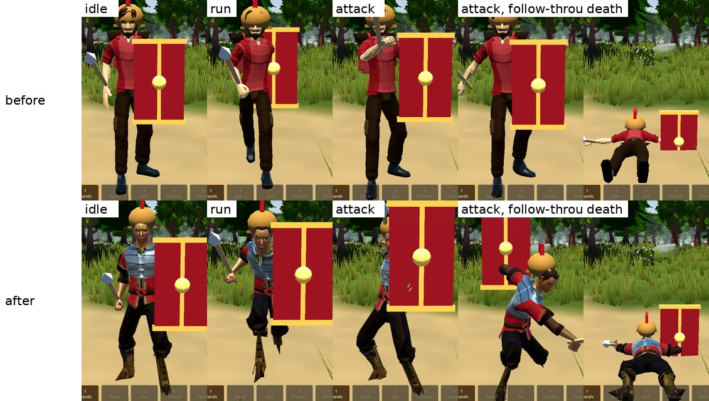
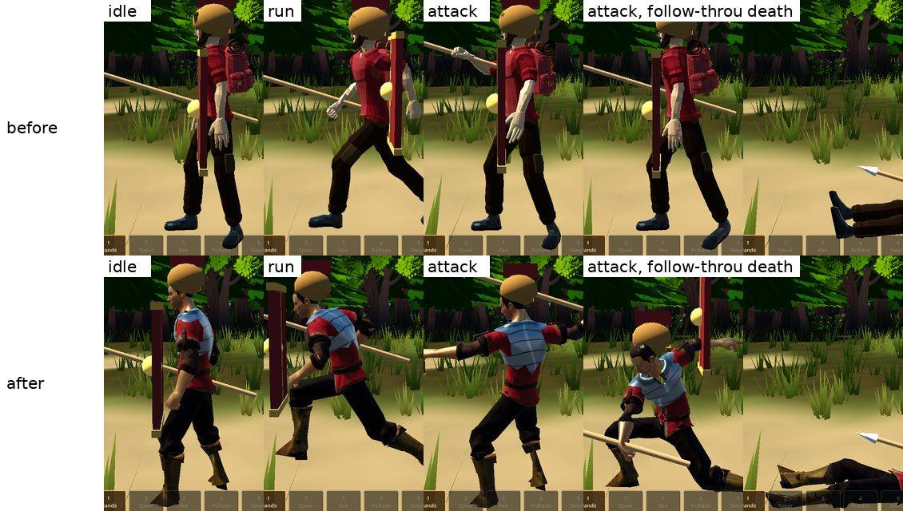
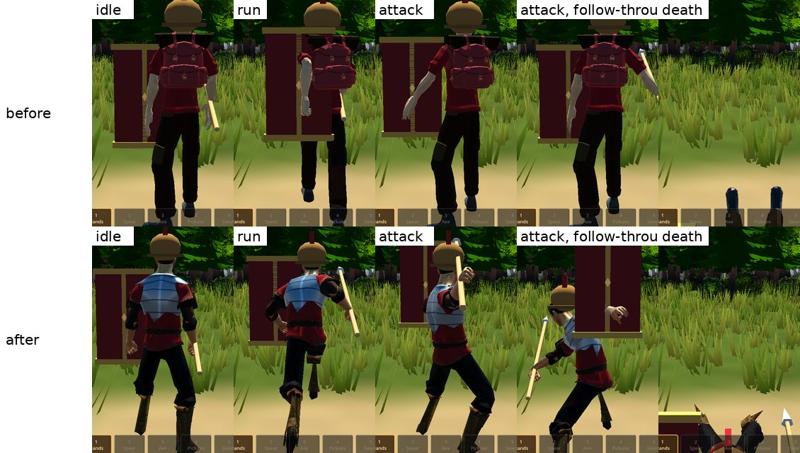
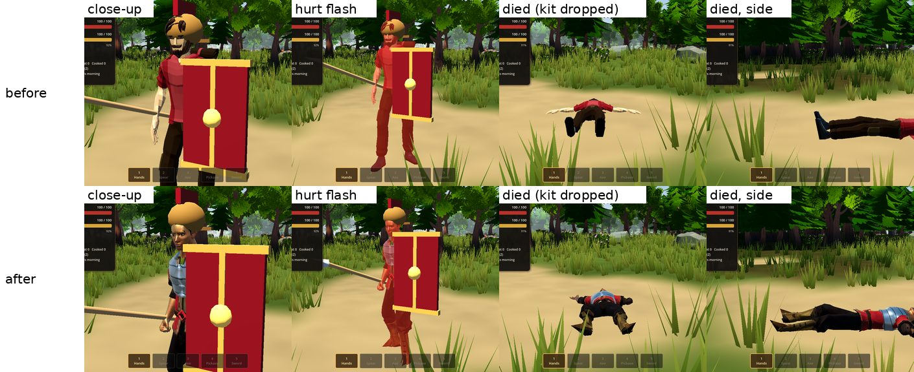
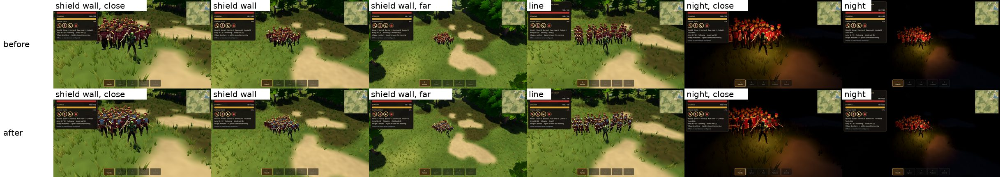

# Phase 4D: Legionary visual upgrade (prototype)

The standard **Legionary** has a new body. It is built from the same CC0 kits as the approved player ranger, so the two match in style, skeleton and animations, and it is **optimised for crowds**: about half the old soldier's triangles and a fifth of its skinned vertices. A legion of 30 uses **14 MB less video memory** than before.

**Scope.** Only the standard legionary changed. Centurions, archers, cavalry, raiders and settlers are unchanged, as instructed. Gameplay, combat, AI, movement, saves and networking are untouched. `?legionary=0` shows the old legionary, for comparison.

## Step 1: audit of the existing system

| Character | Script | Body model | Kit (procedural, placed on bones each frame) | Animations used |
|---|---|---|---|---|
| **Legionary** | `soldier.gd` | `adventurer.glb`, tunic tinted red | helmet (bronze dome, red crest) on `Head`; tall red shield on `Palm.L`; spear on `Palm.R` | idle, run, slash, death |
| Centurion | `soldier.gd` | `adventurer.glb`, dark red | silver helmet with transverse crest, shield, spear, cloak | idle, run, slash, death |
| Archer | `soldier.gd` | `adventurer.glb`, green | leather cap, bow on `Palm.L`, quiver | idle, run, slash, death |
| Cavalry | `soldier.gd` | `adventurer.glb` on `horse.glb` | helmet, lance | idle (riding), slash, death |
| Settler | `settler.gd` | `adventurer.glb`, own colours | tools | idle, run, … |
| Raider | `raider.gd` | `raider.glb` (hooded adventurer, Quaternius CC0) | helmet and mantle for chiefs | idle, run, slash, death |
| Player | `player.gd` | ranger (phase 4C) | spear, sword, axe, pickaxe, torch, lantern | — |

How it all fits together:

- **One shared body.** Every soldier kind and every settler share **one body model**, `adventurer.glb` (Quaternius, CC0): its skeleton with `Palm.L/R`, `Head` and so on, its `Man_*` animations, and 10,198 triangles in 5 meshes. `CharacterModel` merges it into one skinned surface per colour scheme (phase 3D, `character.gdshader`). The merged mesh keeps every part's 62 binds (310) and has **no LODs**.
- **What makes the kinds differ.** Only tunic colours and the procedural kit. Each kit piece is baked into one mesh per kind and shared by every soldier of that kind (`Art.bake`).
- **Rendering per soldier.** Each soldier is drawn as the body, the kit pieces and the selection ring. Soldiers cast **no shadows**, and beyond 45 m they aren't drawn or animated (`DRAW_DISTANCE`).
- **Raiders.** They are the only NPCs with a separate model. Wolves and horses have their own models.

## Step 2: asset research

| Candidate | Licence | Verdict |
|---|---|---|
| **Quaternius Modular Character Outfits – Fantasy (Standard)**: Male Peasant outfit | **CC0 1.0** (`License_Standard.txt`) | **Used.** The same kit, skeleton and texture style as the approved ranger, and already downloaded and credited. The linen tunic, forearm wraps, belt, trousers and laced boots, dyed red and given iron plates, make a convincing legionary. |
| Quaternius Universal Base Characters | CC0 1.0 | **Used** for the head, eyes, eyebrows and cropped hair (`Hair_Buzzed`), as on the ranger |
| Quaternius Universal Animation Library | CC0 1.0 | **Used**: Idle, Walk, Jog_Fwd, Sword_Attack, Death01 (it also has Hit_Chest and Sword_Idle, which aren't needed today) |
| Modular Character Outfits – Fantasy **Source** edition (12 outfits, tagged "knight") | CC0, but **paid** ($20+) | Not bought: that's your decision. It may hold a better soldier outfit for later NPC types. |
| Rigged Roman legionaries on CGTrader, Sketchfab and TurboSquid | paid or custom licences; none CC0 | Rejected: different rigs and styles, unclear redistribution rights, and often heavy (one is 75.8k triangles) |
| KayKit Adventurers (Knight) | CC0 | Rejected in phase 4C: the chibi proportions clash with the ranger |

No new files were downloaded; everything comes from kits already in the project's credits.

## Step 3: implementation

### The body (`tools/build_legionary_model.gd` → `models/soldiers/legionary.scn`)

- **Outfit.** The Male Peasant outfit. Its undyed linen (light, unsaturated texels, 12,169 of 65,536) is dyed **legion red** (`#8b2e2e`, the old legionary's tunic colour) at build time. Each texel is scaled by its own brightness, so the folds and shading stay. Leather, belt, trousers and boots are untouched.
- **Iron plates (a lorica segmentata).** These are made the same way as the approved ranger armour: the tunic's chest, back and shoulder triangles are moved 1.6 cm out along their normals and skinned with the body. The shared shader draws them as plates with seams, a ridge and trim, in Gear's iron colours, set per soldier by instance uniforms.
- **Head.** The ranger's head, eyes and eyebrows, with cropped dark hair, clean-shaven.
- **Animations.** Five clips from the Universal Animation Library, named as `soldier.gd` already asks for:

  | Action | Clip |
  |---|---|
  | idle | Idle |
  | walk | Walk |
  | run | Jog_Fwd |
  | slash (the attack) | Sword_Attack |
  | death | Death01 |
- **Simplification for crowds.** Every part is simplified with Godot's own mesh simplifier:

  | Part | Triangles before | After |
  |---|---|---|
  | Arms (sleeves, wraps, hands) | 5,338 | 1,064 |
  | Tunic | 3,856 | 1,328 |
  | Boots | 2,588 | 346 |
  | Trousers | 1,112 | 464 |
  | Head (cut from the full body) | 12,566 (2,852 head) | 1,280 |
  | Eyes / eyebrows / hair | 768 / 984 / 830 | 128 / 154 / 496 |
  | Iron plates | — | 276 |
  | **Total** | | **5,536** |
- **LODs.** Godot's automatic mesh LODs: **2,400 and 1,200 triangles** for distant soldiers.
- **One surface, one material for every legionary.** The material is `Legionary_Atlas`, using the shared `character_atlas.gdshader` (the same as the player). Its atlas is small, because a soldier is rarely more than a few dozen pixels tall: colour 512×256, normal and roughness/metal 256×128, **0.15 MB on the GPU** in total. It is loaded once and shared by the whole legion.

### In the game (`soldier.gd`, visual only)

- **Loading.** A legionary loads `legionary.scn` instead of `adventurer.glb` and turns on its iron plates. Every other kind takes the old path unchanged (`uses_new_model()`).
- **Equipment bones.** The kit uses the same followers: `Palm.R`/`Palm.L` find the humanoid rig's `hand_r`/`hand_l` through phase 4C's aliases, and `Head` exists in both rigs.
- **Kit placement on the new rig.** Its head bone is lower in the head and its hand bone is at the wrist, not the palm. Three constants keep the **same helmet, shield and spear where they were on the body**, applied to the new legionary only (all other soldiers are unchanged):
  - the helmet is lifted 5 cm and scaled to 0.88, since the old head was larger;
  - the shield is lifted 16 cm.
- **Unchanged:** shadows stay off for soldiers, the 45 m draw distance applies, and the hurt flash and the death (which hides the kit) work as before.
- **Comparison switch:** `?legionary=0` (or `-- --legionary=0`).

### Animation and equipment compatibility

| | Old | New |
|---|---|---|
| Skeleton | adventurer rig (`Palm.R/L`, `Head`, …) | humanoid rig shared with the player (65 bones) |
| idle / run / attack / death | Man_Idle / Man_Run / Man_SwordSlash / Man_Death | Idle / Jog_Fwd / Sword_Attack / Death01 |
| Right hand (spear) | `Palm.R` | `hand_r` (alias) |
| Left hand (shield) | `Palm.L` | `hand_l` (alias), shield lifted to the same height |
| Head (helmet) | `Head` | `Head`, helmet lifted and scaled to sit at the brow |
| Hurt flash | material overlay | material overlay (works on the shader material) |
| Death | kit hidden, death clip | the same |
| Shadows | off | off |

## Step 6: testing

**Renders** (`tools/legionary_shots.gd`, run with and without `--legionary=0`; Compatibility renderer, 1280×720):

- one legionary in idle, run, attack (two moments) and death, from the front, side and back;
- a close-up;
- the hurt flash;
- a real in-game death through `hurt()`, which drops the kit;
- a legion of 30 in a shield wall and in a line, by day and at night, close and far.

| Test | Result |
|---|---|
| Idle, running, attacking, death | All play. The legionary has no walk in-game: the soldier code only runs or idles, as before. |
| Receiving damage | The red hurt flash covers the whole body |
| Weapon and shield positioning | The spear is in the right hand, level with the old one. The shield is in front of the left side at the old height. The helmet sits at the brow. |
| Shadows | Soldiers cast none, as before (by design, for crowds), and still receive the sun's shadow |
| Day and night | Both read clearly. At night the iron plates catch the torchlight. |
| Many soldiers together | 30 in a shield wall and in a line: the formation spacing is unchanged, and the bodies don't overlap more than before |
| **Smoke test** (gameplay and save/load, CI gate) | **Passes** with the new legionary and with `--legionary=0`. New checks: the legionary is the new body (humanoid rig, one surface of 5,536 triangles with LODs, the shared material, all four animations); it keeps its spear, shield and helmet on the hand and head bones and wears its plates; soldiers still cast no shadows; archers and the other kinds keep the old body. The old bind-count check now allows the pre-merged body. |

## Step 4: performance

### Per legionary

| | Old | New | Change |
|---|---|---|---|
| Body triangles | 10,198 | **5,536** | −46% |
| Body triangles at a distance (LOD) | 10,198 (no LODs) | 2,400 / 1,200 | −76% / −88% |
| Skinned vertices | 20,569 | **3,904** | −81% |
| Skin binds | 310 | 123 | −60% |
| Whole soldier (body and kit) | 10,589 triangles | 5,927 triangles | −44% |
| Meshes / surfaces / materials | 5 / 5 / 3 | 5 / 5 / 3 | unchanged |
| Body texture memory | none (vertex colours) | 0.15 MB, **shared by all legionaries** | +0.15 MB once |
| Download (`index.pck`) | 5,631,056 B | 6,160,496 B | **+529 KB** (+472 KB gzipped) |

The download is mostly `legionary.scn` (373 KB), most of it the five animation clips, plus the atlas PNGs (224 KB).

### Browser benchmark

**Setup:**

- **Runner:** `perf/run_web_bench.cjs`, with Chromium and ANGLE on Mesa llvmpipe (WebGL 2, Compatibility renderer), 1280×720, fixed seed.
- **Builds:** the same web build, run with `?legionary=0` (old) and without (new).
- **Legion scenes:** both runs add `?legionbench=1`, a new opt-in benchmark section that measures **1, 10 and 30 legionaries** on open ground. The default benchmark is unchanged.
- **Village scenes:** the village armies are the benchmark's usual mix: 60% legionaries, plus archers, cavalry and a centurion.
- **Results:** `perf/legionary/web-old.json`, `web-new.json`.

| Scene | Soldiers | Draw calls | Primitives | Mesh surfaces | Frame p50 (ms) | Frame p95 (ms) | Video memory (MB) | Texture memory (MB) |
|---|---|---|---|---|---|---|---|---|
| Empty area (no soldiers) | 0 → 0 | 311 → 311 | 2.082 M → 2.081 M | 559 → 559 | 493 → 506 | 750 → 724 | 33.2 → 33.2 | 9.8 → 9.8 |
| **1 legionary** | 1 → 1 | 306 → 307 | 2.095 M → 2.092 M | 564 → 564 | 478 → 489 | 503 → 528 | 35 → 33.7 | 9.8 → 10 |
| **10 legionaries** | 10 → 10 | 347 → 347 | 2.186 M → 2.139 M | 609 → 609 | 528 → 517 | 561 → 548 | 40.1 → 34.8 | 10 → 10 |
| **30 legionaries** | 30 → 30 | 444 → 444 | 2.377 M → 2.240 M | 709 → 709 | 571 → 537 | 612 → 554 | 51.5 → 37.2 | 10.3 → 10.2 |
| Village (no soldiers) | 0 → 0 | 565 → 565 | 1.987 M → 1.987 M | 713 → 713 | 506 → 516 | 560 → 567 | 41.2 → 40.1 | 10 → 10 |
| Village + 10 soldiers (6 legionaries) | 10 → 10 | 605 → 605 | 1.981 M → 1.953 M | 764 → 764 | 563 → 564 | 612 → 641 | 50.8 → 47.3 | 10.2 → 10.3 |
| **Village + 30 soldiers** (18 legionaries) | 30 → 30 | 705 → 705 | 2.209 M → 2.128 M | 866 → 866 | 676 → 633 | 701 → 706 | 62.8 → 53.9 | 10.5 → 10.5 |
| **Night village + 30 soldiers** | 30 → 30 | 796 → 795 | 2.734 M → 2.650 M | 868 → 868 | 742 → 715 | 778 → 735 | 62.8 → 53.9 | 10.5 → 10.5 |
| Forest | 0 → 0 | 326 → 314 | 2.385 M → 2.309 M | 555 → 555 | 667 → 662 | 1173 → 893 | 34.2 → 33.1 | 9.9 → 9.9 |
| Area transitions | 0 → 0 | 307 → 310 | 1.608 M → 1.631 M | 524 → 523 | 680 → 682 | 807 → 777 | 43.8 → 42.6 | 10 → 10 |

How to read this:

- **The crowd gets cheaper.**
  - **Video memory:** with 30 legionaries it falls by **14.3 MB** (51.5 → 37.2), and in the 30-soldier village by **8.9 MB**. This is the much smaller vertex buffer per soldier.
  - **Primitives:** −137,000 with 30 legionaries and −81,000 to −84,000 in the 30-soldier villages, from fewer triangles and LODs at a distance.
  - **Frame times:** these improve where there are many legionaries: 30 legionaries p50 571 → 537 ms and p95 612 → 554 ms; village + 30 p50 676 → 633 ms; night village p50 742 → 715 ms. On this software renderer some of that is noise, but the direction is consistent across the crowd scenes.
- **No new draw calls or surfaces.** Draw calls and mesh surfaces are identical in every soldier scene, because each legionary is still one body draw plus its kit.
- **Texture memory is the same within 0.1 MB.** The atlas is one 0.15 MB set for every legionary.
- **No soldiers, no change.** The scenes without soldiers (empty area, village, forest, travel) are unchanged within noise.
- **One anomaly.** Render-CPU time (the engine's own render thread) averaged 73–83 ms in the first two legion scenes on the new build, against about 2 ms for the old build and in every later scene. It looks like a one-off cost the first time the model is drawn: the first use of its shader variant, or the texture and mesh upload. It doesn't recur with 30 legionaries or in the villages. It should be checked on a real GPU, and if it shows there, warmed up at load.

The headless benchmark has no real GPU, so the counts and memory are the reliable figures. **Real-GPU frame times are still unmeasured** (phase 4A's GPU validation was skipped).

## Known limitations

- **Peasant outfit with plates.** The legionary is the kit's peasant outfit with iron plates, not a modelled Roman soldier: it wears trousers (as northern legions did), not bare legs, and laced boots, not caligae. A modelled lorica, pteruges or caligae would need other assets, perhaps from the paid Source edition.
- **Kit unchanged.** The helmet, shield and spear are the same procedural pieces as before, placed for the new rig, so they are simpler than the body. Upgrading them is a separate step.
- **Plate edges.** Simplification leaves a few small red tunic slivers at the edges of the iron plates, visible at the closest camera only.
- **Animations not shared.** Each model carries its own copy of the same library clips: `legionary.scn` holds about 0.3 MB of them. Sharing one animation library between the player and soldiers would cut the download; that's for when more soldier types move to the new rig.
- **First-appearance render cost.** See the render-CPU note above.
- **Same face for every legionary.** Variety (skin, hair) could come from instance uniforms later, without new geometry.
- **Other types unchanged.** Centurions, archers, cavalry, settlers and raiders keep the old body, as instructed, so a mixed army shows both styles side by side until the next NPC types are done.

## Files

| File | What |
|---|---|
| `game/tools/build_legionary_model.gd` | new: builds the legionary from the kits |
| `game/models/soldiers/legionary.scn`, `legionary_colour.png`, `legionary_normal.png`, `legionary_orm.png` (+ `.import`) | new: the model and its atlas |
| `game/scripts/soldier.gd` | the legionary loads the new body and wears its plates; kit offsets for the new rig; `uses_new_model()` |
| `game/scripts/main.gd` | `?legionary=0` |
| `game/scripts/perf_bench.gd` | opt-in `?legionbench=1` legion scenes; `_recruit` can recruit one kind |
| `game/tools/legionary_shots.gd` | new: before/after renders |
| `game/tools/smoke_test.gd` | the legionary checks |
| `game/models/CREDITS.md` | the soldiers section |
| `perf/legionary/` | renders and benchmark results |
