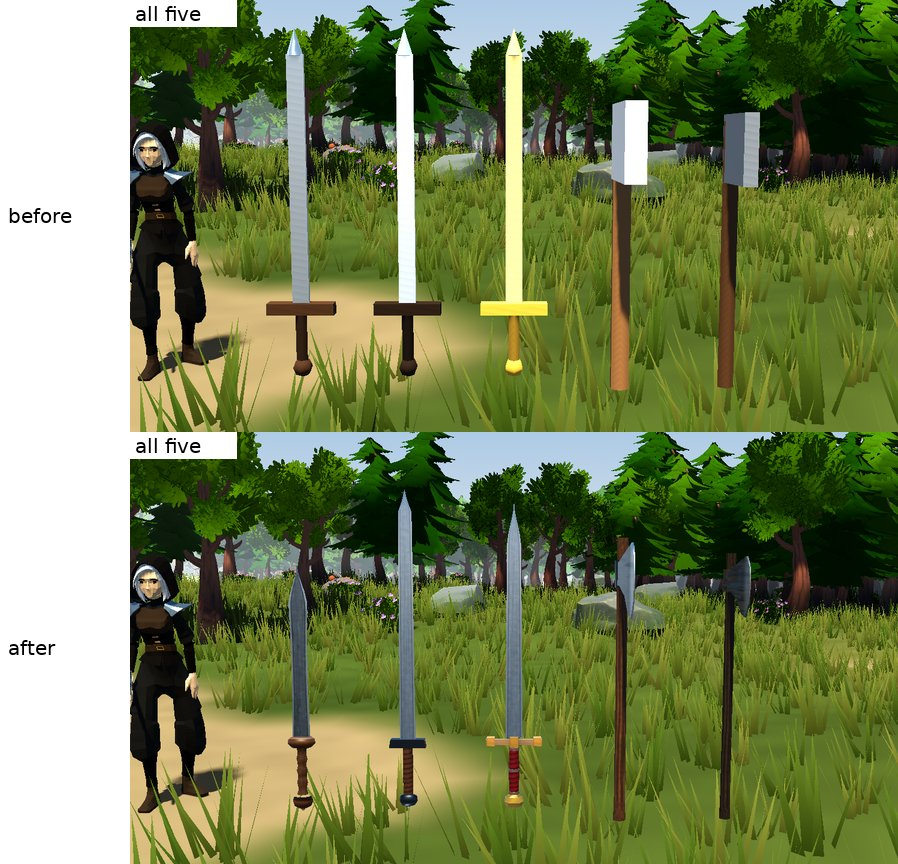
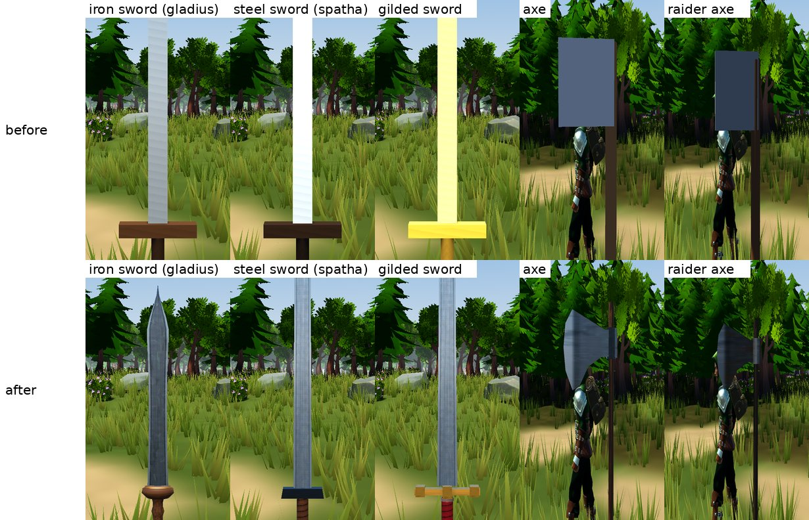
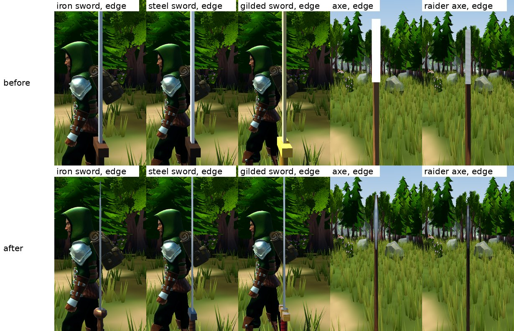
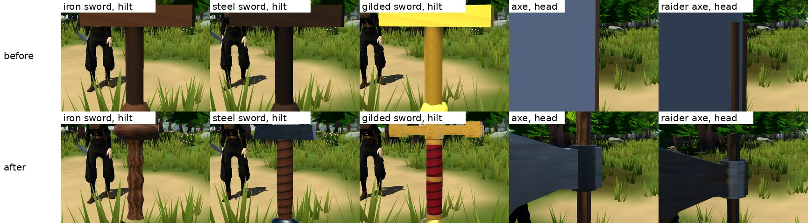
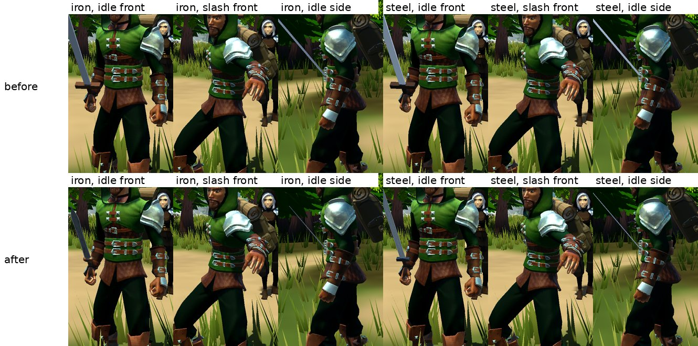
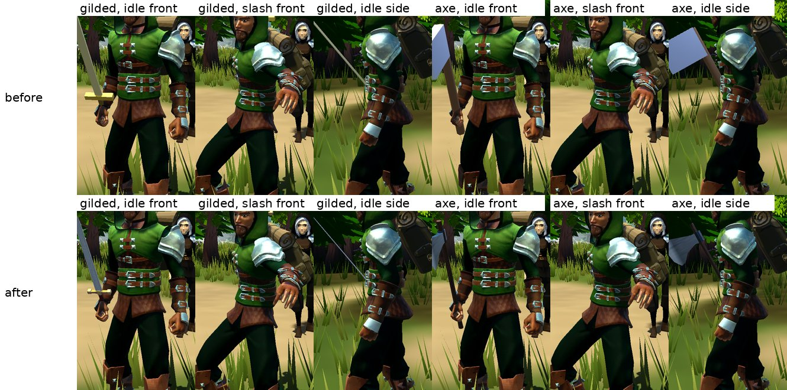
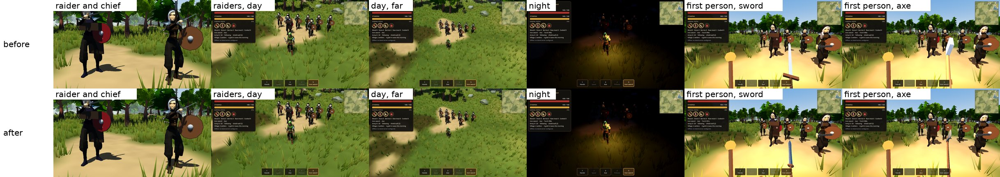

# Phase 4E.1: realistic swords and blades

The game's swords and axes are rebuilt as historically inspired weapons:

- **Iron sword:** a Roman **gladius**.
- **Steel sword:** a **spatha**.
- **Gilded sword:** a sword with gilded fittings.
- **Player's axe:** a bearded felling axe.
- **Raiders' axe:** a rougher, rusted axe.

All five are original geometry on **one shared material** with a small procedurally painted atlas. Each sword is now **one mesh instead of five**, so holding one costs **8 fewer draw calls** (colour and shadow passes).

**Unchanged:** damage, attack timing, hit detection, combat, AI, saves, networking and equipment. **Comparison:** `?swords=0` shows the old weapons.

**Scope, as you decided:**

- **Player swords only.** Legionaries and centurions carry no sword today: they fight with spear and shield. So no gladius or centurion sword was added to them, and the approved 4D soldiers are unchanged. "Gladius" here is the player's iron sword.
- **Axes included.** The player's axe and the raiders' axes are upgraded in this phase.
- **Spears and the pickaxe** are left for a later phase.

**Branch:** `claude/swords-blades`, cut from `main` at `07e6ba4` (which includes #40). Not merged, no pull request.

## 1. Inspection

**Repository state.** The branch was cut from `main` at `07e6ba4`, which has PRs #34–#40 merged; the working tree was clean. No earlier graphics report touched weapons. Phase 4C's report named the old boxy kit as a known limitation.

**Every blade in the game:**

| Weapon | Who | Built from | Draws | Material(s) | Placement |
|---|---|---|---|---|---|
| **Sword: Iron, Steel, Gilded** (`Gear.SWORD`, damage 6/10/15) | player | 5 primitives: blade box, cone tip, guard box, grip cylinder, pommel sphere (122 triangles) | 5 | 5, retinted per tier (`_tint` by child order) | `tick_visuals`: on `Palm.R` (→ `hand_r`), tilted 0.7 rad; first person `place_view_model` |
| **Axe** | player | haft cylinder + head box (48 triangles) | 2 | 2 | on `Palm.R`, the same |
| **Raider axe** | raiders and chiefs | haft cylinder + head box (42 triangles), baked into one vertex-coloured mesh per kind | 1 | shared vertex-colour material | `raider.gd _animate`: on `Palm.R`, tilted 0.6 rad |
| Spears, lance, pickaxe, arrows | player, soldiers, cavalry, archers | primitives | — | — | not swords; not in this phase |
| *Gladius / centurion sword* | *legionary / centurion* | **none**: they hold a spear and shield | — | — | — |

All weapons are procedural primitive meshes placed every frame on hand-bone followers. None is an imported model and none is skinned. The attack is an animation (Sword_Slash / Sword_Attack) plus timing in code; the weapon mesh plays no part in hit detection.

## 2. Asset research

| Candidate | Source | Licence (verified) | Formats | Size | Look | Verdict |
|---|---|---|---|---|---|---|
| **Quaternius LowPoly Medieval Weapons** (22 weapons) | quaternius.itch.io/lowpoly-medieval-weapons (page read) | **CC0 1.0**: "CC0 License https://creativecommons.org/publicdomain/zero/1.0/" | FBX, OBJ, Blend (3.5 MB zip); no glTF | low-poly | flat colours, stylised | Not used: not realistic, and no PBR materials |
| **KayKit Adventurers weapons** (sword_1handed, sword_2handed, axe_1handed, axe_2handed …) | KayKit-Game-Assets (cloned locally; `LICENSE.txt` read) | **CC0 1.0** ("free to use in personal, educational and commercial projects") | glTF + shared gradient texture | a few hundred triangles | chunky, made for chibi characters | Not used: cartoon proportions, which the brief says to avoid |
| Swordtember 2022 "30 Unique Lowpoly Swords" | cc0gameassets.itch.io/swordtember2022 | listed as CC0 | GLB, FBX | low-poly | stylised fantasy | Not used: not realistic. Not downloaded. |
| OpenGameArt low-poly swords (several) | opengameart.org (e.g. "3D swords lowpol cc0") | listed as CC0 | GLB, Blend | ~300 triangles | stylised fantasy | Not used, for the same reason |
| **Godot Asset Store "PBR arming sword"** | store.godotengine.org/asset/vairek/pbr-arming-sword | search results say CC0; **the page is blocked from this environment**, so licence, polycount and textures are unverified | — | — | realistic PBR | Not used: unverifiable here, and a single medieval sword (no gladius, no axes) |
| Sketchfab / CGTrader / TurboSquid gladius models | various | mostly **CC-BY** or "royalty free", **not CC0**; redistribution terms vary per model | various | 300–3,000 triangles | some realistic | Not used: redistribution inside the game is not clearly allowed. Sketchfab downloads need an account. |
| Poly Haven | polyhaven.com | CC0 | — | — | — | No sword models were found |

**Conclusion.** No asset was both realistic and verifiably free to redistribute, as the brief requires. So, as the brief allows, the weapons are **original geometry and original procedurally painted textures**, made by `tools/build_weapon_models.gd`. They carry no licence risk, match each other in style, and their cost is under control. Nothing was downloaded.

## 3. Implementation

### The build tool (`tools/build_weapon_models.gd` → `models/weapons/`)

**The atlas** (`weapons_colour.png` + `weapons_orm.png`) is 256×256, in eight 32-pixel columns, one per material, each painted from noise:

| Region | Colour | Roughness / metal |
|---|---|---|
| **bright steel** | brushed streaks along the length, fine scratches; honed edges bright, with a darker worn band just inside them | 0.2–0.4 / metal |
| **iron** | darker, soft wear and pitting, honed edges | ~0.45–0.55 / metal |
| **rusty iron** | dark iron with rust patches, dulled edges | rust patches matte and less metallic |
| **gold**, **bronze** | grime in broad patches; bronze with a hint of patina | ~0.35 / metal |
| **wood**, **weathered wood** | grain | 0.7–0.85 / none |
| **leather wrap** (brown and red) | a strap wound diagonally, with dark grooves | 0.75 / none |
| **dark steel fittings** | plain dark steel | metal |

A first version was too noisy (spotty grime, heavy scratches), as the brief warns against. It was toned down to broad wear and fainter, fewer scratches. On the GPU the atlas is 2 × 43 KB (S3TC/BPTC, mipmapped).

**One material** (`weapons.tres`): a plain StandardMaterial3D, opaque, using the atlas's colour, roughness (G) and metal (B), with no normal map. It's the cheapest lit material in Godot's Compatibility renderer. Every sword and axe uses it.

**Geometry.** Every weapon keeps the old one's frame: the grip at the origin (the hand), the blade or haft along +y, sword flats facing ±z, the axe edge towards +z. So the existing placement code, swing and first-person view are unchanged.

- **Blades** are swept cross-sections. Every face of the section is its own smoothing group, so edges, bevels, ridges and fullers stay crisp.
- **Handles** are lathed.
- **Axe heads** are extruded outlines that thin to a honed edge.
- **Faces point outward.** Each triangle is turned to face outward explicitly, the lesson from the centurion helmet.

| Weapon | Tier / user | Design | Triangles | Length |
|---|---|---|---|---|
| **Gladius** | Iron sword | Mainz pattern: a waisted, double-edged iron blade with a **diamond section** and a long point; an oval wooden handguard faced with bronze, a **ribbed wooden grip** (four finger ridges), an oval wooden pommel with a bronze peen | 782 | ~0.75 m |
| **Spatha** | Steel sword | A slender, bright **fullered** steel blade (the fuller fades towards the point), a short dark iron guard, a **leather-wound grip**, a dark steel wheel pommel | 816 | ~0.95 m |
| **Gilded sword** | Gilded sword | A fine fullered steel blade, a **gilded cross-guard** with end blocks, a **red leather grip bound with gold wire**, a **faceted gold pommel** | 914 | ~0.92 m |
| **Axe** | player | A bearded felling axe: an iron head with a bright honed edge, an iron eye and wedge, an ash haft with grain | 152 | 0.85 m haft (as before) |
| **Raider axe** | raiders, chiefs | The same family, smaller and rough: rusty head, dulled edge, dark handled haft | 152 | 0.8 m haft (as before) |

The three swords are deliberately different, so each tier keeps its identity: a short, dark Roman sword; a long, bright cavalry sword; an ornate gold-fitted sword. The old swords were one oversized (~1 m) blade with three tints. The new lengths are historically proportioned for a 1.62 m character.

### In the game (visual only)

- **`player.gd`:**
  - `_sword` holds **one** MeshInstance3D, whose mesh `_restyle_gear` picks by `sword_tier` (`SWORD_MODELS`), instead of five tinted parts. `_axe` holds one mesh.
  - Placement (`tick_visuals`, `place_view_model`), visibility, `equip`, `swing` and every gameplay path are untouched.
- **`raider.gd`:** the axe piece holds the modelled axe, which is already one surface and so isn't baked. Placement is unchanged.
- **`main.gd`:** `?swords=0` (or `-- --swords=0`) shows the old swords and axes, following the `?player=0` / `?legionary=0` / `?centurion=0` convention. Existing URL options are unaffected.
- **`perf_bench.gd`:** opt-in `?swordbench=1` adds "player holding the sword" and "10 raiders with axes" scenes. The player keeps the sword for the rest of that run. The default benchmark is unchanged.

## 4. Testing

**Renders** come from `tools/weapon_shots.gd`, run with and without `--swords=0` (native Godot, Compatibility renderer, 1280×720):

- each weapon alone: front, edge and hilt or head;
- the player holding each sword and the axe, idle and mid-swing, front and side;
- raiders and a chief with axes;
- raiders at the game camera by day and at night;
- first person with the sword and the axe.

| Check | Result |
|---|---|
| Attachment position and hand alignment | The grips sit in the right hand exactly where the old ones did. The frame is the same and the placement code is untouched (`held-*.jpg`). |
| Floating weapons, clipping | None in the renders. Weapons stay in the hand through idle and swing. |
| Missing textures | None. The smoke test checks one material across all weapons; the renders show the atlas. |
| Animations, attack | Unchanged code paths: the swing still plays the slash, and the first-person chop is the same transform. |
| Damage, hit detection, selection, multiplayer | No gameplay code changed. Smoke checks: sword damage is still 6/10/15; equipping, crafting each tier and the hotbar all pass, as does the full save and reload. |
| **Smoke test** | **Passes with the new weapons (312 checks) and with `--swords=0` (311).** New checks: each tier is its own one-mesh weapon (gladius, spatha, gilded), as is the axe, all on one material; raiders carry the modelled axe on the same material; sword damage unchanged; with `--swords=0`, the old 5-part sword and 2-part axe. |

**Screenshots:**

## 5. Performance

### Per weapon

| | Old | New |
|---|---|---|
| Sword (any tier): meshes = draws per pass | 5 | **1** |
| Sword: materials | 5 (per player) | **1, shared by every weapon** |
| Sword: triangles | 122 | 782 / 816 / 914 (gladius / spatha / gilded) |
| Player axe: draws / materials / triangles | 2 / 2 / 48 | **1 / 1 / 152** |
| Raider axe: draws / triangles | 1 / 42 (baked) | 1 / 152 |
| Textures | none | one 256² atlas, 2 × 43 KB on the GPU, shared |
| Download (`index.pck`) | 6,542,880 B | 6,685,760 B: **+143 KB** (+104 KB gzipped) |

### Browser benchmark (software renderer)

**Setup:**

- **Runner:** `perf/run_web_bench.cjs`, with Chromium and **ANGLE on Mesa llvmpipe, a CPU software renderer** (WebGL 2, Godot Compatibility), 1280×720, fixed seed.
- **Builds:** the same web build, run with `?swords=0` (old) and without (new).
- **Scenes:** both runs add `?swordbench=1&legionbench=1&centurionbench=1`. The player holds the iron sword from the second scene on. One legionary or centurion, and 10 and 30 of either, come from the legion and centurion sections; the villages use the usual mixed army.
- **Results:** `perf/swords/web-old.json`, `web-new.json`.

Each cell is old → new.

| Scene | Draw calls | Primitives | Mesh surfaces | Frame p50 (ms) | Frame p95 (ms) | Video memory (MB) | Texture memory (MB) |
|---|---|---|---|---|---|---|---|
| Empty area (player, no sword) | 311 → 310 | 2.078 M → 2.077 M | 559 → 559 | 567 → 492 | 837 → 716 | 33.2 → 33.3 | 9.8 → 9.9 |
| **Player holding the sword** | 312 → 304 | 2.086 M → 2.088 M | 564 → 560 | 505 → 509 | 545 → 550 | 33.2 → 33.3 | 9.8 → 9.9 |
| **10 raiders with axes** | 442 → 434 | 2.239 M → 2.242 M | 626 → 622 | 550 → 536 | 614 → 616 | 38.3 → 38.4 | 9.9 → 10 |
| 1 legionary | 309 → 302 | 2.070 M → 2.076 M | 569 → 565 | 498 → 505 | 560 → 600 | 35.2 → 35.3 | 10 → 10.1 |
| 1 centurion | 300 → 292 | 2.001 M → 2.000 M | 568 → 564 | 511 → 504 | 560 → 628 | 35.3 → 35.4 | 10 → 10.1 |
| 10 legionaries | 351 → 344 | 2.095 M → 2.105 M | 614 → 610 | 514 → 521 | 547 → 602 | 36.3 → 36.4 | 10 → 10.1 |
| 30 legionaries | 444 → 437 | 2.160 M → 2.166 M | 714 → 710 | 541 → 548 | 590 → 566 | 38.6 → 38.7 | 10.2 → 10.3 |
| 10 centurions | 335 → 327 | 2.042 M → 2.049 M | 604 → 600 | 512 → 506 | 581 → 546 | 36.4 → 36.5 | 10 → 10.1 |
| 30 centurions | 411 → 404 | 2.122 M → 2.139 M | 684 → 680 | 544 → 547 | 562 → 574 | 39 → 39.1 | 10.2 → 10.3 |
| Village | 569 → 560 | 1.971 M → 1.967 M | 717 → 713 | 506 → 512 | 561 → 568 | 41.7 → 41.8 | 10.2 → 10.3 |
| Village + 10 soldiers | 609 → 601 | 1.939 M → 1.941 M | 766 → 762 | 552 → 557 | 588 → 585 | 47.4 → 47.5 | 10.3 → 10.4 |
| **Village + 30 soldiers** | 700 → 692 | 2.077 M → 2.079 M | 864 → 860 | 657 → 631 | 701 → 701 | 53.1 → 53.2 | 10.5 → 10.6 |
| **Night village + 30 soldiers** | 793 → 785 | 2.607 M → 2.608 M | 866 → 862 | 700 → 724 | 735 → 762 | 53.1 → 53.2 | 10.5 → 10.6 |

How to read this:

- **Draw calls: 8 fewer in every scene with the sword in hand** (for example 312 → 304, and 793 → 785 in the night village). The sword is one mesh instead of five, in the colour pass and the shadow pass.
- **Mesh surfaces:** 4 fewer.
- **Raiders' axes:** still one draw each, as before.
- **Primitives:** +2,000 to +17,000 (at most +0.8%). That's the sword's extra triangles in each pass, plus the raiders' axes. The legion and centurion scenes differ by the same small amount: their soldiers are unchanged and their numbers vary with streaming.
- **Memory:** video and texture memory are up by **0.1 MB** each (the atlas).
- **Frame times are within this software renderer's run-to-run noise,** in both directions. The empty area, where nothing changed, moved more than any weapon scene.
- **Software renderer only.** These are **CPU software-renderer measurements and do not represent real-GPU performance.** The counts (draw calls, surfaces, primitives, memory) carry over to a GPU, and fewer draw calls is the change most likely to help there. Real-GPU timing is still to be done.

## 6. Known limitations

- **Small at gameplay distance.** At the normal top-down camera, a 5 cm-wide blade is a few pixels. The new silhouettes (the waisted gladius, the gold guard) read better than the old boxes, but the surface detail (brushing, wear, grain, wraps) is for close and first-person views. The raiders' axes are hard to make out at game distance, as before.
- **The gilded guard is blocky.** The cross-guard is built from boxes (a block, two arms, end blocks). A curved, flaring guard would need more geometry.
- **No normal map.** The bevels, ridge and fuller are geometry, but the leather wraps and grain are painted, not embossed. That keeps the material the cheapest lit material, but close up the wraps look flat.
- **More triangles per weapon.** 782–914 per sword against 122. Only the player holds a sword, so the cost is one weapon. The raiders' axes add 110 triangles each.
- **The axe in first person** is seen mostly edge-on, so the head shows as a thin profile.
- **Soldiers have no swords.** As decided, legionaries and centurions still carry only spear and shield. A sheathed gladius for them would be a separate, approved change.
- **Not in this phase:** spears, the cavalry lance, the pickaxe and arrows keep their old primitive look.

## 7. Files

| File | What |
|---|---|
| `game/tools/build_weapon_models.gd` | new: the atlas, material and five weapon meshes (original work) |
| `game/models/weapons/` | new: `gladius.res`, `spatha.res`, `gilded_sword.res`, `axe.res`, `raider_axe.res`, `weapons.tres`, `weapons_colour.png`, `weapons_orm.png` (+ `.import`) |
| `game/scripts/player.gd` | swords by tier and the axe use the new meshes; old path kept for `?swords=0` |
| `game/scripts/raider.gd` | the modelled raider axe; old path kept |
| `game/scripts/main.gd` | `?swords=0` |
| `game/scripts/perf_bench.gd` | opt-in `?swordbench=1` scenes |
| `game/tools/weapon_shots.gd` | new: the renders |
| `game/tools/smoke_test.gd` | the weapon checks |
| `game/models/CREDITS.md` | the weapons section (original work) |
| `perf/swords/` | renders and benchmark results |
