# Phase 4E.2: realistic spears and shields

Every spear and shield in Last Light is rebuilt as historically inspired equipment, made to the same standard and with the same tool and shared materials as the approved swords (4E.1):

- **Spears:** the legionaries' **pilum**, the centurion's bronze-fitted **hasta**, the cavalry's **lance**, and the player's five spear tiers.
- **Shields:** a curved, painted Roman **scutum** for the legionaries, an **officer's scutum** for the centurion, and painted round shields for raiders and their chiefs.

Every item is one mesh with no new draw calls; the scutum is one fewer draw than before. Visual only:

- **Unchanged:** damage, reach, attack timing, hit detection, AI, saves, networking and the equipment each character carries.
- **Comparison:** `?spears=0` and `?shields=0` show the old models, each independently.

**Branch:** `claude/spears-shields`, cut from `main` at `5f087e7`, which includes the swords (#41). Not merged, no pull request.

## 1. Inspection

**Repository state.** The branch was cut from `main` at `5f087e7`, with PRs #34–#41 merged; the working tree was clean.

**Every spear and shield:**

| Item | Who | Old build | Draws | Placement (unchanged) |
|---|---|---|---|---|
| Spear, **5 tiers**: Wooden, Flint, Iron, Steel, Gilded (`Gear.SPEAR`, damage 2/3/5/8/12, reach 34) | player | shaft cylinder + cone tip, 55 triangles, retinted per tier | 2 | `tick_visuals` on `Palm.R`; first-person `place_view_model` |
| Spear (1.6 m) | legionary, centurion | the same two primitives, baked into one mesh per kind | 1 | `soldier.gd _animate` on `Palm.R` (`hand_r`) |
| Lance (2.2 m) | cavalry | the same, longer | 1 | the same, held level and thrust |
| Scutum (0.52 × 0.86 m) | legionary (`#8e2323`), centurion (`#6e1f1f`) | box + three trim boxes, baked, plus a separate glowing boss sphere; 144 triangles | 2 | `_animate` on `Palm.L` (`hand_l`), with the 4D shield lift |
| Round shield (r 0.3 m) | raider (brown), raider chief (red) | disc + rim + boss, baked; 224 triangles | 1 | `raider.gd _animate` on `Palm.L` |

Archers, settlers and the player carry no shield.

**No shield blocking exists in the game.** There is no blocking logic, block direction, shield collision or block animation. Shields are drawn kit only, so "blocking" has nothing to preserve beyond the shield's look and placement; nothing related was touched.

**Spear range, damage and timing** come from `Gear.SPEAR`, `SPEAR_REACH` and `Soldier.KINDS`, never from the mesh.

**Sword material reuse.** The 4E.1 tool (`tools/build_weapon_models.gd`) and its atlas (brushed steel, iron, gold, bronze, wood, weathered wood, leather) were extended, not copied. The spears use **the swords' own material**.

## 2. Asset research

| Candidate | Source | Licence (verified) | Format / size | Look | Verdict |
|---|---|---|---|---|---|
| **KayKit Adventurers shields** (round, square, badge, spikes) | KayKit-Game-Assets (local clone; `LICENSE.txt` read) | **CC0 1.0** | glTF, low-poly, shared gradient texture | chunky, chibi-scale | Not used: cartoon proportions |
| **Quaternius LowPoly Medieval Weapons** (tagged shield) | quaternius.itch.io/lowpoly-medieval-weapons (read for 4E.1) | **CC0 1.0** | FBX/OBJ/Blend, flat colours | stylised | Not used: not realistic |
| **drxwat "Melee Weapon Pack"** (a spear among four) | drxwat.itch.io/melee-weapon-pack | listed as CC0 | GLB, 160-vertex spear | stylised low-poly | Not used: not realistic. Not downloaded. |
| Scutum models on CGTrader / Free3D | cgtrader.com, free3d.com | "Royalty Free" (some "No AI"), **not CC0** | various | some realistic | Not used: redistribution inside the game not clearly allowed |
| Sketchfab "Scutum" (13.8k triangles) | sketchfab.com | "Free Standard", **not CC0** | — | realistic, heavy | Not used: licence and polycount |
| Poly Haven | polyhaven.com | CC0 | — | — | No spears or shields found |

**Conclusion.** Nothing was both realistic and verifiably CC0. As the brief allows, the spears and shields are **original geometry and procedurally painted textures**, from the same tool as the swords. They carry no licence risk, match the approved swords in style, and their cost is controlled. Nothing was downloaded.

## 3. Implementation

### The tool

`tools/build_weapon_models.gd` now takes `TARGETS`:

- **`swords`** (the default) builds exactly what it built before.
- **`spears,shields`** builds only the new items and leaves the swords' files alone. All ten of them hash identically before and after.

**The shields' atlas** (`shields_colour.png` + `shields_orm.png`) is 512 × 512, painted procedurally:

- **The four faces** (descriptions below), each with wear: paint chipped to the wood at the edges, light scratches, and grime towards the bottom. The centurion's gilt design is metallic.
- **Glued plank backs**, with grain and seams.
- **Iron, bronze, gold and rusted iron.**
- **Knapped flint.**
- **A shaft wood, rawhide, sinew binding and leather.**

On the GPU it takes 2 × 175 KB (S3TC/BPTC, mipmapped). **One material**, `shields.tres`, a plain opaque StandardMaterial3D like the swords', serves every shield and the flint spear.

### Spears

Each keeps the old spear's frame and length: the hand at the origin, the shaft from y −0.5 to the tip at about 1.3 m (the lance from −0.7 to 1.7 m). Placement, thrust and first-person view are unchanged.

| Spear | Who | Design | Material | Triangles |
|---|---|---|---|---|
| **Pilum** | legionary | Ash shaft swelling towards an iron collar; a long thin iron shank; a small pyramidal point; an iron butt-spike | swords' | 256 |
| **Officer's hasta** | centurion | Dark polished shaft with bronze bands; a bronze socket and butt; a broad leaf-shaped steel head with a central ridge | swords' | 432 |
| **Lance** | cavalry | Long dark shaft; a narrow steel head on an iron socket; a leather grip where the hand holds it | swords' | 368 |
| Wooden spear | player, tier 1 | One length of ash, its point shaped and charred (fire-hardened) | swords' | 112 |
| Flint spear | player, tier 2 | A thick knapped flint head bound on with sinew | shields' | 224 |
| Iron spear | player, tier 3 | A leaf-shaped iron head with honed edges, an iron socket and butt cap | swords' | 336 |
| Steel spear | player, tier 4 | A longer, narrower steel head on a dark steel socket, a dark shaft | swords' | 336 |
| Gilded spear | player, tier 5 | A steel head on a gold socket, gold bands and butt cap | swords' | 432 |

The heads are swept diamond sections, crisp at the edges and ridge. Sockets, collars and bands are lathed.

### Shields

Each keeps the old shield's size and origin, with the front to +z. Placement on the left hand, including the 4D lift, is unchanged.

| Shield | Who | Design | Triangles |
|---|---|---|---|
| **Scutum** | legionary | A tall curved board: part of a cylinder, so the edges sweep 9 cm back towards the body. 2.2 cm thick. **Legion red**, painted with a yellow border, **thunderbolts** to the four corners and **wings** above and below the boss. Iron edging round the rim, a domed **iron boss** on a bronze plate, a plank back with a leather grip on iron brackets. | 534 |
| **Officer's scutum** | centurion | The same board, **deeper crimson**, a **double gilt border**, a gilt **laurel wreath** round the boss and gilt wings. **Gold edging** and a **gold boss and plate**. | 534 |
| **Round shield** | raider | Planks, slightly domed, painted in dark quarters, worn; a **rawhide** rim; a **rusted iron boss**; a grip behind | 440 |
| **Chief's round shield** | raider chief | Red, with a **black ring and cross**; an **iron rim**; an iron boss | 440 |

### In the game (visual only)

- **`soldier.gd`:** a legionary's, centurion's or cavalryman's spear piece, and a legionary's or centurion's shield piece, hold one modelled mesh (`_kit_mesh`). Its material is on the mesh, so `Art.bake` leaves it alone. Placement in `_animate` is unchanged. The old path is kept.
- **`player.gd`:** `_spear` holds one mesh picked by `spear_tier` in `_restyle_gear` (`SPEAR_MODELS`), instead of two tinted parts.
- **`raider.gd`:** the round shield, by kind.
- **`main.gd`:** **`?spears=0`** and **`?shields=0`** (or `-- --spears=0`, `-- --shields=0`), each on its own, following the existing convention. The other URL options are unaffected.

## 4. Testing

**Renders** come from `tools/spear_shield_shots.gd`, run with and without `--spears=0 --shields=0` (native Godot, Compatibility renderer, 1280×720):

- every spear and shield on its own, front, side and back, with close-ups of spearheads, bosses and paint;
- the legionary and centurion carrying both, in idle, run, attack and death, from the front, side and back;
- the cavalry lance and the raiders' shields;
- the player with each spear tier;
- a centurion leading 29 legionaries in a shield wall, by day and at night.

| Check | Result |
|---|---|
| Grip and shield arm alignment | Spears sit in the right hand and shields on the left arm, at the old positions, through idle, run and attack (`carried-*.jpg`) |
| Floating geometry, clipping | None seen. The scutum's curved edges sweep back towards the body without passing through it, at the old shield offset. |
| Death | The kit is hidden on death, as before (no change) |
| Blocking | Not applicable: the game has no blocking (section 1) |
| Collision, hit detection, damage, reach | No gameplay code changed. Smoke check: spear damage 2/3/5/8/12, `SPEAR_REACH` 34 and legionary reach 26 are unchanged. |
| Other equipment | The swords' files hash identically. Helmets, bows, armour and the soldiers' bodies are untouched. |
| **Smoke test** | **Passes in all four combinations:** new, `--spears=0`, `--shields=0`, and both (316 checks each). |

New smoke checks:

- each spear tier is its own one-mesh spear;
- legionaries carry the pilum, centurions the officer's spear, cavalry the lance;
- legionaries and the centurion carry painted scuta, and a raider chief its round shield, one mesh each;
- damage and reach are unchanged;
- with each switch off, the old models.

**Screenshots:**

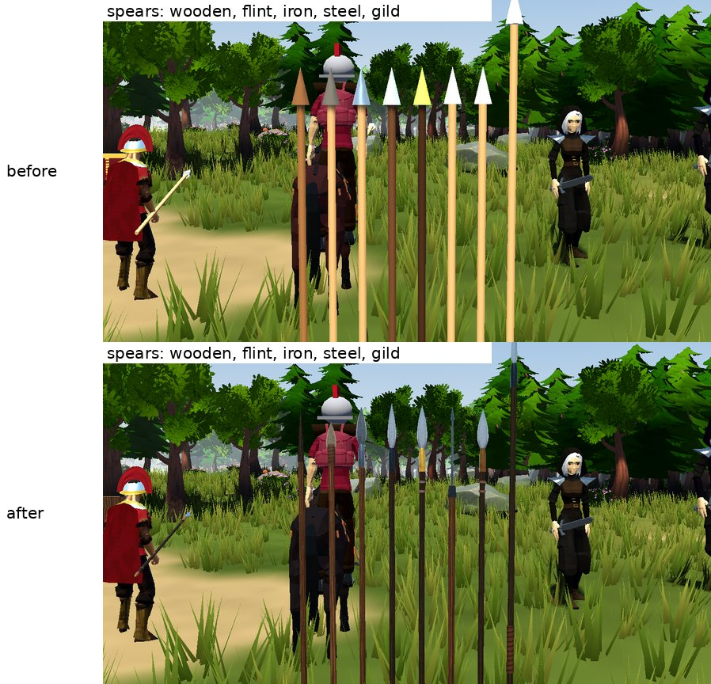
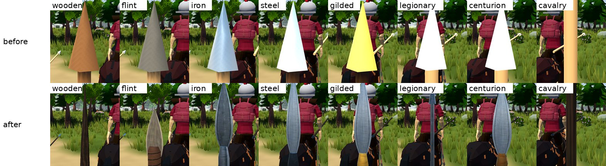
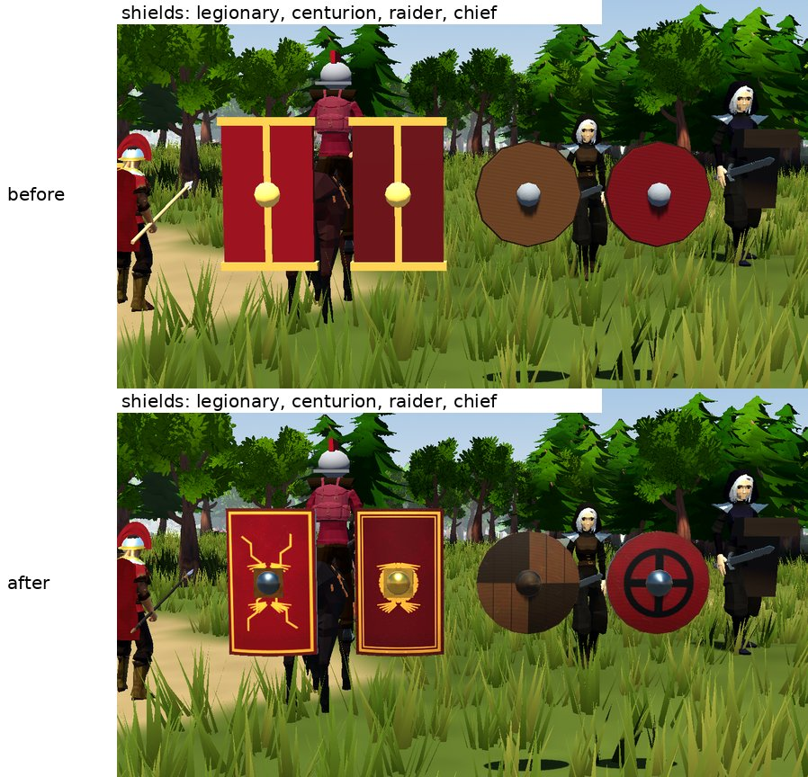
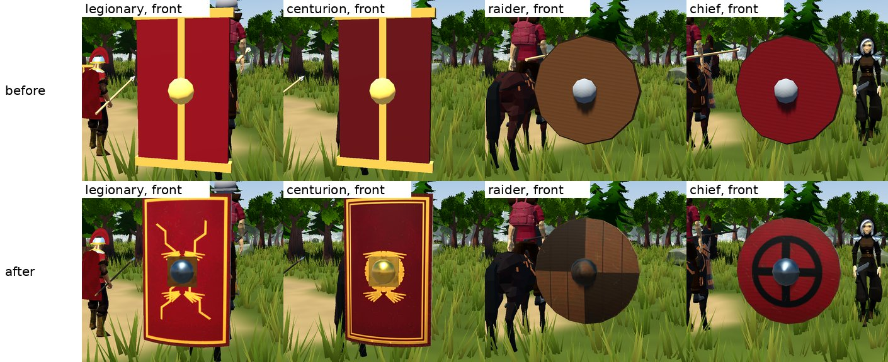
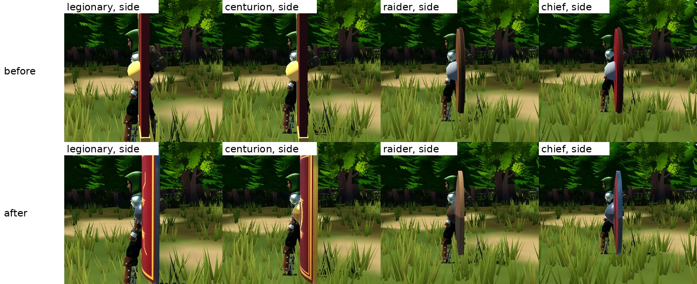
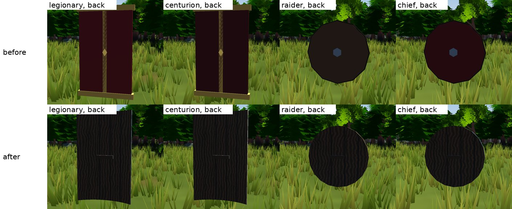
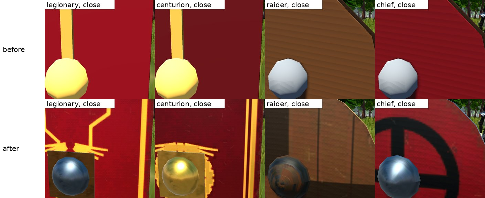
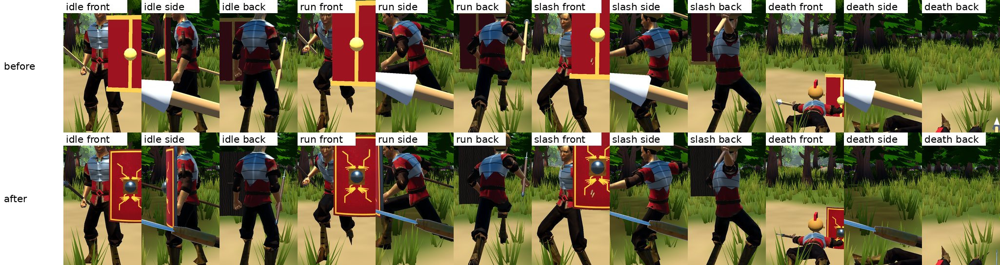
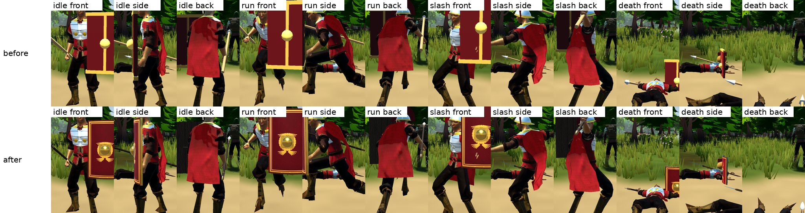
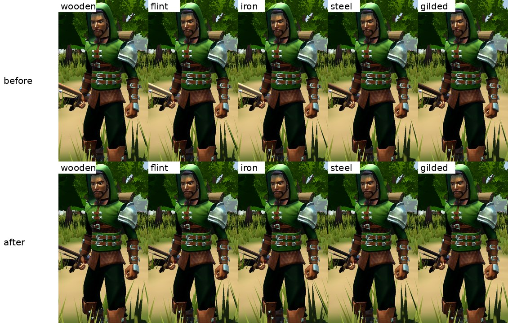
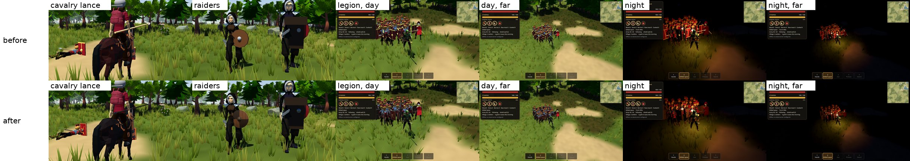

## 5. Performance

### Per item

| Item | Old: draws / triangles | New: draws / triangles | Material |
|---|---|---|---|
| Player spear (each tier) | 2 / 55 | **1** / 112–432 | swords' (flint: shields') |
| Soldier spear (pilum, hasta, lance) | 1 / 55 | 1 / 256, 432, 368 | swords' |
| Scutum (legionary, centurion) | **2** / 144 (the boss was a separate glowing mesh) | **1** / 534 | shields' |
| Round shield (raider, chief) | 1 / 224 | 1 / 440 | shields' |
| Textures | none | the shields' atlas, 2 × 175 KB on the GPU; the spears reuse the swords' atlas | |
| Download (`index.pck`) | 6,685,760 B | 7,113,248 B: **+427 KB** (+158 KB gzipped) | |

### Browser benchmark (software renderer)

**Setup:**

- **Runner:** `perf/run_web_bench.cjs`, with Chromium and **ANGLE on Mesa llvmpipe, a CPU software renderer** (WebGL 2, Godot Compatibility), 1280×720, fixed seed.
- **Builds:** the same web build, run with `?spears=0&shields=0` (old) and without (new).
- **Scenes:** both runs add `?legionbench=1&centurionbench=1`. One legionary, one centurion, and 10 and 30 of either come from those sections; the villages use the usual mixed army.
- **Results:** `perf/spears_shields/web-old.json`, `web-new.json`.

Each cell is old → new.

| Scene | Draw calls | Primitives | Mesh surfaces | Frame p50 (ms) | Frame p95 (ms) | Video memory (MB) | Texture memory (MB) |
|---|---|---|---|---|---|---|---|
| Empty area | 311 → 311 | 2.076 M → 2.086 M | 559 → 559 | 549 → 499 | 880 → 753 | 33.3 → 33.3 | 9.9 → 9.9 |
| **1 soldier (legionary)** | 308 → 305 | 2.094 M → 2.091 M | 564 → 563 | 500 → 502 | 531 → 584 | 33.9 → 34.2 | 10.1 → 10.4 |
| 1 centurion | 295 → 294 | 2.042 M → 2.043 M | 563 → 562 | 517 → 506 | 557 → 601 | 33.9 → 34.3 | 10.1 → 10.4 |
| **10 legionaries** | 347 → 337 | 2.139 M → 2.145 M | 609 → 599 | 539 → 548 | 565 → 628 | 34.9 → 35.2 | 10.1 → 10.5 |
| 10 centurions | 324 → 314 | 2.046 M → 2.054 M | 599 → 589 | 522 → 520 | 562 → 560 | 35.1 → 35.4 | 10.1 → 10.5 |
| **30 legionaries** | 444 → 414 | 2.243 M → 2.258 M | 709 → 679 | 542 → 590 | 638 → 668 | 37.3 → 37.5 | 10.3 → 10.6 |
| 30 centurions | 406 → 376 | 2.187 M → 2.210 M | 679 → 649 | 553 → 569 | 596 → 614 | 37.7 → 38 | 10.3 → 10.6 |
| Village | 561 → 561 | 1.981 M → 1.971 M | 712 → 712 | 545 → 532 | 648 → 628 | 41.5 → 41.5 | 10.3 → 10.3 |
| Village + 10 soldiers | 600 → 593 | 1.944 M → 1.948 M | 761 → 754 | 580 → 568 | 610 → 614 | 47.2 → 47.6 | 10.4 → 10.7 |
| **Village + 30 soldiers** | 695 → 673 | 2.098 M → 2.112 M | 859 → 838 | 681 → 643 | 755 → 804 | 52.9 → 53.3 | 10.6 → 10.9 |
| **Night village + 30 soldiers** | 787 → 766 | 2.637 M → 2.651 M | 861 → 840 | 729 → 748 | 760 → 838 | 52.9 → 53.3 | 10.6 → 10.9 |

**Reading the results:**

- **Draw calls go down:** one fewer for every legionary and centurion, because the scutum's boss is no longer a separate mesh. That is 30 fewer with 30 legionaries (444 → 414), and 21–22 fewer in the villages with 30 soldiers.
- **Primitives rise by under 1%:** at most +0.023 M, with 30 centurions.
- **Texture memory rises by about 0.3 MB:** the shields' atlas, loaded once soldiers or raiders appear. Video memory rises by the same amount.
- **Frame times are within the software renderer's noise.** They move by ±10% in both directions; the empty area, with no spears or shields in it, moved 549 → 499 ms on its own. Load time was 10.6 s → 9.3 s.
- **These are not GPU numbers.** llvmpipe frame times measure the CPU rasteriser. On a real GPU these changes (fewer draws, about 15k more triangles at 30 soldiers) are expected to be negligible, but that has not been measured here.

## 6. Known limitations

- **Small at gameplay distance.** At the normal camera a spearhead is a few pixels. The silhouettes (the pilum's shank, the leaf heads, the scutum's boss and painted design) read; the metal wear and wood grain are for close views.
- **The designs are painted procedurally.** The thunderbolts, wings and laurel are simple procedural shapes, not hand-painted art: the thunderbolts are angular and the wings stylised.
- **No normal map.** The bosses, edging, ridges and sockets are geometry, but the planks, binding and leather are painted, not embossed.
- **The shield backs are dark** under top lighting. The grips and brackets show only when a shield is seen from behind.
- **No blocking to show.** The game has no shield blocking or blocking animation, so there was none to test or preserve.
- **More triangles per item** (spears 112–432, shields 440–534). This is kept in proportion by the scutum's saved draw and by soldiers casting no shadows.

## 7. Files

| File | What |
|---|---|
| `game/tools/build_weapon_models.gd` | `TARGETS`; the shields' atlas and material; `_spear`, `_scutum`, `_round_shield`; `_lathe` takes a transform (bosses) |
| `game/models/weapons/` | new: `spear_pilum/officer/lance/wooden/flint/iron/steel/gilded.res`, `scutum.res`, `scutum_centurion.res`, `shield_raider.res`, `shield_chief.res`, `shields.tres`, `shields_colour.png`, `shields_orm.png` (+ `.import`). The swords' files are unchanged. |
| `game/scripts/soldier.gd` | modelled spears and shields for legionary, centurion and cavalry; `_kit_mesh` |
| `game/scripts/player.gd` | spear tiers as modelled spears |
| `game/scripts/raider.gd` | modelled round shields |
| `game/scripts/main.gd` | `?spears=0`, `?shields=0` |
| `game/tools/spear_shield_shots.gd` | new: the renders |
| `game/tools/smoke_test.gd` | the spear and shield checks |
| `game/models/CREDITS.md` | spears and shields: original work |
| `perf/spears_shields/` | renders and benchmark results |
