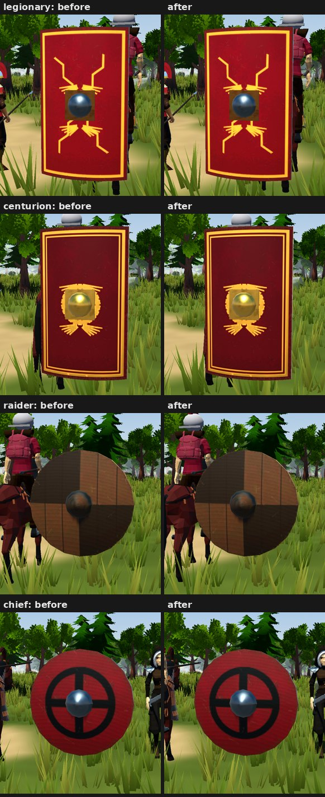
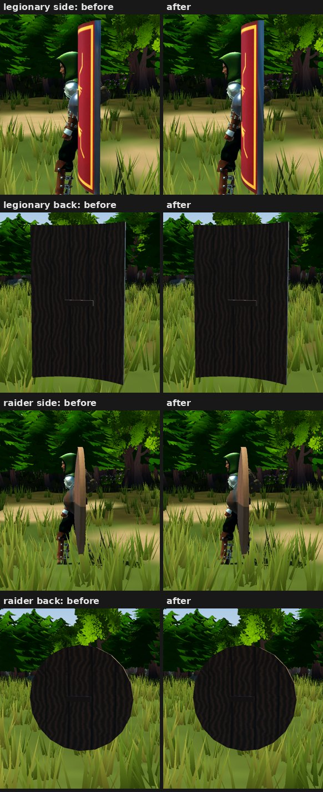
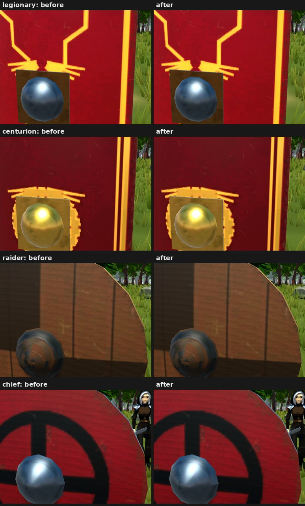
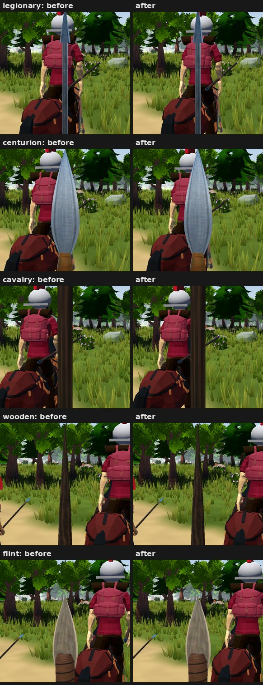
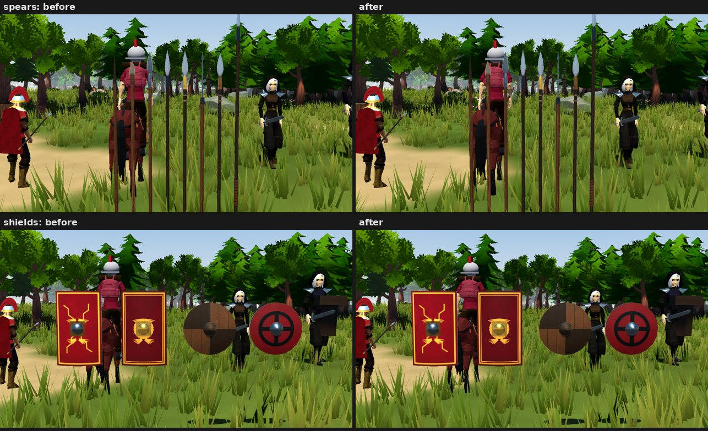
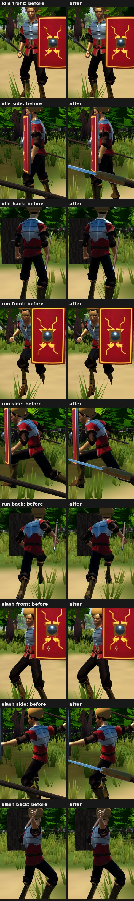
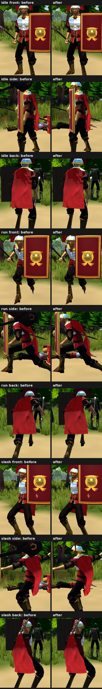
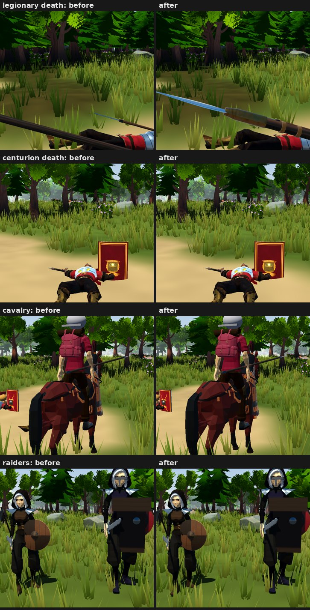
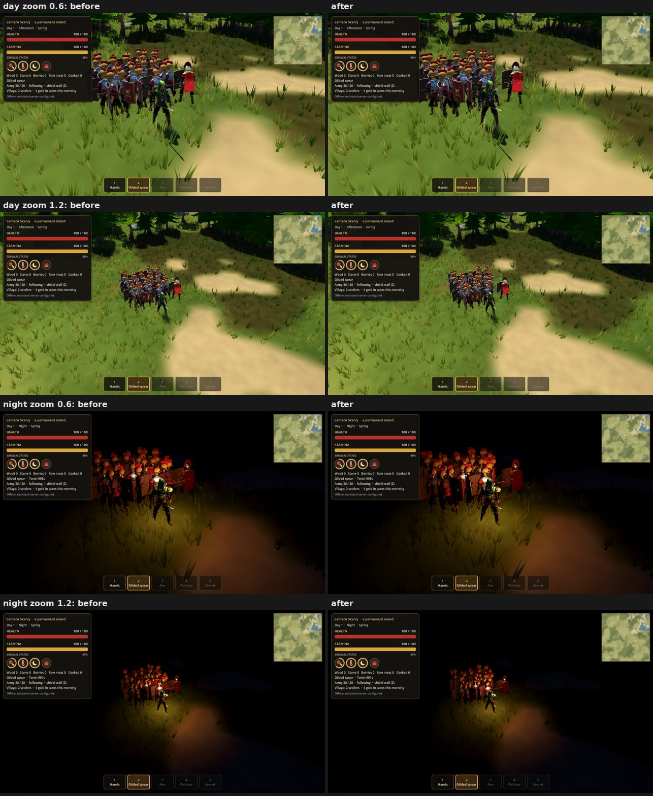

# Phase 4E.5: equipment optimisation and final polish

A final optimisation and quality pass over the upgraded weapons and shields. Two changes, both visual only:

1. **Soldiers' and raiders' kit is drawn in batches.** Each kind of piece (the pilum, the scutum, a legionary's helmet, a raider's axe and so on) is one MultiMesh, instead of one mesh instance per soldier per piece. A legion of 30 draws its 30 scuta in one call. Each piece is still the node that `soldier.gd` and `raider.gd` place on the body every frame; only its drawing is shared.
2. **Hidden and redundant geometry is removed** from the spears and shields: faces inside other parts, and the scutum's flat-direction subdivisions. Silhouettes and dimensions are unchanged.

**Results** (software renderer, see section 6):
- **30 legionaries:** 415 → **327** draw calls (−21%).
- **Village with 30 soldiers:** 675 → **605** (−10%).
- **Night village with 30 soldiers:** 766 → **697** (−9%).
- **Download:** −3.2 KB; texture and video memory unchanged.

**Unchanged:** attachment positions, animations, combat, damage, hit detection, AI, networking, saves, the Workers and Turso.

**Comparison:** `?kitbatch=0` draws each piece on its own. `?swords=0`, `?spears=0` and `?shields=0` still work, alone or together.

**Branch:** `claude/equipment-optimization`, cut from `main` at `1ef04d7` (4E.2 merged as #42). Not merged; no pull request.

## 1. Inspection

**Repository state.** `main` at `1ef04d7` includes phases 4E.1 (swords, #41) and 4E.2 (spears and shields, #42). **Phases 4E.3 (bows) and 4E.4 (materials) were never done**: there are no branches, reports or assets for them. Bows, arrows and quivers are still the old procedural parts and are not covered here beyond batching.

**What carries what, and how it was drawn.** Each piece of kit is a top-level node placed on a bone every frame, holding one mesh (`_kit_mesh`), or the old parts merged by `Art.bake` into a mesh shared by every soldier of that kind.

| Character | Kit pieces | Draws per character on `main` (kit only) |
|---|---|---|
| Legionary | helmet (baked), scutum, pilum | 3 |
| Centurion | officer's scutum, officer's spear (the helmet is in the body) | 2 |
| Cavalry | helmet (baked), lance | 2 |
| Archer | leather cap, bow (both baked) | 2 |
| Raider / raider chief | round shield, axe (+ helmet for a chief) | 2 / 3 |
| Player | sword or axe or spear (one mesh) | 1 |

On `main`, 30 legionaries cost about 3.4 draw calls each: the body plus **three kit pieces**. Kit was the largest part of a soldier's draw cost.

**Other findings:**
- **LOD:** none on kit. Kit meshes are saved straight from the builder, so Godot's import-time LODs don't apply. The soldiers' bodies have LODs.
- **Shadows:** soldiers' kit already casts none (phase 3D); raiders' kit does.
- **Earlier reports:** `GRAPHICS_DRAWCALL_OPTIMIZATION.md` (phase 3D: merged parts), `GRAPHICS_PHASE_4E1_SWORDS.md`, `GRAPHICS_PHASE_4E2_SPEARS_SHIELDS.md`.
- **Comparison options:** `?swords=0`, `?spears=0`, `?shields=0`, `?legionary=0`, `?centurion=0`, `?propgroup=0` and others, all read in `main.gd` the same way. `?kitbatch=0` follows that convention.

## 2. Texture and material inventory

Every modelled weapon and shield (`tools/equipment_inventory.gd` lists them):

| Material | Used by | Textures | GPU memory (S3TC/BPTC, mipmapped) |
|---|---|---|---|
| `weapons.tres` | swords, axes, 7 of 8 spears (12 meshes) | `weapons_colour.png` 256², `weapons_orm.png` 256² | 2 × 43.7 KB |
| `shields.tres` | 4 shields, flint spear (5 meshes) | `shields_colour.png` 512², `shields_orm.png` 512² | 2 × 174.8 KB |

- **Two materials, four textures, all shared.** Both materials are plain opaque StandardMaterial3D: per-pixel, no normal map, no transparency, no custom shader. Every mesh is one surface.
- **Old procedural pieces** (helmets, bows, the old-model kit behind the switches) use the shared vertex-colour materials from `Art.shared_material`, as before.
- **Duplicates:** none. Every equipment mesh already uses one of the two shared materials.
- **Unused assets:** none. Every file in `models/weapons/` is referenced; checked by search of scripts, scenes and resources. Nothing was deleted.

**Tried and rejected: halving the shields' ORM map** (512² → 256² by import setting; saves 131 KB of GPU memory). At half resolution, the 1-pixel padding between atlas regions becomes half a pixel. That bleeds the neighbouring region into the lathed bosses' seam, which showed as a visible line across every shield boss in close-ups. Reverted.

**Not done: merging the two atlases into one material.** It wouldn't save a draw call: each MultiMesh is one draw, whatever its material. It wouldn't save memory either, and it would mean re-mapping every UV.

## 3. Geometry optimisation

`tools/build_weapon_models.gd` gained two options:

- `_lathe(..., caps)` leaves out end caps that sit inside other parts.
- `_box(..., skip)` leaves out faces pressed against other parts.

Only the spears and shields were rebuilt (`TARGETS=spears,shields`).

| Item | Carried by | Triangles before → after | What was removed |
|---|---|---|---|
| **Scutum** | every legionary | **534 → 250** (−53%) | The board curves only across, so its 6 rows down the height (front, back and side edging) become 1; the outline and curvature are unchanged. Also: the boss's base inside the plate, the plate's back against the board, and the bracket faces against the board and grip. |
| **Officer's scutum** | centurion | **534 → 250** | the same |
| **Pilum** | every legionary | 256 → **220** | the shaft's end caps (inside the butt spike and collar), the shank's caps (inside the collar and point), the butt spike's buried base |
| Officer's spear / lance | centurion / cavalry | 432 → 416 / 368 → 352 | shaft caps inside the butt cap and socket |
| Round shields | raider, chief | 440 → **408** | the front's middle (under the boss), the boss's sunken base |
| Player spears (wooden, flint, iron, steel, gilded) | player | 112/224/336/336/432 → **88/216/320/320/416** | the same hidden caps |
| Swords, axes | player, raiders | unchanged | see below |

**Dimensions are identical:** every rebuilt mesh has the same bounding box (`perf/equipment_opt/inventory-*.txt`). The swords' and axes' files are byte-identical.

**Why the swords were left alone.** They are carried only by the player, so one of them is on screen at a time. The spatha's and gilded sword's fullered blades (about 640 of their 816 and 914 triangles) could lose some sections. That would save under 1k triangles once, in a scene drawing over 2 M, at a risk to the approved close-up look. Raiders' axes (152 triangles) have nothing hidden to remove.

## 4. Draw calls: batching the kit

New `scripts/kit_batcher.gd`, made by `main.gd` as the node `KitBatcher`:

- **Adoption.** When a soldier or raider is built, each kit piece's mesh instance is adopted by `KitBatcher.adopt(piece)`. It is grouped by mesh, material and shadow setting, then hidden.
- **Drawing.** Each group is one `MultiMeshInstance3D`, with the same mesh, material and shadow setting as the pieces.
- **Every frame.** After `main.gd` has moved the soldiers and raiders (`process_priority` 1000), the batcher writes each piece's current transform into its group's buffer. So the piece is drawn exactly where the old code placed it, the same frame.
- **What gets left out.** Pieces whose node isn't visible: soldiers hidden beyond `DRAW_DISTANCE`, and the dead.
- **Cleanup.** Freed pieces drop out. An empty group is freed, so its mesh and textures are released once nobody carries them.
- **Unchanged:** the kit nodes, their placement code, the body, the player's weapons and first-person view, Art.bake's shared meshes, shadows (soldiers' kit still casts none).
- **Comparison:** `?kitbatch=0` (or `--kitbatch=0`) turns batching off.

**Per army, kit draws:**

| | Legion of 30 (+ a centurion) | With batching |
|---|---|---|
| Helmets | 30 | 1 |
| Scuta | 30 + 1 | 1 + 1 |
| Spears | 30 + 1 | 1 + 1 |
| **Total** | **92** | **5** |

The benchmark's 30-legionary scene shows **88 fewer draw calls**.

**Trade-offs, measured and accepted:**
- **Culling is per batch,** not per piece. A batch is drawn when any of its pieces is on screen, so off-screen pieces of a visible army are still sent to the GPU. That costs a few hundred triangles each; primitives stayed within ±0.5% (section 6).
- **Lighting is per batch in the Compatibility renderer.** A batch is lit by the lights near the whole army, up to the per-object limit, rather than per piece. The night renders show the kit lit by the torches as before, but a very spread-out army near many lights could pick up slightly different light on its kit.

## 5. LOD and distance

**Not introduced.** The brief asks for LODs only where a benchmark shows a benefit, and none would:

- A legion of 30 now carries about 30 × (250 + 220 + ~150) ≈ 19k kit triangles. That is under 1% of the 2.1–2.6 M primitives drawn in every scene.
- Kit triangles stay below 1% of every scene even at the farthest zoom.
- Godot's automatic LODs need meshes to go through the importer, which these don't.
- The kit's cost was draw calls, which LOD doesn't reduce and batching did.

**At distance** (`legion-distances.jpg`, close and far zoom, day and night): the shield faces, bosses, spear shafts and heads read the same as before, with no popping (nothing switches), no shimmering and no missing kit.

## 6. Performance (browser, software renderer)

**Setup:**

- **Runner:** `perf/run_web_bench.cjs`, with Chromium and **ANGLE on Mesa llvmpipe, a CPU software renderer**: WebGL 2, Godot Compatibility, 1280×720, fixed seed, identical scenes and settings.
- **Original:** `main`'s web build with `?swords=0&spears=0&shields=0`. These are the pre-4E.1 weapons and shields, drawn as on `main` before 4E.1.
- **Upgraded:** `main`'s web build (4E.1 + 4E.2 as merged).
- **Optimized:** this branch.
- **URL:** all three runs add `?legionbench=1&centurionbench=1` (1, 10 and 30 legionaries or centurions).
- **Results:** `perf/equipment_opt/web-{original,upgraded,optimized}.json`.

Each cell is original → upgraded → optimized.

| Scene | Draw calls | Mesh surfaces | Primitives | Frame p50 (ms) | Frame p95 (ms) | Video memory (MB) | Texture memory (MB) |
|---|---|---|---|---|---|---|---|
| Empty area | 311 → 311 → 311 | 559 → 559 → 559 | 2.080 M → 2.078 M → 2.085 M | 537 → 512 → 547 | 795 → 761 → 820 | 33.2 → 33.3 → 33.3 | 9.8 → 9.9 → 9.9 |
| **1 legionary** | 307 → 305 → 306 | 564 → 563 → 563 | 2.092 M → 2.091 M → 2.092 M | 517 → 522 → 520 | 603 → 569 → 566 | 33.7 → 34.2 → 34.2 | 10 → 10.4 → 10.4 |
| 1 centurion | 295 → 294 → 294 | 563 → 562 → 562 | 2.046 M → 2.050 M → 2.047 M | 512 → 525 → 518 | 582 → 629 → 574 | 33.8 → 34.3 → 34.2 | 10 → 10.4 → 10.4 |
| **10 legionaries** | 347 → 337 → 310 | 609 → 599 → 572 | 2.139 M → 2.145 M → 2.142 M | 565 → 541 → 526 | 655 → 693 → 604 | 34.8 → 35.2 → 35.2 | 10 → 10.5 → 10.5 |
| 10 centurions | 325 → 315 → 297 | 599 → 589 → 571 | 2.049 M → 2.058 M → 2.053 M | 560 → 530 → 531 | 645 → 598 → 588 | 35 → 35.4 → 35.4 | 10 → 10.5 → 10.5 |
| **30 legionaries** | 444 → 415 → 327 | 709 → 679 → 592 | 2.243 M → 2.262 M → 2.251 M | 560 → 590 → 591 | 596 → 718 → 659 | 37.2 → 37.5 → 37.5 | 10.2 → 10.6 → 10.6 |
| 30 centurions | 405 → 375 → 318 | 679 → 649 → 591 | 2.183 M → 2.205 M → 2.199 M | 587 → 575 → 575 | 729 → 657 → 680 | 37.6 → 38 → 38 | 10.2 → 10.6 → 10.6 |
| Village | 561 → 562 → 561 | 712 → 712 → 712 | 1.981 M → 1.991 M → 1.986 M | 547 → 561 → 559 | 645 → 606 → 596 | 41.4 → 41.5 → 41.5 | 10.2 → 10.3 → 10.3 |
| Village + 10 soldiers | 601 → 594 → 576 | 761 → 754 → 737 | 1.945 M → 1.950 M → 1.946 M | 583 → 602 → 576 | 756 → 700 → 629 | 47.1 → 47.6 → 47.6 | 10.3 → 10.7 → 10.7 |
| **Village + 30 soldiers** | 696 → 675 → 605 | 859 → 838 → 769 | 2.098 M → 2.112 M → 2.105 M | 698 → 668 → 646 | 877 → 728 → 695 | 52.8 → 53.3 → 53.3 | 10.5 → 10.9 → 10.9 |
| **Night village + 30 soldiers** | 787 → 766 → 697 | 861 → 840 → 771 | 2.637 M → 2.651 M → 2.645 M | 760 → 772 → 724 | 897 → 826 → 755 | 52.8 → 53.3 → 53.3 | 10.5 → 10.9 → 10.9 |

**Reading it:**

- **Draw calls.** The upgrade (4E.2) already saved 1 per legionary or centurion, because the shield boss was merged into the scutum. Batching saves the rest of the kit:
  - 10 legionaries: 337 → 310;
  - 30 legionaries: 415 → 327;
  - village with 30 soldiers: 675 → 605;
  - night village with 30 soldiers: 766 → 697.

  Against the original equipment, 30 legionaries go 444 → 327 (−26%) and the night village 787 → 697 (−11%). Scenes without soldiers are unchanged.
- **Mesh surfaces** fall by the same amounts.
- **Primitives:** the trimmed geometry gives back about half of what 4E.2 added. With 30 legionaries: 2.262 M → 2.251 M, against 2.243 M originally.
- **Texture memory:** +0.4 MB against the original (the shields' atlas, from 4E.2), unchanged by this phase. The village without soldiers matches the upgrade (10.3 MB): empty batches release their textures.
- **Video memory:** unchanged by this phase.
- **Frame times** move within the software renderer's noise (±10%). The empty area, which has no kit at all, ranged 512–547 ms across the three runs.
  - The soldier scenes are the same or better with batching; p95 improves in most. Examples: village with 30 soldiers, 728 → 695 ms; night village, 826 → 755 ms.
  - Load time: 9.8 s → 10.0 s → 9.9 s.
- **These are not GPU numbers.** llvmpipe measures CPU rasterisation, which underplays draw-call overhead. On a real GPU in WebGL, each draw call costs CPU time in the browser and ANGLE, so 70–90 fewer per frame is a real saving. How much it saves in milliseconds has not been measured here; a real-GPU run is `?bench=1&perf=1&legionbench=1&centurionbench=1` in Chrome, with and without `&kitbatch=0`.

**Download:**

| | `index.pck` | gzipped |
|---|---|---|
| Original (before 4E.1, from the 4E.1 report) | 6,542,880 B | ≈ 5.50 MB |
| Upgraded (`main`) | 7,113,248 B | 5,761,862 B |
| **Optimized** | **7,110,000 B** (−3.2 KB) | **5,759,657 B** (−2.2 KB) |

The download is essentially unchanged: the meshes were already small, and the textures, which dominate, are untouched.

## 7. Visual quality control

**Renders:** `tools/spear_shield_shots.gd` on `main` and on this branch, native Godot with the Compatibility renderer (OpenGL 3), 1280×720. They are paired in the before/after sheets:

| Sheet | Shows |
|---|---|
| `shields-front.jpg`, `shields-side-back.jpg`, `shields-close.jpg` | each shield front, side and back, and the boss and paint close up |
| `spearheads.jpg`, `spears-shields-lineup.jpg` | every spear and shield |
| `carried-legionary.jpg`, `carried-centurion.jpg` | idle, run and attack, front, side and back, carried and batched |
| `carried-death-cavalry-raiders.jpg` | death poses, the cavalry lance, raiders' shields and axes |
| `legion-distances.jpg` | a centurion and 29 legionaries in a shield wall, close and far, day and night |

| Check | Result |
|---|---|
| Material quality, metal and wood | Unchanged: the same materials and textures |
| Missing textures, wrong UVs | None. The trimmed scutum keeps its UVs (one row of quads spans the same 0–1 range). |
| Floating equipment, clipping | None. Every piece is at the same place as before, the same frame (checked exactly by the smoke test). |
| Hand alignment | Unchanged: the same placement code |
| Animations | Unchanged; kit follows idle, run, attack and death as before |
| Distances | Same look close and far, day and night; no popping (no LOD) |
| Raiders, cavalry, archers | Batched the same way. Archers' bows are the old procedural parts, since 4E.3 was not done. |

**Differences between before and after shots** are only other characters' poses: the raiders wander, and the side shots catch neighbouring soldiers at different moments.

## 8. Regression testing

**Smoke test** (`tools/smoke_test.gd`, the CI gate): **passes in every combination tried, with 319 checks each.**

- Default;
- `--kitbatch=0`;
- `--spears=0`;
- `--shields=0`;
- `--spears=0 --shields=0`;
- `--swords=0`;
- `--swords=0 --spears=0 --shields=0 --kitbatch=0`.

**New checks:**

- the legion's shields are one batch, each instance at its own soldier's shield;
- a hidden or a dead soldier's kit is left out;
- while the army moves, every batched piece of every kind is drawn exactly at its own piece's transform, the same frame;
- with `--kitbatch=0`, each piece is drawn on its own.

| Requirement | How it is verified |
|---|---|
| Weapon and shield attachment unchanged | The placement code is untouched. The smoke test compares every drawn instance with its piece's transform. |
| Animations unchanged | No animation or body code touched |
| Combat, damage, hit detection unchanged | No gameplay code touched. The smoke test checks sword damage (6/10/15), spear damage (2/3/5/8/12) and reach (34, legionary 26), plus the existing combat checks. |
| Blocking | The game has no blocking system (found in 4E.2) |
| Multiplayer | No networking code touched. Kit is drawn locally from the same nodes. |
| Save and load | No save code touched; the smoke test's save and reload checks pass |
| URL comparison options | All of them, alone and together (above) |
| No unrelated NPC or environment changes | Only `soldier.gd` and `raider.gd` gained one line each, to adopt their kit. Wolves, settlers, horses, buildings and the world are untouched. |

## 9. Known limitations

- **Culling and lighting are per batch,** not per piece (section 4). That is measured to be harmless here, but a very spread-out army could draw some off-screen kit, and pick slightly different light on its kit near many torches.
- **Kit no one shares gets its own batch.** Pieces whose mesh is unique to one soldier (the old shield's glowing boss behind `?shields=0`) form single-instance batches. That is the same draw count as before, with no gain.
- **4E.3 and 4E.4 were not done,** so bows, arrows and quivers are still the old procedural parts. There is no materials pass beyond 4E.1 and 4E.2's atlases.
- **No real-GPU measurement.** The frame-time effect of about 70–90 fewer draw calls is unmeasured on hardware.
- **The shields' 512² atlas** (0.35 MB on the GPU) stays at full size, because halving the ORM map showed seams.

## 10. Recommendations

1. **Measure on a real GPU** in Chrome, with and without `&kitbatch=0`, to put a number on the draw-call saving.
2. If bows are upgraded (4E.3), give them **one mesh each, on one of the two existing materials**. They are batched automatically.
3. **Keep new kit on `weapons.tres` or `shields.tres`.** A third material would add nothing a batch needs, and more texture memory.
4. The next draw-call win for soldiers would be the **centurion's and cavalry's helmets and the horse**, which are per-soldier meshes. That is outside this phase.
5. Once reviewed, `?kitbatch=0` can stay as a developer switch, like `?propgroup=0`.

## 11. Files

| File | What |
|---|---|
| `game/scripts/kit_batcher.gd` | new: draws kit pieces in batches |
| `game/scripts/main.gd` | makes the `KitBatcher`; reads `?kitbatch=0` |
| `game/scripts/soldier.gd`, `game/scripts/raider.gd` | adopt their kit pieces into the batches (one line each) |
| `game/tools/build_weapon_models.gd` | `_lathe` caps and `_box` skip; hidden geometry removed from spears and shields |
| `game/models/weapons/spear_*.res`, `scutum*.res`, `shield_*.res` | rebuilt (swords and axes unchanged) |
| `game/tools/equipment_inventory.gd` | new: lists every weapon and shield's mesh, triangles, material and textures |
| `game/tools/smoke_test.gd` | batching checks |
| `game/tools/spear_shield_shots.gd`, `game/tools/weapon_shots.gd` | copies of batched pieces made visible for close-ups |
| `perf/equipment_opt/` | before/after sheets, inventories, benchmark results |
