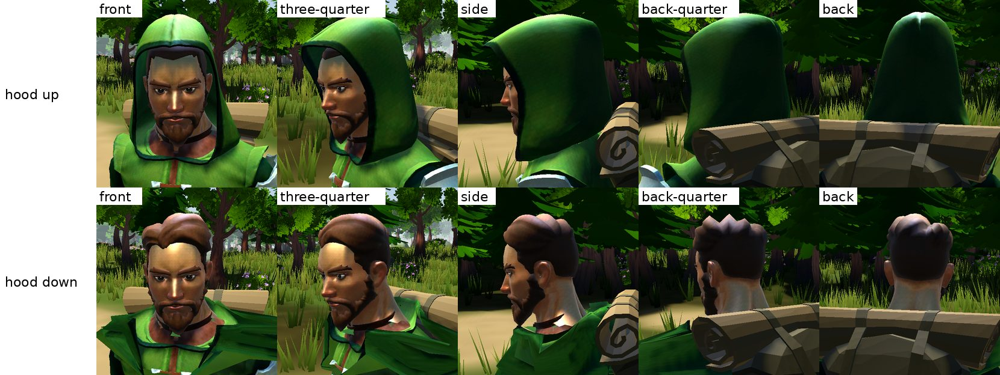
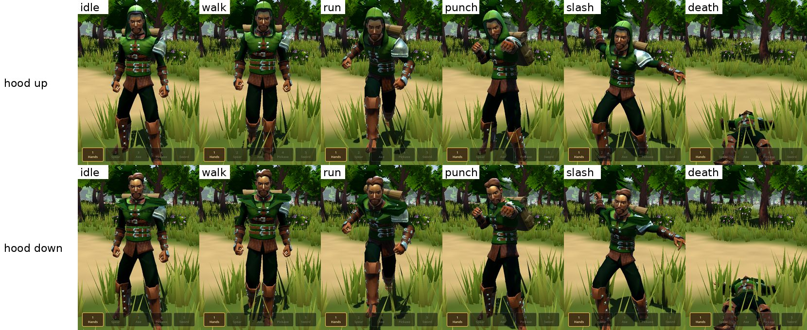
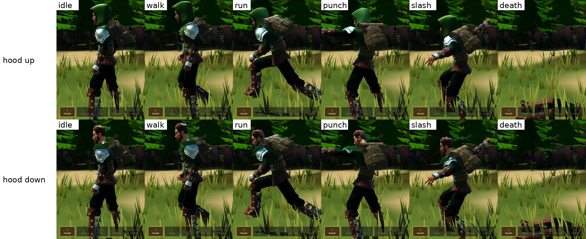
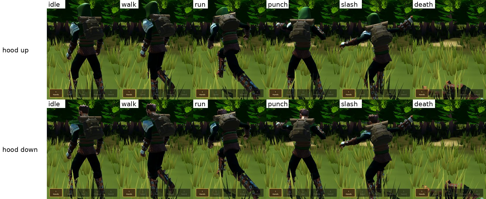
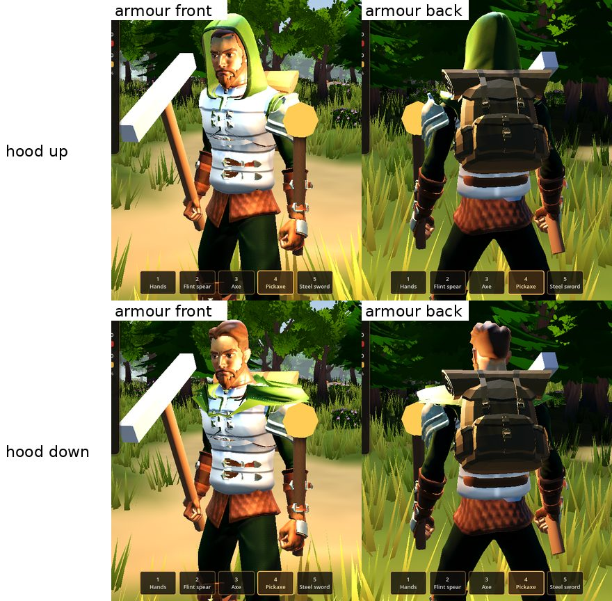
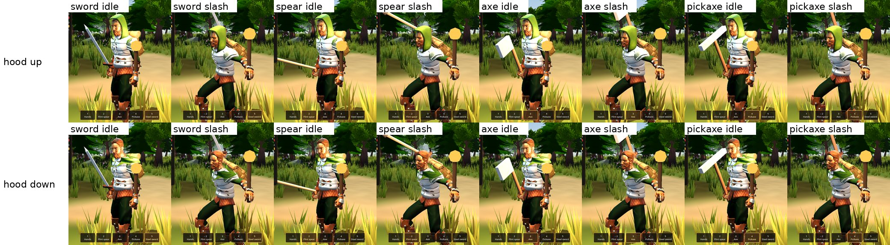
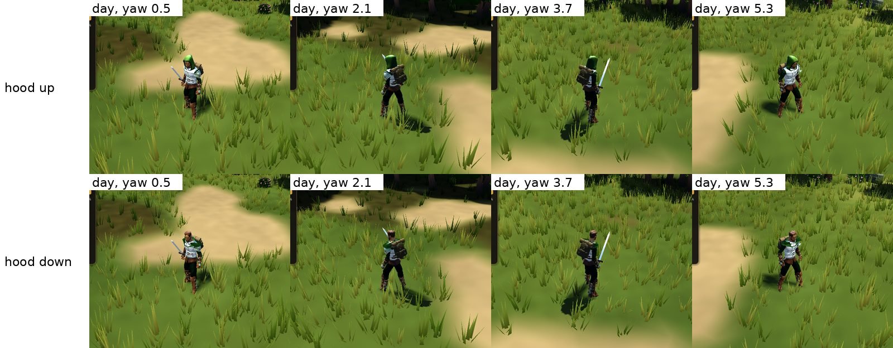
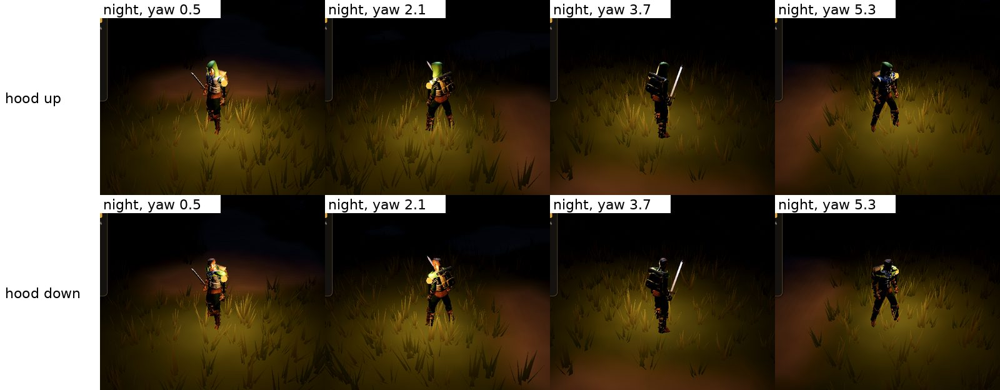
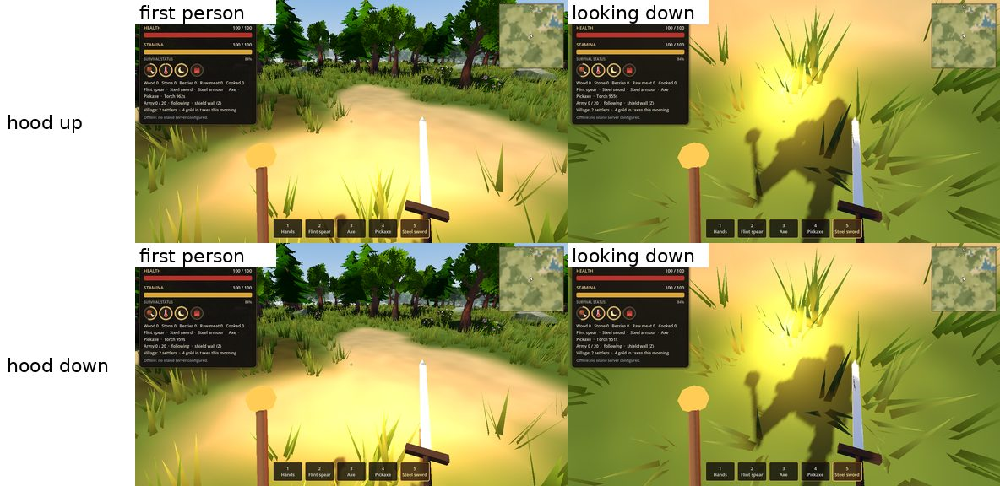

# Phase 4C: hood up and hood down

The ranger player now has two hood looks, switchable at any time at no cost:

1. **Hood up.** The kit's hood, as before, now with cropped hair under it, so there's no bare scalp at the brow.
2. **Hood down.** The same hood folded down off the head onto the shoulders and back, with the kit's parted hair.

The approved armour, the clothing, the body, the backpack and the materials are unchanged. A fingerprint of every vertex of those parts is identical before and after (see [Armour unchanged](#armour-unchanged)). The model is still **one mesh, one surface, one material**, with no new textures. Gameplay, combat, movement, networking, the backend and saves are untouched.

## What the kit offers

The ranger comes from Quaternius's **Modular Character Outfits – Fantasy** (free Standard edition, CC0). I inspected the whole kit:

- **Hood.** The only hood is `Male_Ranger_Head_Hood` (with a female version): hood **up**. There is **no hood-down mesh or variant** among its parts, which are the Peasant and Ranger arms, body, feet, legs, the pauldron and the hood. The kit's readme says the Standard edition "only contains a portion of the models", and the rest is in the paid Source edition, which wasn't used.
- **Hair.** The **Universal Base Characters** kit (CC0, already used for the head) has hairstyles rigged to the same head bone. Among them are `Hair_SimpleParted` (already used) and `Hair_Buzzed`, a close crop. Both use the hair material already in the atlas.

So, as the brief asks, **the existing hood was adapted rather than new geometry made.**

## How it works

The hood mesh (2,136 triangles) has two parts: the hood over the head (1,514 triangles, mostly weighted to the head bone) and the cowl on the shoulders (622). They meet at a neckline of 74 vertices. All of it is merged into the player's one skinned surface by `tools/build_player_model.gd`.

**Hood up** (part 2 in `character_atlas.gdshader`):
- the hood over the head, exactly as before;
- `Hair_Buzzed` (830 triangles), a close crop that stays inside the hood. Before, the base head's bald scalp showed shiny and grey at the brow.

**Hood down** (part 3):
- **Fold.** A folded copy of the same 1,514 hood triangles. At each point around the neck, the fabric above the neckline turns outward and down over a horizontal axis along the neckline, the way a hood falls when pushed back:
  - **Lining.** The lining comes to the outside, as it does on a real lowered hood.
  - **Length.** It hangs 70% of the hood's height at the back, where the hood is deepest, and 22% at the sides.
  - **Joint.** The neckline stays exactly where it was, so the fold stays joined to the cowl with no gap.
- **Clearance.** Every folded vertex is kept outside the clothes, plus the armour's 1.4 cm offset and a 6 mm margin, so it lies over the armour and never through it.
- **Skinning.** Folded vertices take the skin weights of the neckline point they hang from, with the head's share moved to the upper spine. The drape moves with the shoulders and chest, not with the head.
- **Hair.** `Hair_SimpleParted` (1,301 triangles), as before.

**Switching.** The two sets are switched by the `hood_up` instance uniform, as in the refinement. The hidden set's vertices collapse to a point in the vertex shader, so switching costs nothing: no new material, texture, surface or draw call.

**What changed from the previous hood down.** The approved model's hood down simply removed the hood over the head and left the cowl's cut edge. That read as a ragged collar rather than a lowered hood. The fold replaces it.

## Comparing the two (developers)

| How | What |
|---|---|
| `?devlook=1` (or `-- --devlook=1`) | **F8 switches the hood up and down while playing**, with a toast saying which. Off unless the flag is given, so players never see it. |
| `?hood=down` (or `-- --hood=down`) | starts with the hood down (from the refinement) |
| `tools/hood_shots.gd` | renders every comparison shot below as `<shot>-up.png` / `<shot>-down.png` |
| `tools/model_parts_hash.gd` | fingerprints each part of the model, to prove what a rebuild changed |

The look still isn't saved, because that would change the save format.

## Testing

All renders come from `tools/hood_shots.gd`: native Godot 4.4.1, Compatibility renderer, 1280×720, the same seed and spot.

| Test | Result |
|---|---|
| **Clipping**: head, face and hair, all round (`head-closeups.jpg`) | Hood up: the crop stays inside the hood and nothing of the head shows through it. Hood down: the drape stays below the jaw and clear of the hair, the face is unobstructed, and the neck shows above the cowl. |
| **Third person**: idle, walk, run, punch, slash, death, from the front, side, back and three-quarter back (`animations-*.jpg`) | Both hoods follow every animation. The drape moves with the shoulders, and the head turns freely inside it. |
| **Camera rotation**: the game camera at four angles, by day and at night with the torch (`camera-day.jpg`, `camera-night.jpg`) | Both read clearly at play distance. Hood down shows the hair and a green collar on the shoulders. |
| **First person**: looking ahead and down (`first-person.jpg`) | The body is shadow-only in first person, as before. The hood is in the shadow, up or down; there is nothing to clip into the view. |
| **Armour**: the approved shell, steel (`armour.jpg`) | The drape lies over the shell's shoulders and never through it. The armour itself is unchanged. |
| **Equipment**: sword, spear, axe and pickaxe, idle and mid-swing, with the torch (`equipment.jpg`) | No interference. The tools hang from the hands, and the hood is not near them. |
| **Backpack** | With the hood down the back of the drape is under the pack, as fabric under a pack's straps would be. With the pack off (`?backpack=0`) it shows on the back. Backpack work is not part of this task. |
| **Smoke test** (CI gate) | Passes. New check: both hood sets are in the one surface, and the F8 switch is off by default. |

## Armour unchanged

`tools/model_parts_hash.gd` hashes every vertex of each part: position, normal, both UVs, bone names and weights. The model on `main` (approved) and on this branch:

| Part | Approved | This branch |
|---|---|---|
| 0 Clothing | 17,430 tris, `cb9556e9…` | **identical** |
| 1 Skin | 4,732 tris, `e70aed2b…` | **identical** |
| 2 Hood up | 1,514 tris, `16920a35…` | 2,344 tris (+ cropped hair), `61cd5f89…` |
| 3 Hood down | 1,301 tris, `d68fbf7e…` | 2,815 tris (+ folded hood), `b2b559e0…` |
| 4 **Armour** | 2,115 tris, `720d3c0b…` | **identical** |
| 5 Backpack | 1,748 tris, `814a0e23…` | **identical** |

The atlas textures (`player_colour.png`, `player_normal.png`, `player_orm.png`, `player_outfit_earth.png`) are byte-identical, and the shader changed in comments only.

## Performance

**Model:**

| | Approved | Hood work | Change |
|---|---|---|---|
| Meshes / surfaces / materials / textures | 1 / 1 / 1 / 4 | 1 / 1 / 1 / 4 | none |
| Triangles drawn, hood up | 25,424 | 26,254 | +830 (cropped hair) |
| Triangles drawn, hood down | 25,211 | 26,725 | +1,514 (the folded hood) |
| Triangles in the buffer (all parts) | 28,840 | 31,184 | +2,344 |
| Vertices (all skinned every frame) | 26,554 | 27,934 | +1,380 (+5%) |
| `ranger.scn` | 1.07 MB | 1.13 MB | +55 KB |
| Export (`index.pck`) | 5,574,496 B | 5,630,320 B | +55.8 KB (+53.8 KB gzipped) |

**Browser benchmark.** The approved build (`main`) against this branch with the hood up and with the hood down (`?hood=down`):

- runner: `perf/run_web_bench.cjs`;
- browser: Chromium with ANGLE on Mesa llvmpipe;
- resolution: 1280×720;
- seed: fixed;
- results: `perf/hood/web-approved.json`, `web-hood-up.json` and `web-hood-down.json`.

Each cell is approved / hood up / hood down.

| Scene | Draw calls | Primitives | Mesh surfaces | Frame p50 (ms) | Frame p95 (ms) | Video memory (MB) |
|---|---|---|---|---|---|---|
| Empty area | 311 / 311 / 311 | 2.077 M / 2.085 M / 2.080 M | 559 / 559 / 559 | 481 / 495 / 505 | 702 / 736 / 760 | 33.1 / 33.2 / 33.2 |
| Forest | 321 / 321 / 330 | 2.376 M / 2.377 M / 2.408 M | 555 / 555 / 555 | 667 / 667 / 661 | 964 / 997 / 1152 | 32.9 / 33.1 / 33.1 |
| Village | 571 / 570 / 571 | 1.994 M / 1.999 M / 2.000 M | 714 / 714 / 714 | 516 / 517 / 526 | 593 / 565 / 593 | 41.1 / 41.2 / 41.2 |
| Village + 10 soldiers | 609 / 609 / 609 | 1.976 M / 1.979 M / 1.979 M | 765 / 765 / 765 | 557 / 562 / 527 | 616 / 604 / 576 | 51.8 / 51.9 / 51.9 |
| **Village + 30 soldiers** | 706 / 706 / 706 | 2.195 M / 2.197 M / 2.197 M | 867 / 867 / 867 | 647 / 604 / 652 | 702 / 708 / 714 | 63.8 / 64 / 64 |
| Night village + 30 soldiers | 794 / 794 / 794 | 2.709 M / 2.712 M / 2.712 M | 869 / 869 / 869 | 730 / 740 / 677 | 753 / 769 / 744 | 63.8 / 64 / 64 |
| Area transitions | 308 / 313 / 310 | 1.611 M / 1.649 M / 1.626 M | 525 / 546 / 546 | 695 / 644 / 658 | 784 / 772 / 747 | 44.8 / 45 / 45 |

| | Approved | Hood up | Hood down |
|---|---|---|---|
| Texture memory | 9.8–10.5 MB | same | same |
| Load to first frame | 10.5 s | 9.3 s | 9.3 s |

How to read this:

- **Draw calls, surfaces and texture memory.** In the scenes the hood can affect, these are the same in all three runs. The player is one draw however its hood is worn.
- **Two scenes that vary by themselves.** The forest (+9 draw calls with the hood down) and the area transitions (more surfaces in both new runs) stream in props and grass as the camera moves. Their counts differ between runs of the same build, as in earlier phases. The player can't add draw calls or surfaces.
- **Primitives.** In the steady scenes, primitives rise by 2,000–8,000 (at most 0.4%): the extra hood triangles in each pass that draws the player (colour, shadows). The forest and area transitions vary more, with the streaming.
- **Video memory.** It rises by 0.1–0.2 MB, the larger vertex buffer.
- **Frame times.** These move both ways within the software renderer's run-to-run noise, with no trend.

The headless benchmark has no real GPU, so the counts are the figures to trust. Real-GPU frame times are still to be measured (phase 4A validation, skipped).

## Licensing

Every asset used is **CC0 1.0** (public domain), by Quaternius, from kits already used and credited. The kit licence files were checked again: the Outfits kit's `License_Standard.txt` states CC0 1.0 Universal. Nothing new was downloaded; `Hair_Buzzed` comes from the Universal Base Characters archive already in use.

| Asset | Kit | Licence | Used for |
|---|---|---|---|
| `Male_Ranger_Head_Hood` (in `Male_Ranger.gltf`) | Modular Character Outfits – Fantasy (Standard) | CC0 1.0 | hood up as made; folded for hood down |
| `Hair_Buzzed.gltf` | Universal Base Characters | CC0 1.0 | cropped hair under the hood (new) |
| `Hair_SimpleParted.gltf` | Universal Base Characters | CC0 1.0 | hair with the hood down (as before) |

These are recorded in `game/models/CREDITS.md`.

## Files

| File | Change |
|---|---|
| `game/tools/build_player_model.gd` | `_add_lowered_hood()` (the fold, clearance from the clothes and armour, skin weights from the neckline), `_outfit_profile()`; `Hair_Buzzed` added to the hood-up set |
| `game/models/player/ranger.scn` | rebuilt; the textures are unchanged |
| `game/scripts/main.gd` | `?devlook=1` and the F8 hood switch (developers only) |
| `game/tools/hood_shots.gd` | new: the hood comparison renders |
| `game/tools/model_parts_hash.gd` | new: per-part fingerprints |
| `game/tools/smoke_test.gd` | the hood check |
| `game/shaders/character_atlas.gdshader` | comments only (what parts 2 and 3 hold) |
| `game/models/CREDITS.md` | `Hair_Buzzed`, and the hood's new use |
| `perf/hood/` | renders and benchmark results |

## Known issues

- **Not a modelled lowered hood.** It's the hood folded by the build tool. It reads well at play distance and in the close-ups, but the fold is even all round and has no cloth folds or sag.
- **Lining in the hood's colour.** The fold shows the hood's lining, which the texture paints the same green as the outside.
- **Under the backpack.** With the pack on, the back of the drape is under it and only the shoulders and sides show. That is natural, but from straight behind hood down mostly reads as hair and pack.
- **Drape at LOD distance.** Godot's automatic LOD (used at a distance) simplifies the whole surface at once. The full-detail armour is identical, but its far LOD triangles may differ slightly from the approved build because the simplifier now sees more geometry.
- **Cost.** Hood down draws 1,514 more triangles than the approved hood down, and both hood sets are skinned every frame whichever is shown.
- **Hood up still has the hood's own shape.** Hood up is the kit's own model, now with hair. If the brow should sit lower, that needs the hood itself edited, which wasn't done to keep hood up as approved.
- **Proper lowered-hood mesh.** If one is wanted, the paid Source edition of the outfits kit may have one; it was not bought or checked.
