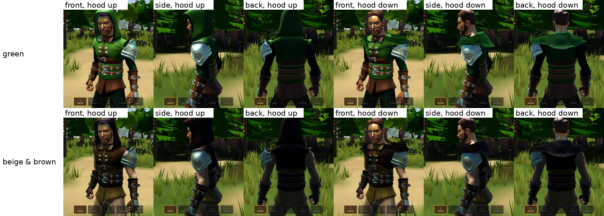
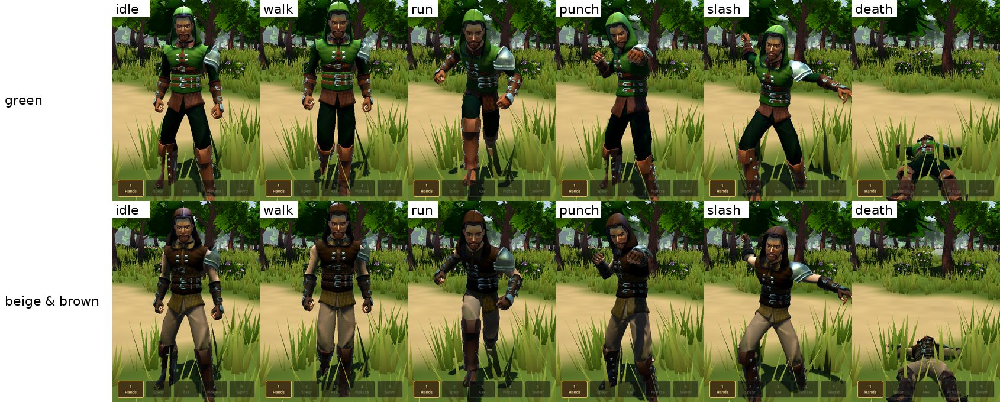
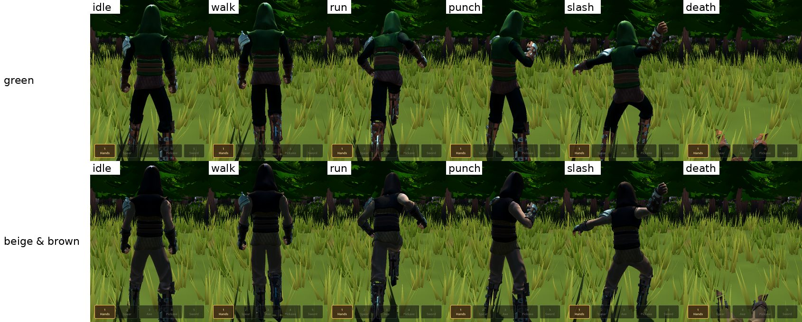
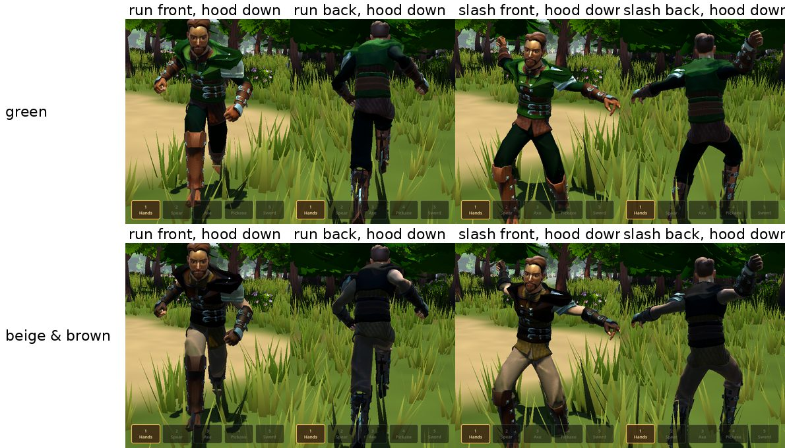
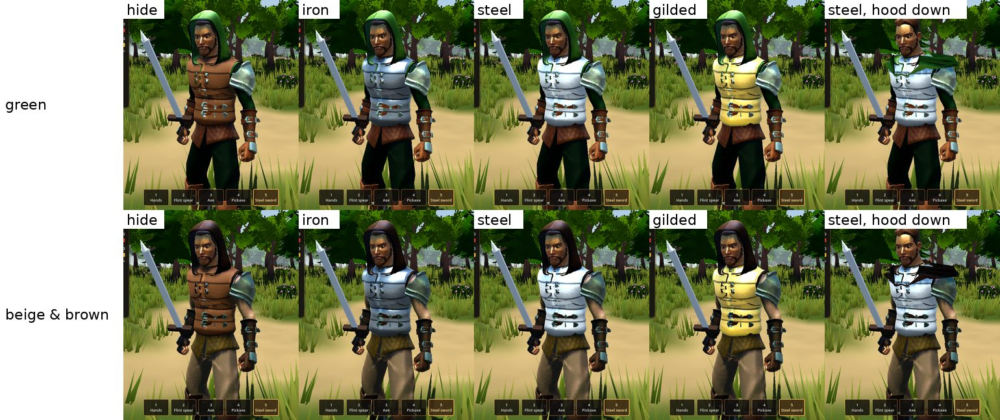
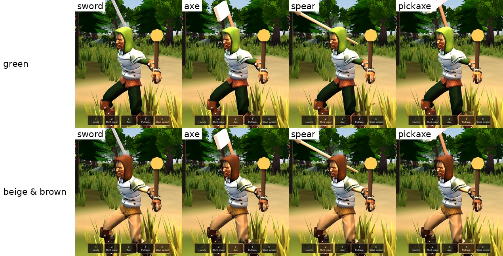
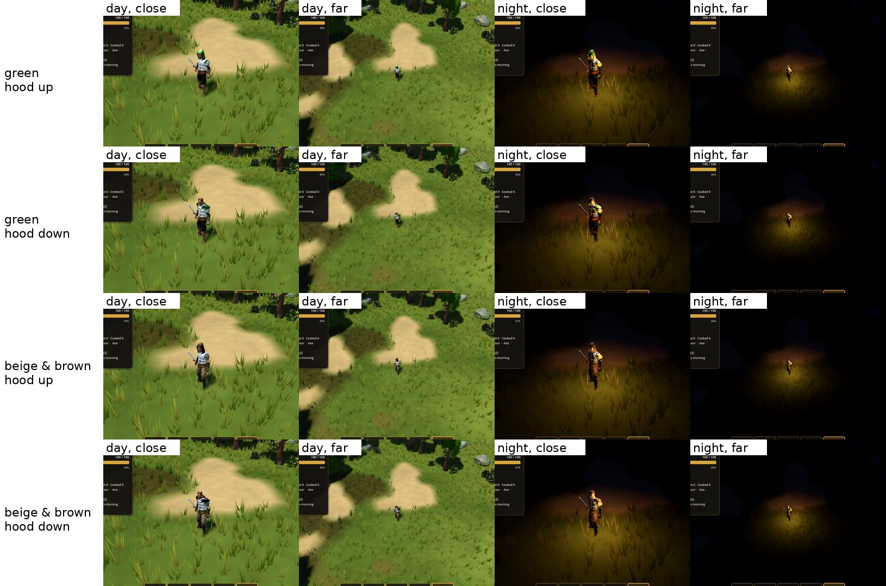
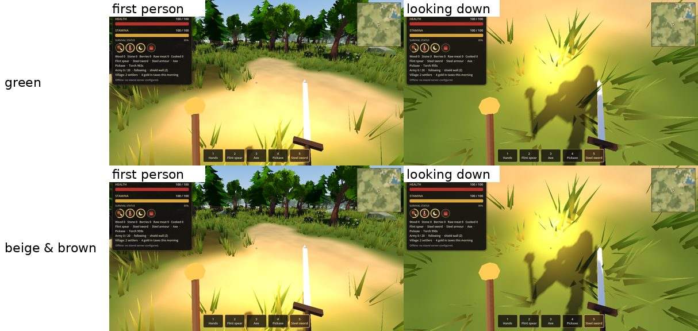

# Phase 4C: outfit variations

The ranger player can wear the ranger kit's two colourways of the same clothes:

1. **Green** (`ranger`, the original and the default): green tunic and hood, dark trousers, red-brown leathers.
2. **Beige and brown** (`earth`): dark-brown leather tunic and hood, beige linen trousers and sleeves, brown leathers.

It is a **material variant**: the same geometry, the same single surface and material, and one extra texture holding only the clothing.

Unchanged, as instructed:
- **Approved work:** the armour, both hood options, the ranger model and its textures.
- **Systems:** gameplay, networking, backend and saves.
- **Backpack:** left alone. It is hidden in every render and benchmark here.
- **Model files:** `ranger.scn` and all textures are byte-identical to `main`. Only the shader, the appearance script and the developer switch changed.

## What the kit offers

The ranger outfit is from Quaternius's **Modular Character Outfits – Fantasy** (free Standard edition):

| File | What |
|---|---|
| `Textures/Ranger/T_Ranger_BaseColor.png` (4096²) | the green colourway (already in the atlas) |
| `Textures/Ranger/T_Ranger_3_BaseColor.png` (4096²) | **the beige and brown colourway** |
| `T_Ranger_Normal.png`, `T_Ranger_ORM.png` | one normal map and one roughness/metal map, **shared by both colourways** |

There is no other ranger colourway and no second normal or roughness map. `T_Ranger_3` uses **the same UV layout** as the green texture. So the two colourways differ only in colour, which makes the beige and brown version a pure **base-colour (material) variant**.

**Why a whole texture.** I compared the two at the size used in game (512²): **99.8% of texels differ**, including the metal parts, which are repainted too (some trims and pieces in gold-yellow). It is a full repaint, not a tint of some areas, so it needs a full clothing texture. Storing only a "difference" or a mask would save nothing, and recolouring the green texture in the shader can't reproduce it.

## Implementation

The character's textures form one atlas (`player_colour.png`, 1024×512). Its left half (UV x < 0.5) is the outfit, and its right half holds the skin (face, hands), hair, beard and eyes.

- **The beige and brown texture covers the clothing half only.** `player_outfit_earth.png` is 512×512: `T_Ranger_3_BaseColor` at the same resolution as the green clothing in the atlas.
  - Skin, hair and eyes stay in the shared atlas. They are **not duplicated** and never change with the outfit.
  - It was already built by `tools/build_player_model.gd` in the refinement (#35) and is unchanged.
- **The shader.** `character_atlas.gdshader` chooses per character with the `outfit` instance uniform (0 green, 1 beige and brown):
  - Where UV x < 0.5 it reads the outfit texture; everywhere else it reads the atlas.
  - The normal and roughness/metal maps are shared, as in the kit.
  - **Change in this task:** the second texture is now read **only by characters wearing the beige and brown outfit**. Before, every pixel of the character sampled both outfit textures. The `outfit` value is the same over the whole character, so the branch is uniform and mipmaps stay correct.
  - For both outfits the result is exactly what it was. The green path is now just the atlas read it always used.
- **Material separation:**
  - **Skin:** the face and hands are their own atlas region and part (with the skin-tone gain), so they're never recoloured.
  - **Clothing:** the tunic, hood (up, and folded down), cowl, sleeves, trousers, boots, belts, bracers and pauldron switch together, as the kit paints them.
  - **Armour:** the approved shell draws its own plate colours over whatever is under it, so it looks identical over both outfits.
  - **Equipment:** the tools, torch and lantern are separate models with their own materials, so they're unaffected.
- **No new draw calls, surfaces, materials or meshes.** Characters in different outfits share one mesh and one material. Selection is per character, ready for the soldiers later.

### Choosing an outfit

| How | What |
|---|---|
| `?outfit=earth` (or `beige`), `?outfit=ranger` (or `green`) | start in that outfit; `-- --outfit=…` on the command line |
| `?devlook=1`, then **F9** | **developers:** cycles the outfit while playing, with a toast saying which. F8 still switches the hood. Off unless the flag is given. |
| `tools/outfit_shots.gd` | renders every comparison below, as `<shot>-ranger…png` / `<shot>-earth…png` |
| In code | `Player.appearance["outfit"]`, applied with `character_appearance.gd`'s `apply()` |

The outfit isn't saved, because that would change the save format.

## Testing

The renders come from `tools/outfit_shots.gd`: native Godot 4.4.1, Compatibility renderer, 1280×720, fixed seed and spot, backpack hidden.

| Test | Result |
|---|---|
| **Close-ups**, front, side and back, hood up and hood down (`closeups.jpg`) | Only the clothes change; skin, hair, beard and eyes are identical. The folded hood-down takes the outfit's colour (brown) like the rest of the hood. |
| **Animations**: idle, walk, run, punch, slash, death, front and back (`animations-front.jpg`, `animations-back.jpg`) | Same geometry and skinning, so both outfits animate identically. |
| **Both hoods in motion**: run and slash, hood down (`animations-hood-down.jpg`) | Both hood options work in both outfits. |
| **Armour**: hide, iron, steel, gilded, plus steel with the hood down (`armour.jpg`) | The approved armour looks identical over both outfits. |
| **Equipment**: sword, axe, spear and pickaxe mid-swing, torch lit (`equipment.jpg`) | No change; equipment has its own materials. |
| **Day and night**: the game camera close and far, both hoods (`day-night.jpg`) | Both outfits read clearly. The beige and brown one is darker and less saturated, so it stands out less against grass by day and blends in more at night. |
| **First person**: ahead and looking down (`first-person.jpg`) | The body only casts a shadow in first person, so there's no visible difference: the outfit only affects third person. |
| **Smoke test** (CI gate) | Passes. New checks: the beige and brown texture is exactly the clothing half of the atlas, outfit names resolve (`earth`/`beige`, `ranger`/`green`), and the default is green. |
| **F9** | Tested: it does nothing without `--devlook=1`, and with it cycles green → beige and brown → green without touching the hood. |

## Performance

| | Green | Beige and brown |
|---|---|---|
| Meshes / surfaces / materials | 1 / 1 / 1 | 1 / 1 / 1 (the same ones) |
| Triangles, vertices | unchanged | unchanged (same geometry) |
| Texture reads per pixel | 3 (atlas, normal, roughness/metal); was 4 before this change | 4 (+ outfit texture), as before |
| Textures on the GPU | atlas 0.35 MB, normal 0.17 MB, roughness/metal 0.09 MB, outfit 0.17 MB | the same textures |
| Download | export `index.pck` +576 bytes against `main` (the shader); the outfit texture was already in it | — |

The outfit texture (0.17 MB on the GPU, compressed with mipmaps) is loaded with the material even when nobody wears it. It is shared by every character that does.

**Browser benchmark.** The approved build (`main`) against this branch in green and in beige and brown (`?outfit=earth`), all with the backpack hidden (`?backpack=0`):

- runner: `perf/run_web_bench.cjs`;
- browser: Chromium with ANGLE on Mesa llvmpipe;
- resolution: 1280×720;
- seed: fixed;
- results: `perf/outfits/web-approved.json`, `web-green.json` and `web-beige-brown.json`.

Each cell is approved / green / beige and brown.

| Scene | Draw calls | Primitives | Mesh surfaces | Frame p50 (ms) | Frame p95 (ms) | Video memory (MB) | Texture memory (MB) |
|---|---|---|---|---|---|---|---|
| Empty area | 311 / 311 / 309 | 2.082 M / 2.082 M / 2.096 M | 559 / 559 / 559 | 494 / 507 / 467 | 701 / 771 / 535 | 33.2 / 33.2 / 33.2 | 9.8 / 9.8 / 9.8 |
| Forest | 331 / 321 / 321 | 2.425 M / 2.379 M / 2.377 M | 555 / 555 / 555 | 660 / 647 / 629 | 1110 / 1025 / 939 | 33.1 / 33.1 / 33.1 | 9.9 / 9.9 / 9.9 |
| Village | 571 / 571 / 570 | 1.996 M / 1.997 M / 1.998 M | 714 / 714 / 714 | 513 / 507 / 504 | 577 / 543 / 548 | 41.2 / 41.2 / 41.2 | 10 / 10 / 10 |
| Village + 10 soldiers | 609 / 609 / 608 | 1.979 M / 1.979 M / 1.979 M | 765 / 765 / 765 | 530 / 534 / 528 | 599 / 604 / 572 | 51.9 / 51.9 / 51.9 | 10.2 / 10.2 / 10.2 |
| **Village + 30 soldiers** | 706 / 705 / 705 | 2.197 M / 2.197 M / 2.197 M | 867 / 867 / 867 | 650 / 636 / 617 | 668 / 673 / 672 | 64 / 64 / 64 | 10.5 / 10.5 / 10.5 |
| Night village + 30 soldiers | 794 / 794 / 794 | 2.713 M / 2.714 M / 2.713 M | 869 / 869 / 869 | 697 / 725 / 709 | 740 / 784 / 741 | 64 / 64 / 64 | 10.5 / 10.5 / 10.5 |
| Area transitions | 310 / 312 / 314 | 1.629 M / 1.649 M / 1.654 M | 546 / 546 / 546 | 654 / 645 / 622 | 792 / 694 / 744 | 45 / 45 / 45 | 10 / 10 / 10 |

Load to first frame: 9.4 / 10.0 / 9.0 s (noise).

How to read this:

- **Outfit-independent figures.** Draw calls, mesh surfaces, video memory and texture memory are **the same for both outfits and for the approved build**. The outfit texture was already loaded on `main`, so switching outfits allocates nothing.
- **Streaming scenes.** Small differences in the forest and area transitions (±10 draw calls, a few percent of primitives) come from props and grass streaming as the camera moves. They occur between runs of the same build, as in earlier phases; the player is one draw in every case.
- **Frame times.** These are within the software renderer's run-to-run noise, with no trend between the outfits.
- **The saved texture read.** One texture read per pixel of the player in green can't be measured here: the player is a small part of the screen, and the headless benchmark has no real GPU.

The counts are the figures to trust. Real-GPU frame times are still to be measured (phase 4A validation, skipped).

## Licensing

| Asset | Source | Licence |
|---|---|---|
| `T_Ranger_3_BaseColor.png` → `models/player/player_outfit_earth.png` | Quaternius, **Modular Character Outfits – Fantasy** (Standard), `Textures/Ranger/` | **CC0 1.0** (the kit's `License_Standard.txt`: public domain dedication; commercial use and redistribution allowed, no attribution required) |

It was already downloaded and credited in `game/models/CREDITS.md` with the ranger outfit (refinement, #35). Nothing new was downloaded.

## Files

| File | Change |
|---|---|
| `game/shaders/character_atlas.gdshader` | the outfit texture is read only when the second outfit is worn (uniform branch); same result |
| `game/scripts/character_appearance.gd` | `OUTFIT_NAMES`; outfit aliases (`beige`/`brown` → `earth`, `green`/`original` → `ranger`) |
| `game/scripts/main.gd` | F9 cycles the outfit (developers, `?devlook=1`) |
| `game/tools/outfit_shots.gd` | new: the outfit comparison renders |
| `game/tools/smoke_test.gd` | outfit checks |
| `perf/outfits/` | renders and benchmark results |

## Known issues

- **Shared roughness and metal.** The kit gives the beige and brown colourway no maps of its own, so it uses the green one's roughness/metal map. Its few gold-yellow pieces shine like the steel ones.
- **Not saved, no in-game choice.** The outfit is chosen by URL or by the developer key.
- **Texture memory.** The second outfit's texture is loaded (0.17 MB) even if nobody wears it. Loading it only when first worn would need the material to change at runtime, and wasn't worth it for 0.17 MB.
- **Backpack.** The backpack from the refinement (#35) is **still on by default in the game**. As instructed, this work leaves it alone; it's only hidden in this task's renders and benchmarks. Turning it off by default, or removing it, is a one-line change for a later task.
