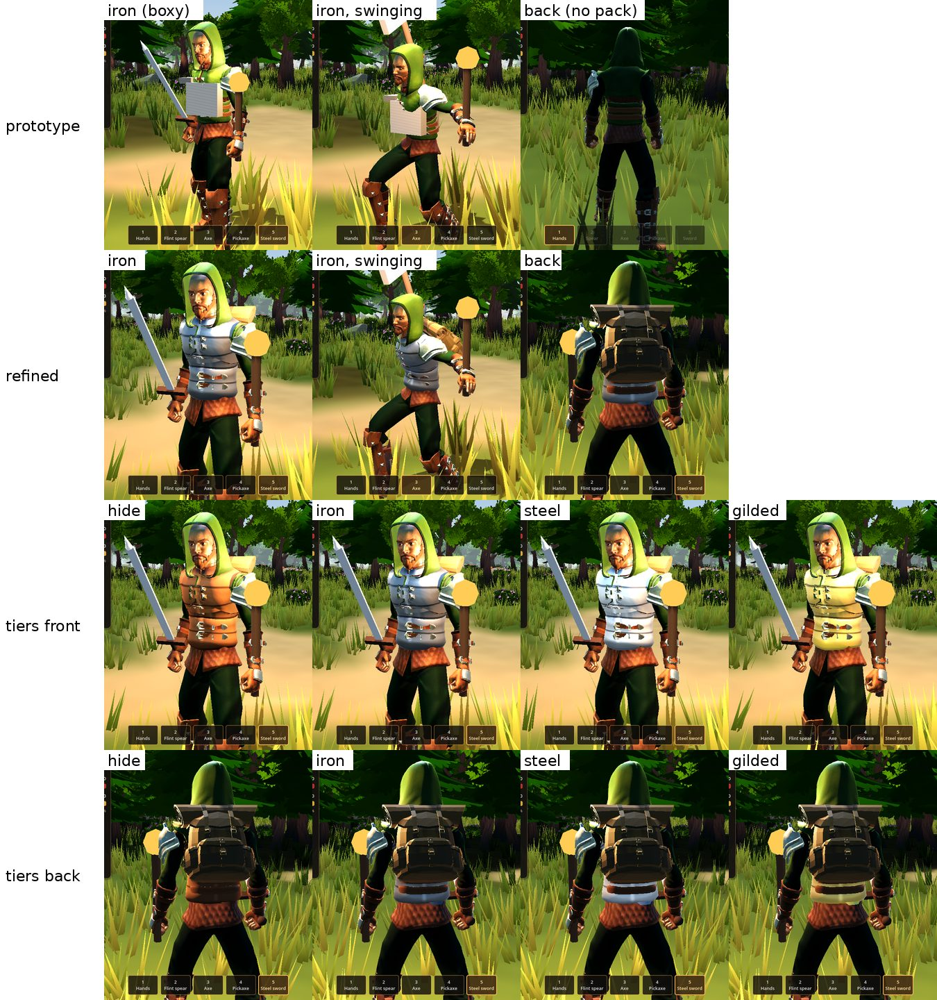
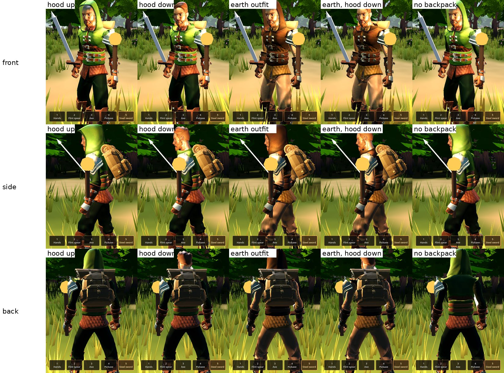
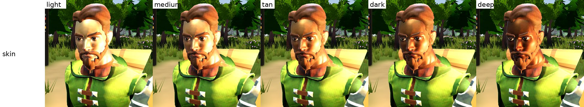
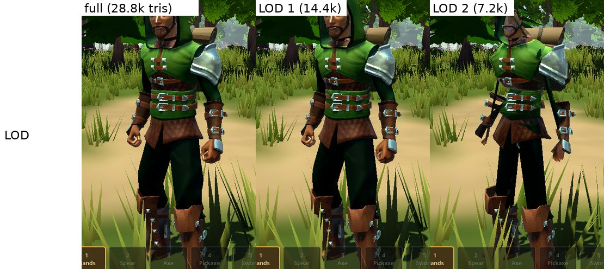
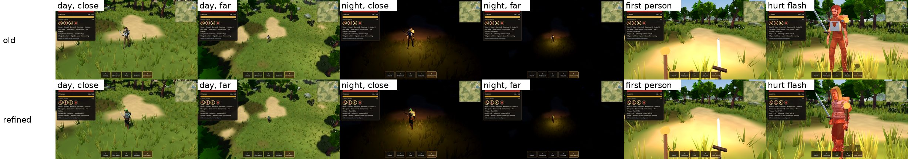
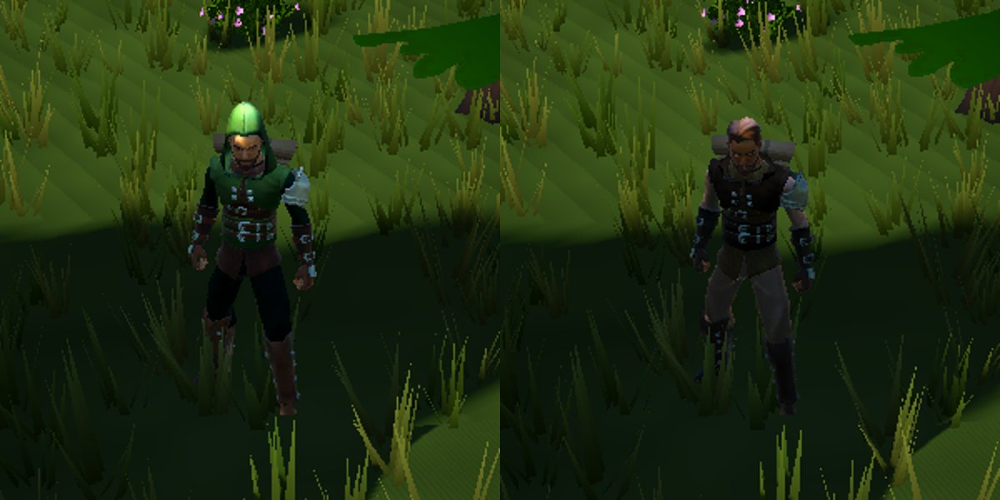

# Phase 4C: player character refinement

This builds on the character prototype ([GRAPHICS_CHARACTER_PROTOTYPE.md](GRAPHICS_CHARACTER_PROTOTYPE.md), PR #34). The player is still the Quaternius ranger, and only the player. Soldiers, settlers and raiders are unchanged.

**Results:**

- **Lighter mesh.** The mesh is lighter than in the prototype: 25,424 triangles are drawn by default, down from 32,620. It now also carries the backpack, a hood-down hairstyle and fitted armour.
- **One material.** It is still **one mesh, one surface, one material**, with the same draw calls in every benchmark scene.
- **Appearance system.** A new system (`scripts/character_appearance.gd`, `shaders/character_atlas.gdshader`) chooses per character:
  - hood up or down;
  - one of 5 skin tones;
  - one of 2 outfits;
  - backpack on or off;
  - worn armour in its tier's colours.

  It uses instance uniforms, so characters that look different can share one mesh and one material. That is what the soldiers will need later.
- **Unchanged systems.** Gameplay, combat, collision, saves, networking and the backend are untouched. The only changes outside the player's look are the developer URL options in `main.gd` and the new smoke-test checks.

## What changed, by task

### Task 1: Armour

**Before.** The procedural iron armour was four boxes, a breastplate, a back plate and two shoulder blocks, placed between the chest and neck bones every frame. On the detailed ranger it looked like a crate strapped to the chest, and it floated free of the body when he swung (see the prototype row in `perf/refinement/armour.jpg`).

**Now.** The armour is a fitted shell built from the ranger's own tunic:

- **Geometry.** The tunic triangles skinned mainly to `spine_01–03` and the clavicles (2,115 triangles) are copied 1.4 cm out along their normals. The shell therefore has the tunic's shape and the same bone weights, and bends with every animation, death included.
- **Look.** The shader draws it as plate armour. It has five horizontal lames with dark seams, a raised centre ridge and a trim band at the neck and waist.
- **Colour and finish.** The colours come from `Gear.ARMOUR` exactly as before: hide, iron, steel and gilded. Hide is matte leather; the others are metal.
- **No extra draw call.** The shell is part of the one surface; when no armour is worn its vertices are collapsed and it draws nothing.
- **Unchanged.** Skeleton, bones and equipment followers (`Palm.R`/`Palm.L`/`Torso`/`Neck`) are unchanged. Tools, torch and lantern attach exactly as before.
- **Adventurer unchanged.** The boxy breastplate is still used for the old adventurer (`?player=0`).



### Task 2: Hood

The kit's hood is one mesh (`Male_Ranger_Head_Hood`, 2,136 triangles). Its triangles weighted to the head are the hood itself (1,514); the rest is the cowl over the shoulders (622).

- **Hood up** shows everything, as before.
- **Hood down** hides the part over the head and keeps the cowl, which then reads as a lowered hood around the neck. It shows the kit's `Hair_SimpleParted` hairstyle (1,301 triangles, same skeleton, rigged to the head bone).

Both are in the one surface. The hidden set is collapsed in the vertex shader, so switching costs nothing.

Hood down holds through run, slash and death (`perf/refinement/hood-down-animations.jpg`). The equipment followers are on the hands, chest and neck, not the head, so nothing attached is affected. There is no helmet or head equipment in the game.



### Task 3: Skin tone

**What the kit has.** The skin (face, neck and hands) comes from two textures in the atlas, `MI_Superhero_Male` and `MI_Regular_Male`. The kit's "Light" and "Dark" Superhero textures turned out to have the **same skin colour**: the measured mean of skin pixels is (167, 116, 81) for both, and only other details differ. So the kit offers no real alternative tones to swap in.

**How tones work.** Skin is labelled in the mesh (part 1), and the shader multiplies only skin albedo by `skin_gain`:

- **What it keeps.** The texture's own shading, pores, blush and lip colour all stay. Nothing is painted over and no hue is replaced, and clothes, hair and eyes are untouched.
- **Highlights.** Bright skin highlights are scaled back as a whole colour, never clipped per channel, which had turned light skin white in a first try.
- **No duplicates.** There is no duplicate character, texture or material.

Five presets: `light`, `medium` (the texture as made), `tan`, `dark`, `deep`. The game's ACES tone mapping crushes dark albedo, so the presets were chosen from renders to give evenly spaced tones in daylight. With true-to-life albedo ratios, "deep" rendered as an unreadable black face.



### Task 4: Backpack

The adventurer's backpack (`adventurer.glb`, mesh `Backpack`, 1,748 triangles, bound 100% to its `Chest` bone) was moved onto the ranger at build time:

- **Placement.** Its rest-pose vertices are placed relative to the adventurer's chest bone, then moved to the ranger's `spine_03`.
- **Scale.** It is scaled by the ratio of the two skeletons' head heights, so it is the same size in game.
- **Fit.** It is pushed against the back of the outfit so nothing shows between them.
- **Skinning.** It is bound 100% to `spine_03`, as it was to the chest.
- **Colours.** Its four flat colours (brown, two greens, gold buckles) are swatches painted into unused atlas space, so it stays in the single surface and material.

The backpack had no gameplay function on the model: the inventory "backpack" is the HUD button, which is unchanged. It is on by default (`backpack=0` hides it), follows the spine through every animation (`perf/refinement/before-after-poses.jpg`, back rows), and is hidden from the first-person view along with the rest of the body (shadow only).

### Task 5: Outfit variations

The kit's second colourway, `T_Ranger_3_BaseColor` (beige linen, brown leathers), uses **the same UV layout** as the green one, so it is a pure texture variant:

- **Texture.** It is a 512×512 texture (`player_outfit_earth.png`, 0.17 MB on the GPU), the clothing half of the atlas.
- **Shader.** The shader samples both outfit textures and keeps one per instance (`outfit` uniform).
- **Sharing.** Same geometry, same material.

Hood, armour, skin and backpack combine freely with either outfit.

### Task 6: Performance and a future soldier version

**Triangles in the one surface:**

| Part | Triangles | Drawn |
|---|---|---|
| Clothing | 17,430 | always |
| Skin (head, hands) | 4,732 | always |
| Hood over the head | 1,514 | hood up (default) |
| Hair | 1,301 | hood down |
| Armour shell | 2,115 | wearing armour |
| Backpack | 1,748 | backpack on (default) |
| **Total in the buffer** | **28,840** | |
| **Drawn by default** | **25,424** | prototype: 32,620; adventurer: 10,198 |
| Drawn, hood up, armour, pack | 27,539 | |

**Mesh simplification** (done at build, Godot's own simplifier):

| Part | Before | After |
|---|---|---|
| Boots | 9,172 | 2,216 |
| Bracers | 3,636 | 1,648 |

The boots and bracers are small on screen even at the closest camera and were the costliest parts. No visible change in the renders. This saved more than the new parts added.

**Comparison with the prototype and the adventurer:**

| | Adventurer (`?player=0`) | Prototype ranger | Refined ranger |
|---|---|---|---|
| Meshes / surfaces / materials | 1 / 1 / 1 | 1 / 1 / 1 | **1 / 1 / 1** |
| Triangles drawn | 10,198 | 32,620 | **25,424** (28,840 in buffer) |
| Vertices | — | 28,230 | 26,554 |
| Mesh LODs | — | 18.4k / 9.2k / 4.6k | 14.4k / 7.2k |
| Model file | shared `adventurer.glb` | 1.17 MB | **1.07 MB** |
| GPU textures | none | 0.61 MB | 0.78 MB (the same 0.61 MB atlas + 0.17 MB second outfit) |
| Export (`index.pck`) | | +1.8 MB | +1.9 MB (+90 KB vs the prototype) |

**The cost of hidden parts.** Hidden parts still pass through skinning and the vertex shader (3.4k triangles that collapse to nothing). That is cheaper than a second surface and draw call per part, and keeps one material for any look.

**Reduced-detail soldier variant (investigated, not built):**

- **Godot's LODs.** LOD 1 (14.4k triangles) is nearly identical to the full mesh at the game's camera distances. LOD 2 (7.2k) tears the arms and face apart (`perf/refinement/lod-levels.jpg`). The automatic levels can't simply be reused as a soldier mesh.
- **Recommended path.** A soldier build of the same tool with:
  - the hood-down hair, the armour shell or the backpack left out where a unit doesn't need them;
  - per-part simplification as done here for the boots (the clothing at about 40%, the face at about 50%), aiming at **8–10k triangles**, close to the adventurer's 10.2k;
  - a 512×256 atlas.

  All 30 soldiers would then share **one mesh and one material**. Unit types, skin tones, outfits and armour would be instance uniforms (`character_appearance.gd` already supports this), so the phase 3D draw-call architecture is kept.
- **Not MultiMesh.** Skinned, individually animated characters can't be MultiMesh-instanced in Godot 4.4. The savings come from sharing resources and fewer vertices, not instancing.
- **Texture memory.** Texture memory is already shared: the atlas is loaded once however many characters use it. Thirty soldiers would add only their vertex buffers, about 1 MB each at the full refined mesh. That is the reason to build a lighter soldier mesh.



**Browser benchmark.** The same web build, `?player=0` (old adventurer) against the refined ranger, run in the project's benchmark:

- runner: `perf/run_web_bench.cjs`;
- browser: Chromium with ANGLE on Mesa llvmpipe;
- resolution: 1280×720;
- seed: fixed;
- results: `perf/refinement/web-player0.json` and `web-player1.json`.

| Scene | Draw calls | Primitives | Mesh surfaces | Frame p50 | Frame p95 | 1% low FPS | Video memory | Texture memory |
|---|---|---|---|---|---|---|---|---|
| Empty area | 312 → 312 | 2.071 → 2.076 M | 559 → 559 | 602 → 607 ms | 862 → 867 ms | 1.2 → 1.2 | 31.8 → 33.1 MB | 9.1 → 9.8 MB |
| Forest | 331 → 334 | 2.377 → 2.421 M | 555 → 555 | 828 → 961 ms\* | 1,297 → 1,294 ms | 0.8 → 0.8 | 31.6 → 32.9 MB | 9.2 → 9.9 MB |
| Village | 573 → 573 | 2.002 → 2.017 M | 714 → 714 | 637 → 630 ms | 745 → 751 ms | 1.3 → 1.3 | 39.8 → 41.1 MB | 9.3 → 10.0 MB |
| Village + 10 soldiers | 612 → 612 | 1.969 → 1.978 M | 765 → 765 | 861 → 658 ms\* | 980 → 713 ms | 1.0 → 1.4 | 50.4 → 51.8 MB | 9.4 → 10.2 MB |
| **Village + 30 soldiers** | 714 → 712 | 2.188 → 2.196 M | 867 → 867 | 993 → 789 ms\* | 1,043 → 845 ms | 1.0 → 1.2 | 62.5 → 63.8 MB | 9.8 → 10.5 MB |
| Night village + 30 soldiers | 795 → 794 | 2.698 → 2.711 M | 869 → 869 | 994 → 905 ms | 1,178 → 933 ms | 0.8 → 1.1 | 62.5 → 63.8 MB | 9.8 → 10.5 MB |
| Area transitions | 296 → 296 | 1.515 → 1.534 M | 481 → 481 | 754 → 797 ms | 945 → 934 ms | 1.1 → 1.1 | 43.2 → 44.6 MB | 9.3 → 10.0 MB |

\* Run-to-run noise on the software renderer (one CPU core renders everything). One character can't make a scene 20% faster, nor the forest 16% slower. The prototype's run showed the same scatter. The steady figures are draw calls and surfaces (unchanged) and primitives (+0.3–1.9%).

| | Old | Refined | Change |
|---|---|---|---|
| Load to first frame (same build) | 12.9 s | 11.8 s | within noise |
| Texture memory | 9.3 MB | 10.0 MB | +0.7 MB (atlas and second outfit) |
| Video memory | 39.8 MB | 41.1 MB | +1.3 MB |

The headless benchmark has no real GPU. Like the earlier phases, the numbers to trust are the counts (draw calls, primitives, memory), not the frame times. Real-GPU frame times are still open from the phase 4A validation, which was skipped.

### Task 7: Validation

| Check | How | Result |
|---|---|---|
| Idle, walk, run, punch, slash, death | `tools/player_shots.gd`, front, side and back, old vs refined | `perf/refinement/before-after-poses.jpg`: all animate; backpack and hood follow |
| Hood up / down | renders in idle, run, slash, death | `looks.jpg`, `hood-down-animations.jpg` |
| Skin tones | 5 presets, face and hands | `skin-tones.jpg` |
| Outfits | both, with hood up and down | `looks.jpg` |
| Equipment | sword, spear, axe, pickaxe idle and mid-swing, torch, lantern; armour in all four tiers | `armour.jpg` and the `gear-*` renders; followers unchanged |
| Backpack | on and off, every animation | `looks.jpg`, back rows of `before-after-poses.jpg` |
| First and third person | game camera close and far; first person | `before-after-views.jpg`: in first person the body (with pack and armour) only casts a shadow |
| Day and night | game camera at noon and at night with the torch | `before-after-views.jpg` |
| Hurt flash | `hurt_flash` overlay | works on the shader material (`before-after-views.jpg`) |
| Save and load | smoke test: reload keeps gear tiers, equipped tool and the same ranger mesh and animations | passes |
| In the browser | the web build with `?hood=down&outfit=earth&skin=dark` against the default | `perf/refinement/web-appearance.jpg`: instance uniforms work in WebGL 2 (Compatibility) |
| Smoke test | `tools/smoke_test.gd` (the CI gate) | passes |
| `?player=0` | the same renders and benchmark with the adventurer | unchanged: the boxy breastplate and the old model, as before |

New smoke-test checks:

- every part is in the one surface with the shared shader;
- appearance options parse, and unknown values are ignored;
- the medium skin tone is the texture as made;
- the look is set on the mesh, with hood up and backpack on by default;
- the armour shell goes when armour is taken off and comes back in its tier's colour;
- the ranger no longer shows the boxy breastplate.





## Choosing a look

There is no in-game UI yet, and the look isn't saved: adding it would change the save format, which was out of scope. For trying it out, the URL (or `--key=value` after `--` on the command line) sets it:

```
?hood=down&skin=light|medium|tan|dark|deep&outfit=ranger|earth&backpack=0
```

In code: `Player.appearance` (a dictionary), applied with `character_appearance.gd`'s `apply()`. Armour is set by the player from its gear (`set_armour()`).

## Files

| File | What |
|---|---|
| `game/tools/build_player_model.gd` | builds the model from the kits. Changes:<br>• part labels in UV2<br>• hood split<br>• hair<br>• armour shell<br>• backpack transfer<br>• colour swatches<br>• second outfit texture<br>• boots and bracers simplified |
| `game/shaders/character_atlas.gdshader` | the shared material:<br>• atlas, normal and roughness/metal maps<br>• per-instance parts, skin gain, outfit and armour plates<br>• the finish the old `_enhance()` gave (rim, specular) |
| `game/scripts/character_appearance.gd` | skin tones, outfits, defaults, `apply()`, `set_armour()`, `from_options()` |
| `game/scripts/player.gd` | applies the look; the ranger's armour shell follows armour worn and its tier; the boxy armour only for the adventurer |
| `game/scripts/main.gd` | the `hood`, `skin`, `outfit`, `backpack` URL options |
| `game/models/player/*` | rebuilt model and atlas, plus `player_outfit_earth.png` |
| `game/tools/player_shots.gd` | adds armour tiers, looks, skin tones, hood-down animations and LOD renders |
| `game/tools/smoke_test.gd` | new checks (above) |
| `game/models/CREDITS.md` | adds `Hair_SimpleParted`, `T_Ranger_3_BaseColor` and the adventurer backpack (all CC0) |

All assets are CC0 and from kits already used and credited: Quaternius Modular Character Outfits – Fantasy, Universal Base Characters, and the existing `adventurer.glb`. Nothing new was downloaded.

## Known issues

- **Neck opening.** The brown undershirt at the tunic's neck opening is painted into the outfit texture, not separate skin. It keeps its colour with every skin tone, and at a distance it can read as skin of a different tone. Separating it would need the texture edited.
- **Hair colour.** Hair, beard and eyebrows are one brown for every skin tone. A hair-colour uniform would be easy to add the same way.
- **Hood-down edge.** The lowered hood is the cowl with the top cut away, not a modelled lowered hood. Seen up close from behind, the cut edge can show as a slightly ragged collar.
- **Armour is a shell.** The shell has no thickness at its arm holes and lower edge. The tunic's chest straps and buckles sit on top of it, which reads as the armour's straps.
- **Hidden parts cost vertices.** About 3.4k triangles of hidden parts are still skinned each frame (see Task 6).
- **Look not saved, no UI.** The URL options are for testing.
- **Engine warning.** `Parameter "material" is null` (64 times per render run) appears in Godot's log. It is the same with `?player=0` and on the prototype commit, so it predates this work.
- **Soldiers not done.** They still use the old models by design; the path is in Task 6.
