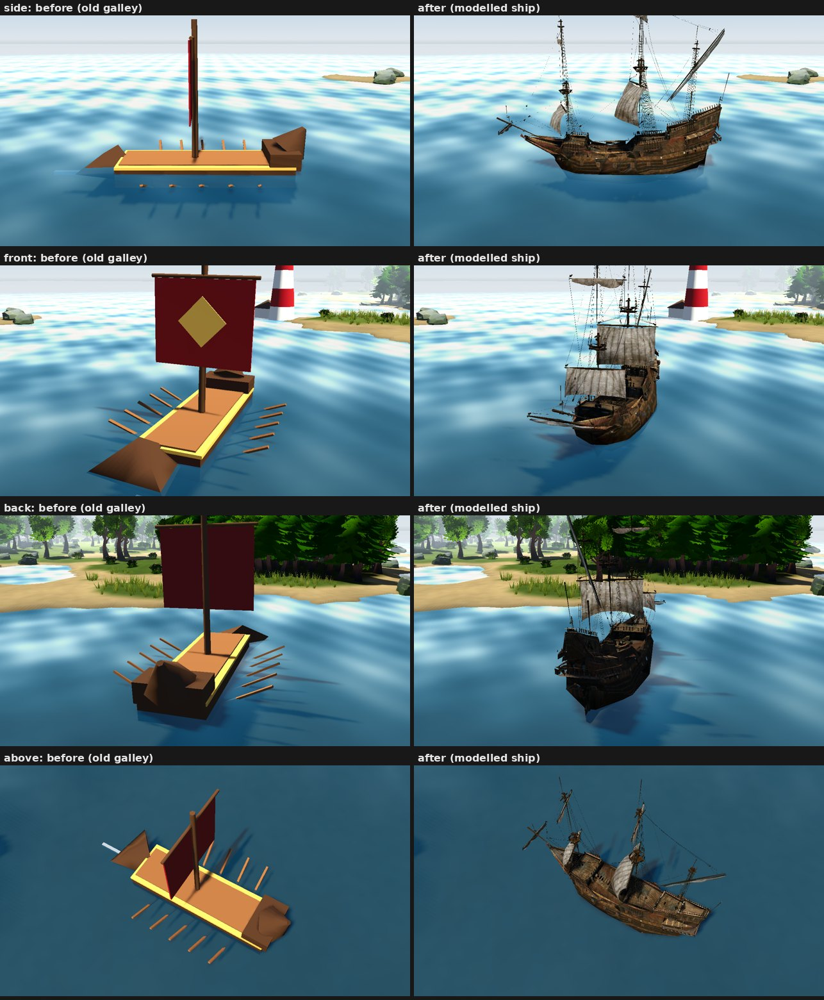
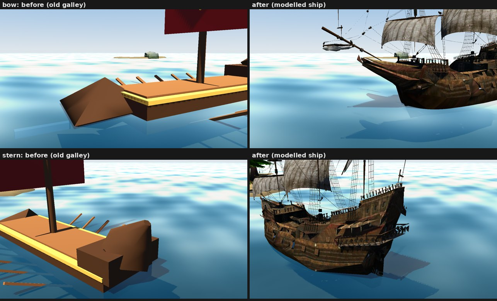
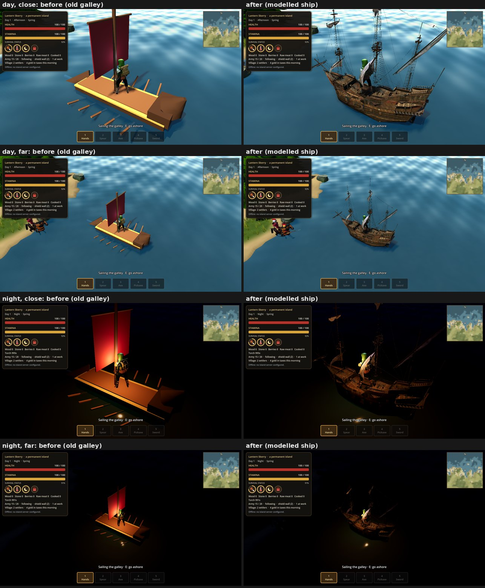
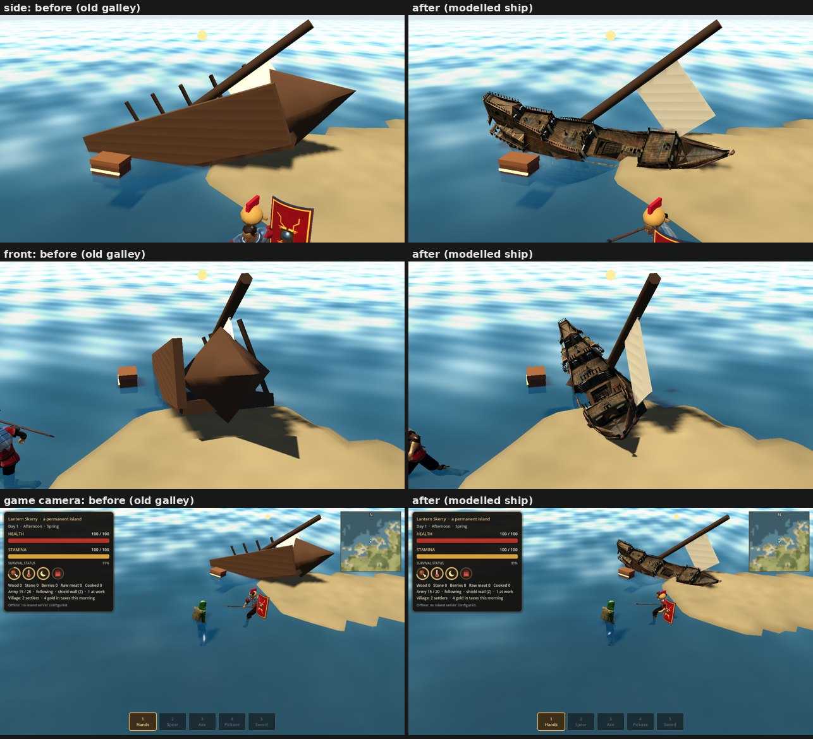

# Ships: the modelled sailing ship

The galley you build at a dock, and the four shipwrecks on the island's shores, are now Poly Haven's **"Dutch Ship Large 01"** (CC0). It has been decimated and rebuilt for the browser the same way as the rest of the art.

| | Original model | In the game |
|---|---|---|
| Triangles | 110,616 | **21,468** (−81%): hull 7,000, rigging and sails 14,468 |
| Materials | 3 (PBR, normal maps) | **1** (a small custom shader) |
| Textures | 9 × 1024² (colour, normal, AO/roughness/metal per part) | **3**: hull 512², rigging 256², sails 512², with the AO baked into the colour |
| GPU texture memory | ≈ 12 MB (uncompressed 1k) | **0.39 MB** (S3TC, mipmapped) |
| Draw calls per ship | — (old galley: about 21 separate parts) | **2** (hull; rigging and sails), plus 1 for the sails' shadow |

**Unchanged:** gameplay (boat speed, deep water, boarding, going ashore, the legion sailing with you), saves and networking. The raft is not a ship and stays as it was.

**Comparison:** `?ships=0` (or `--ships=0`) shows the old galley and wrecks.

**Branch:** `claude/ships`, from `main` at `48290a4`. Not merged; no pull request.

## Source and licence

**Dutch Ship Large 01**, from Poly Haven (https://polyhaven.com/a/dutch_ship_large_01):
- **Authors:** James Ray Cock (model, textures, cleanup), Rico Cilliers (sails model, textures) and Nicolò Zubbini (original model).
- **Licence: CC0.** Poly Haven's licence page says: "Our assets are all licensed as CC0, which is effectively Public Domain even in jurisdictions that do not support the Public Domain." I read this from the page's source on GitHub, because polyhaven.com itself is blocked from this environment.
- **Files:** the uploaded `.gltf` referenced a `.bin` and nine textures that weren't attached. The 1k set came from Poly Haven's API (api.polyhaven.com, cdn), with every file's MD5 checked against the API's listing. The downloaded `.gltf` is identical to the uploaded one. The sails' alpha map was fetched too.
- **Repository:** the original files are not committed. `game/models/CREDITS.md` records the source.

## How it is built

Two steps; the tools are in the repository.

**1. `game/tools/decimate_ship.py`** (Python, with MeshLab via `pymeshlab`). It reads the glTF directly, welds each part's split vertices, and decimates with MeshLab's texture-preserving quadric edge collapse:
- **Hull:** 68,984 → 7,000 triangles.
- **Sails:** 7,548 → 1,200.
- **Rigging:** 34,084 → 13,268. The rigging is 978 separate pieces (masts, yards, furled sails, ropes).
  - Decimated as one mesh, nets of rope collapsed into solid dark sheets. So each piece is decimated on its own.
  - The 24 nets (shrouds and ratlines) whose holes would still close, detected by their surface area growing, are kept as they were.

**2. `game/tools/build_ship_model.gd`** (Godot). It turns the decimated parts into the game's meshes:
- **Placement and scale:** the bow points along +z (the boat's forward) at **scale 0.2**, so the hull is 6.0 m and 6.85 m with the bowsprit; the old galley was about 6.7 m with its ram. The waterline is at y = 0 and the main deck at 0.6 m.
- **Normals** are rebuilt with a 50° crease, so planks and rails stay crisp.
- **UV2.x** stores each part (hull, rigging, sails). Every mesh uses one material, `ship.tres` (`game/shaders/ship.gdshader`), which picks each part's colour map from it.
  - The three textures keep their own tiling: the hull repeats 2.7× along its length and the ropes far more, which an atlas would break.
  - The shader samples all three and keeps one, with no branching on a texture fetch.
  - Faces are double-sided, as in the original. Back faces are lit from their own side, and the canvas (sails, furled sails) lets some light through, so a sail's shaded side isn't black.
- **Textures:** each colour map is multiplied by its ambient occlusion (strength 0.8) and downsized to 512² (hull, sails) or 256² (rigging).
  - Dropped: normal and roughness maps. Roughness is a constant per part, there is no metal, and the sails' alpha is not used, since its map is 99.7% opaque.
- **Vertex data** is compressed (Godot's 16-bit format), which halves the meshes' size on disk and in the download.
- **Output:**
  - `ship_hull.res` (7,000 triangles), shared by the galley and the shipwrecks;
  - `ship_rigging.res` (14,468);
  - `ship_sails_shadow.res` (1,200): the sails alone, which cast the rigging's shadow. The rigging itself casts none: its ropes and spars, drawn again in each shadow cascade, cost about 27k triangles per ship for thin shadows. The Compatibility renderer ignores `ArrayMesh.shadow_mesh` (measured), hence the separate caster.

**In the game:**
- **`boat.gd`:** a galley is the hull, the rigging and the shadow caster. The old gentle roll is kept. There are no oars: a Dutch ship has none. `deck_height` is 0.6, so you stand on its deck.
- **`poi.gd`:** a shipwreck is the same hull, rolled 0.45 rad onto its side and sunk 15 cm into the sand. It keeps the old broken mast and the torn sail, now in the ship's weathered canvas colour, and the chest is in the same place.
- **`main.gd`:** `?ships=0`.
- **`perf_bench.gd`:** opt-in `?shipbench=1` scenes: open sea, you aboard a galley, five galleys, a shipwreck.

**No LODs:**
- Godot's simplifier gives this mesh no levels: its error limit stops it at once.
- Ships are few: you build them one at a time, and there are four wrecks on the island.
- The cost that mattered, shadows, is handled above.

## Screenshots

`game/tools/ship_shots.gd`, run with and without `--ships=0`, native Godot with the Compatibility renderer (OpenGL 3), 1280×720:

`perf/ships/source-vs-decimated.png` shows the original 110k-triangle model and the decimated one at the same scale, seen from opposite sides.

## Performance (browser, software renderer)

**Setup:**
- **Runner:** `perf/run_web_bench.cjs`, with Chromium and **ANGLE on Mesa llvmpipe, a CPU software renderer**: WebGL 2, Godot Compatibility, 1280×720, fixed seed.
- **Build:** one web build, run with `?ships=0` (before) and without (after), both with `?bench=1&perf=1&shipbench=1`.
- **Results:** `perf/ships/web-old.json`, `web-new.json`.

Each cell is before → after.

| Scene | Draw calls | Mesh surfaces | Primitives | Frame p50 (ms) | Frame p95 (ms) | Video memory (MB) | Texture memory (MB) |
|---|---|---|---|---|---|---|---|
| Open sea, no ship | 166 → 166 | 385 → 377 | 0.333 M → 0.333 M | 208 → 211 | 234 → 240 | 33.8 → 34.4 | 9.9 → 10.3 |
| **You aboard a galley** | 217 → 176 | 406 → 380 | 0.334 M → 0.364 M | 216 → 236 | 231 → 256 | 33.9 → 35.2 | 10 → 10.4 |
| **Five galleys** | 404 → 202 | 490 → 392 | 0.337 M → 0.493 M | 216 → 295 | 244 → 316 | 34 → 35.2 | 10 → 10.4 |
| **A shipwreck** | 183 → 166 | 346 → 338 | 0.232 M → 0.241 M | 183 → 194 | 218 → 230 | 32.9 → 33.6 | 10 → 10.4 |
| Empty area (no ships) | 311 → 311 | 559 → 559 | 2.069 M → 2.070 M | 662 → 667 | 870 → 864 | 33.3 → 33.3 | 9.9 → 9.9 |
| Village + 30 soldiers (no ships) | 610 → 614 | 772 → 772 | 2.092 M → 2.103 M | 753 → 859 | 827 → 1018 | 52.1 → 52.1 | 10.9 → 10.9 |

**Reading it:**
- **Draw calls go down:**
  - one ship: 217 → 176;
  - five ships: 404 → 202 (−50%);
  - a shipwreck: 183 → 166.

  The old galley was about 21 separate parts, each drawn on its own, plus their shadows.
- **Primitives go up,** by about 30k for one ship and 155k for five: the price of a detailed ship. Without the shadow change it was 290k for five.
- **Frame time:** with five ships it rises on this software renderer, which rasterises every triangle on the CPU (p50 216 → 295 ms). One ship costs about 20 ms there.

  **On a real GPU,** 150k triangles are a trivial cost, and the 200 fewer draw calls count for more in WebGL. That hasn't been measured here; a real-GPU run is `?bench=1&perf=1&shipbench=1`, with and without `&ships=0`.
- **Memory:** texture memory rises by 0.4 MB (the ship's three textures), and video memory by about 1.3 MB with ships about.
- **Unrelated scenes are unchanged** (the empty area and the village).

**Download** (`index.pck`):

| | Raw | Gzipped |
|---|---|---|
| `main` (4E.5) | 7,110,000 B | 5,759,657 B |
| **With the ship** | **8,054,864 B** (+945 KB) | **6,582,227 B** (+823 KB) |

That is about 0.39 MB of compressed textures (S3TC barely shrinks further) and 0.54 MB of meshes. Halving the sails' texture to 256² would save about 130 KB more, at some cost in close-up detail. That isn't done here.

## Testing

**Smoke test** (`game/tools/smoke_test.gd`, the CI gate): **passes both ways**, by default and with `--ships=0`. New checks:
- the galley is the modelled ship: its hull and rigging, one surface each, and the sails cast the rigging's shadow;
- the deck height;
- with `--ships=0`, the old galley;
- boat speeds and the raft are unchanged;
- shipwrecks use the modelled hull, or the old wreck with `--ships=0`.

The existing boat checks pass unchanged: building at a dock, deep water, boarding, going ashore, and saving while afloat.

## Known limitations

- **The name and description still say "galley"** ("A long ship with a red sail"); the dock's dialog wasn't changed. The ship is a three-masted Dutch merchantman with weathered white sails. Renaming it is a one-line text change, left to you because it's game text.
- **No oars,** so there is no rowing animation while you sail; the ship rolls gently as before.
- **Fine detail at the game's distance.** The ropes are about a centimetre thick at this scale and can flicker at far zoom.
- **More triangles** than the old galley (see Performance), and the download grows by about 0.8 MB gzipped.
- **No normal maps or roughness maps:** the hull's planking is painted, with ambient occlusion, not embossed.
- **The rigging's own shadow is gone:** the masts and ropes cast none; the hull and the sails do.
- **No LODs** (see above).

## Files

| File | What |
|---|---|
| `game/tools/decimate_ship.py` | new: decimates the source glTF (pymeshlab) |
| `game/tools/build_ship_model.gd` | new: builds the meshes, textures and material |
| `game/shaders/ship.gdshader` | new: one material for the three parts |
| `game/models/ships/` | new: `ship_hull.res`, `ship_rigging.res`, `ship_sails_shadow.res`, `ship.tres`, `ship_hull.png`, `ship_rigging.png`, `ship_sails.png` (+ `.import`) |
| `game/scripts/boat.gd` | the galley is the modelled ship (`?ships=0` for the old one) |
| `game/scripts/poi.gd` | shipwrecks use its hull |
| `game/scripts/main.gd` | `?ships=0` |
| `game/scripts/perf_bench.gd` | opt-in `?shipbench=1` scenes |
| `game/tools/ship_shots.gd` | new: the renders |
| `game/tools/smoke_test.gd` | ship checks |
| `game/models/CREDITS.md` | the ship's source and licence |
| `perf/ships/` | before/after sheets, benchmark results |
