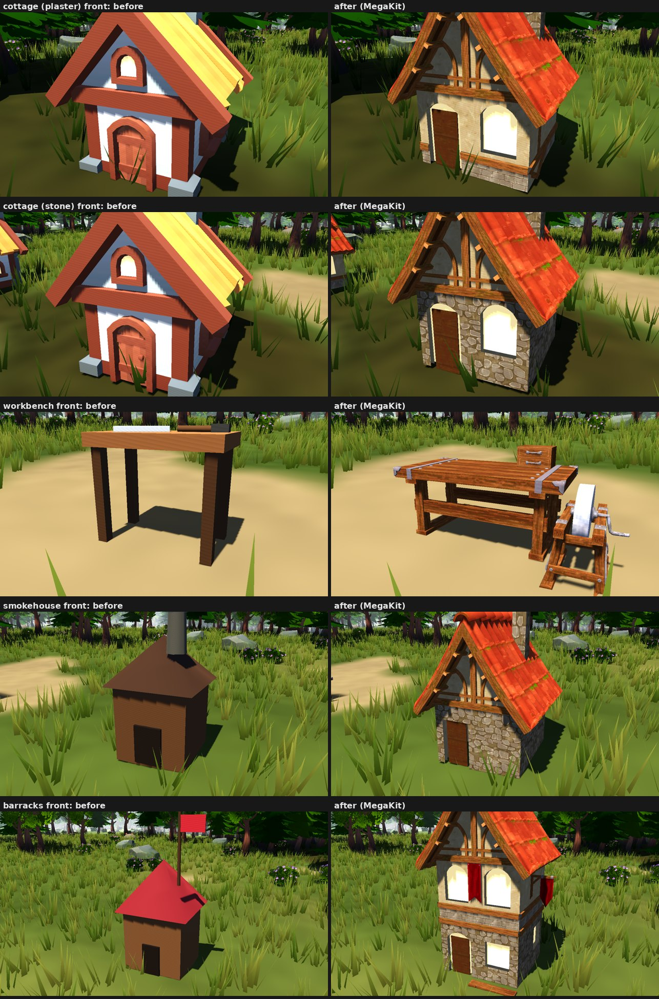
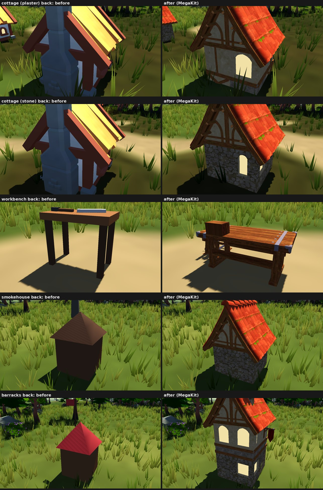
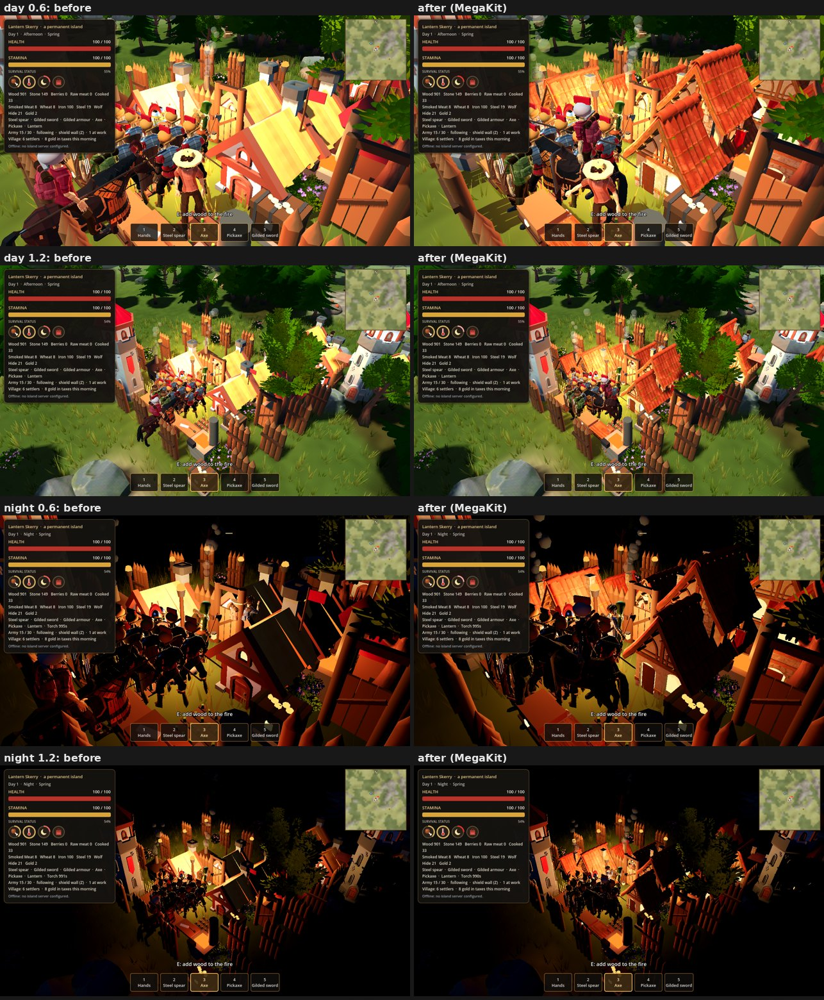

# Village buildings: cottages, workbench, smokehouse and barracks

The cottage, workbench, smokehouse and barracks are rebuilt from Quaternius' **Medieval Village MegaKit** and **Fantasy Props MegaKit**, both free Standard editions under CC0. These are the same family of textured, stylised art as the Stylized Nature MegaKit already used for the trees and rocks, so the village now matches the countryside around it.

| Building | Before | After |
|---|---|---|
| **Cottage** | KayKit cottage (flat palette colours) | **Two designs**, chosen by the cottage's tile: a **plastered, timber-framed** cottage on a brick plinth, and a **fieldstone** cottage. Both have tiled roofs, timbered gables, a stone chimney, a plank door and glowing windows at night. |
| **Workbench** | a few coloured boxes | the kit's **carpenter's bench** with its drawer box, and a **grindstone** beside it |
| **Smokehouse** | a box with a pyramid roof and a pipe | a small, windowless **fieldstone smokehouse** with a big stone chimney; the old smoke now rises from that chimney |
| **Barracks** | a box with a red roof and a flag | a **two-storey** barracks: a fieldstone ground floor and a plastered, timber-framed upper floor under a tiled roof. The legion's **red banners** hang on the front and on iron arms from the sides, with a bench by the door. |

**One draw call per building**, plus one for a building's window glow, the same as the KayKit cottage. Every building uses **one material** (`village.tres`) over **one texture array** holding the kits' ten colour maps.

**Unchanged:** gameplay, costs, hit points, blocking, previews, damage lean, settlers, saves and networking.

**Comparison:** `?village=0` (or `--village=0`) shows the previous buildings.

**Branch:** `claude/village-buildings`, from `main` at `548155d` (#44). Not merged; no pull request.

## Source and licence

- **Medieval Village MegaKit[Standard]** and **Fantasy Props MegaKit[Standard]** by Quaternius (quaternius.com).
- Each pack's `License_Standard.txt` reads: "CC0 1.0 Universal (CC0 1.0) Public Domain Dedication".
- The files used, about 30 models and 10 colour maps, were sent over in this conversation. Normal, roughness and ORM maps weren't needed. The colour maps arrived as chat images, so they were re-encoded; that loss is invisible once they're downsized to 256².
- The originals are not in the repository. `game/models/CREDITS.md` lists the pieces used.

## How it is built

`game/tools/build_village_models.gd`, run with `SRC=<folder with models/ and textures/>`, does three things:

1. **Texture array.** The ten colour maps are downsized to 256² and stacked into `village_textures.png`, which imports as a 10-layer `Texture2DArray`: S3TC, mipmapped, **437 KB on the GPU**.
2. **Pieces.** Each kit piece's surfaces keep their own UVs, so the kits' trims still tile along the walls and the roof tiles still tile both ways. Each piece's material becomes a layer index in UV2.x, and its vertex colour can dye it (the banners).
3. **Assembly.** Each building places the kit pieces, merges them into **one surface**, compresses the vertices and scales the result to the game, matching the KayKit cottage at about 2 m across and 2.4 m tall.
   - **Walls:** 2 m modular pieces, two per side of a 4 × 4 m house: doors, wide and narrow windows, and plain walls, in plaster or fieldstone.
   - **Roof:** the 4 × 4 tiled roof with two timbered gable ends.
   - **Made in the tool:** the stone chimneys (fieldstone with a dressed-stone cap) and the plank doors.
   - **Window glow:** a second surface, an inner box seen through the openings. It uses the game's existing shared "WindowGlow" material, the same soft light the KayKit cottage's windows had.

`game/shaders/village.gdshader` samples the texture array at UV2.x and applies the vertex colour. It is double-sided, like the kit.

**In the game** (`structure.gd`):
- `VILLAGE_MODELS` maps a building kind to its designs; a cottage's design comes from its tile.
- Each design's mesh is loaded once and shared.
- The window glow keeps the shared glow material.
- The smokehouse's smoke is now one helper, `_add_smoke`, used by both the old smokehouse and the new chimney.

| Model | Triangles | Surfaces |
|---|---|---|
| Cottage (plaster) | 3,519 | 1 + glow |
| Cottage (stone) | 3,368 | 1 + glow |
| Smokehouse | 2,998 | 1 |
| Barracks | 5,760 | 1 + glow |
| Workbench | 2,832 | 1 |

## Screenshots

`game/tools/village_shots.gd`, run with and without `--village=0`, native Godot with the Compatibility renderer (OpenGL 3), 1280×720. It takes each building alone on open ground (front and back), then the benchmark's built-up village from the game's camera, close and far, by day and at night.

## Performance (browser, software renderer)

**Setup:**
- **Runner:** `perf/run_web_bench.cjs`, with Chromium and **ANGLE on Mesa llvmpipe, a CPU software renderer**: WebGL 2, Godot Compatibility, 1280×720, fixed seed.
- **Build:** one web build, run with `?village=0` (before) and without (after), both with `?bench=1&perf=1`.
- **Village contents:** the standard benchmark village has four cottages, a barracks, a workbench and a smokehouse, among other buildings.
- **Results:** `perf/village/web-old.json`, `web-new.json`.

Each cell is before → after.

| Scene | Draw calls | Mesh surfaces | Primitives | Frame p50 (ms) | Frame p95 (ms) | Video memory (MB) | Texture memory (MB) |
|---|---|---|---|---|---|---|---|
| Empty area (no village) | 318 → 312 | 559 → 559 | 2.085 M → 2.076 M | 693 → 675 | 1178 → 926 | 33.3 → 33.3 | 9.9 → 9.9 |
| **Village** | 589 → 588 | 714 → 715 | 2.140 M → 2.195 M | 666 → 762 | 1514 → 1784 | 41.3 → 42.2 | 10.1 → 10.5 |
| **Village + 10 soldiers** | 588 → 590 | 739 → 740 | 1.951 M → 1.997 M | 748 → 828 | 924 → 961 | 47.6 → 48.5 | 10.7 → 11.1 |
| **Village + 30 soldiers** | 619 → 618 | 771 → 772 | 2.110 M → 2.153 M | 900 → 903 | 996 → 974 | 53.3 → 54.2 | 10.9 → 11.3 |
| **Night village + 30 soldiers** | 699 → 704 | 773 → 774 | 2.625 M → 2.676 M | 953 → 944 | 1211 → 1036 | 53.3 → 54.2 | 10.9 → 11.3 |

**Reading it:**
- **Draw calls and surfaces are unchanged:** each building is still one mesh plus its window glow.
- **Primitives rise by about 50k** across the village (+2.6%): the kit buildings are more detailed.
- **Texture memory rises by 0.4 MB** (the texture array), and video memory by 0.9 MB.
- **Frame times are within this renderer's noise** (±10%; the empty area, which has no buildings, moved 693 → 675 ms). One sample stands out: the village alone at 666 → 762 ms. The extra 2.6% of triangles alone doesn't explain that, but it hasn't been measured on a real graphics card.
- **Download:** `index.pck` goes from 8,054,864 to 8,776,864 B (**+722 KB**); gzipped, from 6,582,227 to 7,136,193 B (**+554 KB**). That's the texture array (437 KB, S3TC) and the five meshes.

## Testing

**Smoke test** (`game/tools/smoke_test.gd`, the CI gate): **passes both ways**, by default and with `--village=0`. New checks:
- the village buildings (three cottages, workbench, smokehouse, barracks) are the kit models: one shared mesh each, all on the one village material;
- both cottage designs and all five models appear;
- hit points and blocking are unchanged;
- the smokehouse smokes;
- the barracks' windows glow with the shared material.

The existing building checks are adjusted for the new cottages, which have their own material and two designs. The other KayKit buildings (stone wall, archer tower) are unchanged.

`--buildings=0 --village=0` together still fails the existing building-prototype check, because that check assumes the KayKit models. It failed the same way before this change.

## Known limitations

- **Interiors are not modelled.** Doors and windows show a lit inner box (the window glow), as the KayKit cottage's windows did.
- **The doors are plain plank panels** made in the tool. The kit's carved doors and window frames weren't sent.
- **The corner posts are the walls' own overlap,** not the kit's corner pieces.
- **More triangles** than before (about 3–6k per building), and **+554 KB** of download.
- **No LODs** are known to apply. The builder asks Godot to generate them, and these buildings are few.

## Files

| File | What |
|---|---|
| `game/tools/build_village_models.gd` | new: builds the texture array, material and the five buildings |
| `game/shaders/village.gdshader` | new: the one village material (texture array, layer in UV2.x) |
| `game/models/village/` | new: `cottage_plaster.res`, `cottage_stone.res`, `smokehouse.res`, `barracks.res`, `workbench.res`, `village.tres`, `village_textures.png` (+ `.import`) |
| `game/scripts/structure.gd` | `VILLAGE_MODELS`, `use_village`, `_village_mesh`, `_add_smoke` |
| `game/scripts/main.gd` | `?village=0` |
| `game/tools/village_shots.gd` | new: the renders |
| `game/tools/smoke_test.gd` | village checks |
| `game/models/CREDITS.md` | the kits, pieces and licence |
| `perf/village/` | before/after sheets, benchmark results |
